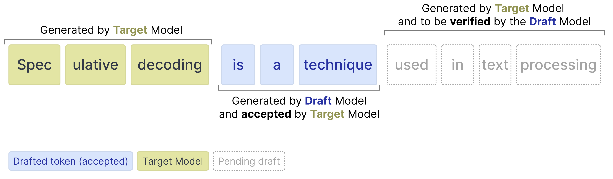
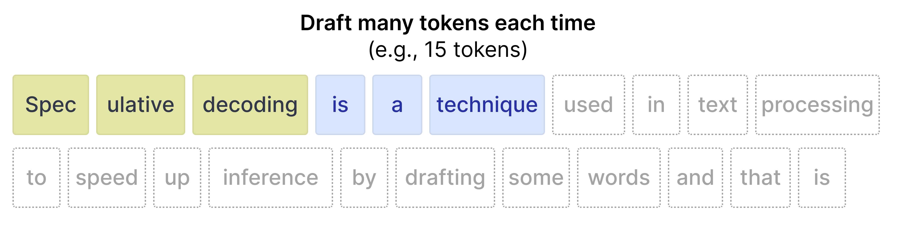
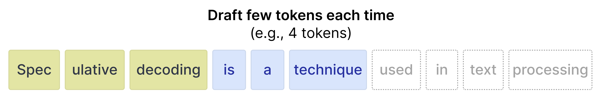

# Speed-up Gemma 4 with Multi-Token Prediction

In Gemma 4, Multi-Token Prediction (MTP) is the specific architecture
used to enable highly efficient Speculative Decoding. Speculative
decoding is a technique to speed up inference in large language models.
Instead of relying solely on the large target model to generate tokens
autoregressively (generating one token at a time, where each new token
depends on the previous ones), a smaller, faster 'draft model' predicts
several tokens ahead. The target model then verifies these drafted
tokens in parallel. If the target model rejects a drafted token, it
still produces the correct token for that position (ensuring that step
is not wasted), and the draft model resumes predicting from that new
correct token.

Gemma 4 implements MTP by extending the base model with
this smaller, faster draft model. This draft model is not independent as
it shares the input embedding table with the target model and builds
directly upon its last-layer activations. This results in significant
decoding speedups while guaranteeing the exact
same quality as standard autoregressive generation, making these
checkpoints perfect for low-latency and on-device applications.

Speculative decoding works by drafting several tokens and verifying
them in a single forward pass. For dense models, the same weights are
used for every token, so verifying multiple drafted tokens adds minimal
overhead. Mixture of Experts (MoE) models like Gemma 4 26B A4B work
differently. Each token may activate different experts, so verifying
drafted tokens can require loading additional expert weights from
memory, offsetting the gains from drafting. At higher batch sizes,
there is typically more overlap in activated experts across sequences,
improving reuse of loaded weights. At batch size 1 this overlap is
limited, which is why the 26B A4B drafter may not yield speedups on
hardware platforms without good parallelism.

!!! tip
    For an illustrated walkthrough, see
    [A Visual Guide to Multi-Token Prediction](../../tutorials/visual-guides/mtp.md).

## MTP Enhancements

Gemma 4 introduces several enhancements to the standard speculative
decoding pipeline to improve the quality of drafted tokens and
efficiency:

- **Shared Input Embeddings**: The draft model shares the input embedding table with the target model.
- **Target Activations**: The draft model uses the activations from the last layer of the target model, concatenates them with the token embeddings, and down-projects them to the drafter model's dimension.
- **Efficient Embedder**: To avoid the expensive operation of predicting across the entire vocabulary, the model groups similar tokens into clusters. It first identifies the most likely clusters and then restricts its final calculations to only the tokens within those selected clusters (E2B and E4B only).

## Run MTP with Transformers

!!! tip
    This walkthrough is also available as a runnable
    [Colab notebook](https://colab.research.google.com/github/google-gemma/cookbook/blob/main/docs/mtp/mtp.ipynb).

After the drafter has predicted multiple draft tokens, the target model now only has to verify
those suggested draft tokens. The verification is done in parallel thereby drastically speeding
up inference. It reduces the number of forward passes the target model has to do for each token.
Because our drafter generates a sequence of tokens for verification, we refer to it as the
Multi-Token Prediction (MTP) head.



### Install Python packages

Install the Hugging Face libraries required for running the Gemma 4 and Gemma 4 assistant model.

```bash
# Install PyTorch & other libraries
pip install torch accelerate

# Install the transformers library
pip install transformers
```

### Load the models

For each target model (one of the main models in the Gemma 4 model), there is an assistant to
helps speed up inference. As such, you will load two models:

- **Target** (e.g., `google/gemma-4-E2B-it`): The full Gemma 4 target model
- **Drafter** (e.g., `google/gemma-4-E2B-it-assistant`): The lightweight 4-layer MTP drafter that proposes candidate tokens

Note that the *drafter* is often referred to as the *assistant* since the model helps the larger
model in choosing which tokens to predict.

Use the `transformers` libraries to create an instance of a `processor` and `model` using the
`AutoProcessor` and `AutoModelForCausalLM` classes as shown in the following code example:

```python
TARGET_MODEL_ID = "google/gemma-4-E2B-it" # @param ["google/gemma-4-E2B-it", "google/gemma-4-E4B-it", "google/gemma-4-12B-it", "google/gemma-4-31B-it", "google/gemma-4-26B-A4B-it"]
ASSISTANT_MODEL_ID = TARGET_MODEL_ID + "-assistant"

import torch
from transformers import AutoProcessor, AutoModelForCausalLM

# Target Model
processor = AutoProcessor.from_pretrained(TARGET_MODEL_ID)
target_model = AutoModelForCausalLM.from_pretrained(
    TARGET_MODEL_ID,
    torch_dtype=torch.bfloat16,
    device_map="auto",
)

# Assistant Model (the drafter)
assistant_model = AutoModelForCausalLM.from_pretrained(
    ASSISTANT_MODEL_ID,
    torch_dtype=torch.bfloat16,
    device_map="auto",
)
```

### Gemma 4 with the assistant

Using an assistant in `transformers` is fortunately quite straightforward and requires you to
pass the assistant model to the `model.generate` function:

```python
# Process inputs with the `target_model`
messages = [
    {
        "role": "user",
        "content": "Explain the concepts of speculative decoding and MTP in 3 sentences."
    }
]
input_text = processor.apply_chat_template(messages, tokenize=False, add_generation_prompt=True)
inputs = processor(text=input_text, return_tensors="pt").to(target_model.device)

# `assistant_model=assistant_model` is all you need to enable MTP!
outputs = target_model.generate(
    **inputs,
    assistant_model=assistant_model,
    max_new_tokens=256,
    do_sample=False,
)

# Decode the response into text
response = processor.decode(outputs[0][inputs["input_ids"].shape[1]:], skip_special_tokens=True)
print(response)
```

Under the hood, the process is as follows:

- The drafter proposes N tokens generated autoregressively
- The target model verifies all N tokens in **one** forward pass
- Drafted tokens with high probabilities are accepted
- Drafted tokens with low probabilities are rejected
- Since the target model does a forward pass, it will always generated 1 token by itself regardless of how many drafted tokens were accepted or rejected

### Draft tokens

The drafter can generate any amount of tokens for the target model to verify. However, the
target model can still choose to reject certain tokens. When it does, all tokens after that are
ignored.


As such, it is important to know the tradeoff when using various values for the number of
drafted tokens.

**More draft tokens**

When you draft many tokens (for instance 15), then there is a high chance that not all tokens
will be accepted. As such, there is a higher potential for wasted compute. In contrast, it does
have a tendency to speed up inference when the acceptance rate is high.



**Fewer draft tokens**

When you draft fewer tokens, the acceptance rate tends to be higher since tokens that are closer
in position to the initial prompt are more accurate. However, since only a few tokens are
drafted, the speed up that you would get from a faster drafter model is reduced.



Fortunately, you do not have to experiment with the best values for your use case in
`transformers` since you can set the `num_assistant_tokens_schedule` to "heuristic" which will
automatically adapt the number of drafted tokens at runtime:

- **All tokens accepted** -- Increase the number of tokens to draft by 2 since the drafter is quite accurate for the prompt. Increasing the number of tokens drafted might result in a speed up if those tokens are also accepted.
- **Any tokens rejected** -- If any tokens are rejected, reduce the amount of tokens to draft by 1. Reducing the number of tokens makes it so that not too many drafted are wasted if the target model continues to reject most of the tokens.

Likewise, you can update number of draft tokens by updating `num_assistant_tokens` in the
drafter like so:

```python
# Update how many draft tokens are generated at the start of inference
assistant_model.generation_config.num_assistant_tokens = 4

# Update how the number of draft tokens are updated ("heuristic" for a dynamic schedule and "constant" for a constant schedule)
assistant_model.generation_config.num_assistant_tokens_schedule = "heuristic"

# Run with MTP
outputs = target_model.generate(
    **inputs,
    assistant_model=assistant_model,
    max_new_tokens=256,
    do_sample=False,
)

# Decode the response into text
response = processor.decode(outputs[0][inputs["input_ids"].shape[1]:], skip_special_tokens=True)
print(response)
```

## What's next

<div class="card-grid">
<a class="card" href="../../deployment/index.md">
  <span class="card-icon">{{ icon('lucide/play') }}</span>
  <div class="card-title">Run Gemma</div>
  <p class="card-desc">Every engine that runs Gemma, from a laptop to a cluster.</p>
</a>
<a class="card" href="../qat.md">
  <span class="card-icon">{{ icon('lucide/shrink') }}</span>
  <div class="card-title">Quantization-Aware Training</div>
  <p class="card-desc">Which quantized weights to download for each engine, and why.</p>
</a>
<a class="card" href="../../tutorials/visual-guides/mtp.md">
  <span class="card-icon">{{ icon('lucide/book-open') }}</span>
  <div class="card-title">A Visual Guide to MTP</div>
  <p class="card-desc">Drafter models and speculative decoding, illustrated.</p>
</a>
</div>
