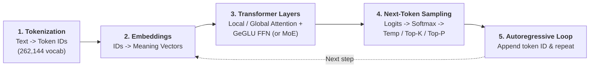

# How LLMs work (with Gemma 4)

This guide puts all five stages of a Gemma 4 forward pass on one screen. Pick a stage in the rail to open its live demo, and expand this terminal whenever you want the full explanation behind what you are clicking on.

<!--
  Each <section class="llm-doc"> is one terminal "file": the shell (overrides/llm-shell.html,
  javascripts/llm-ascii-shell.js) shows the one matching the active stage, and the paragraph
  above belongs to the overview. Keep `data-llm-doc` in step with the stage ids in the template.
  Use <section>, not <div>, as the wrapper: nested admonitions close with </div>.
-->

<section class="llm-doc" data-llm-doc="overview" markdown="1">

At its core, a Large Language Model (LLM) like **Gemma 4** is a next-token prediction engine. Given a sequence of inputs—whether text, code, images, or audio—it calculates a probability distribution over its entire **262,144-piece vocabulary** and selects the next piece of text, one step at a time.

Yet from that simple loop emerges the ability to write software, solve math problems, translate between 140+ languages, and reason step-by-step. This interactive, 5-part series opens the black box and walks through every stage a prompt travels through inside Gemma 4.

## The 5-stage LLM pipeline

Every prompt you send to Gemma 4 flows through five connected stages before generating a single word—and then loops each newly sampled token ID back through **Embeddings (Stage 2)** to generate the next one:



## The Gemma 4 model family at a glance

Throughout this series, you will see how the exact same 5-stage pipeline scales from compact mobile-friendly models (`E2B` and `E4B`) up to workstation and cloud flagships (`12B`, `26B A4B`, and `31B`):

| Model | Parameters | Architecture Style | Decoder Layers | Max Context | Local Sliding Window | Local : Global Ratio | Native Modalities |
|---|---|---|---|---|---|---|---|
| **Gemma 4 E2B** | **2.3B effective** (5.1B w/ PLE) | **Efficient** (Dense + Per-Layer Embeddings) | 35 | 128K | 512 tokens | **4 : 1** | Text, Image, Audio, Video |
| **Gemma 4 E4B** | **4.5B effective** (8.0B w/ PLE) | **Efficient** (Dense + Per-Layer Embeddings) | 42 | 128K | 512 tokens | **5 : 1** | Text, Image, Audio, Video |
| **Gemma 4 12B** | **11.95B** | **Unified** (Encoder-free linear projection) | 48 | 256K | 1,024 tokens | **5 : 1** | Text, Image, Audio, Video |
| **Gemma 4 26B A4B** | **25.2B total / 3.8B active** | **Mixture-of-Experts (MoE)** (8 of 128 routed + 1 shared) | 30 | 256K | 1,024 tokens | **5 : 1** | Text, Image, Video |
| **Gemma 4 31B** | **30.7B** | **Dense** | 60 | 256K | 1,024 tokens | **5 : 1** | Text, Image, Video |

</section>

<section class="llm-doc" data-llm-doc="tokenization" markdown="1">

## 1. Tokenization: From text to numbers

Computers cannot directly perform matrix math on raw strings like `"Hello world!"`. Before a neural network can read your prompt, a **tokenizer** chops the text into small pieces called **tokens** and maps each piece to a unique integer **Token ID**.

### Why subwords instead of characters or whole words?

Language models need a vocabulary that balances sequence length against dictionary size:

- **Character-by-character** (`'c'`, `'a'`, `'t'`) requires tiny vocabulary tables, but makes sequences 4–5× longer and forces the model to spend layers just learning how letters spell words.
- **Word-by-word** requires millions of vocabulary entries to cover every inflected form (`"run"`, `"running"`, `"ran"`), typo, and language—and still fails with an `<unk>` ("unknown") token whenever it sees a new compound word or variable name.
- **Subword tokenization** (used by Gemma 4 via a SentencePiece-style Byte-Pair Encoding vocabulary) hits the sweet spot: common words like `▁cat` (`ID 5866`) stay whole, while rare or compound words like `"unbelievable"` split into reusable roots, prefixes, and suffixes.

### Inside Gemma 4's 262,144-token vocabulary

All five Gemma 4 model sizes share the exact same **262,144-token** (`262K`) vocabulary (`0` to `262,143`):

| Token Category | Examples in Gemma 4 | Real Token IDs | Why it matters |
|---|---|---|---|
| **Leading-space words (`▁`)** | `▁the`, `▁is`, `▁cat`, `▁Gemma`, `▁multimodal` | `506`, `563`, `5866`, `147224`, `151359` | Spaces are attached to the start of words as `▁` (U+2581) so tokenization is 100% reversible without losing whitespace. |
| **Subword stems & suffixes** | `Ant`, `idis`, `establishment`, `arian`, `ism` | `14054`, `33090`, `163524`, `8225`, `1929` | Any unfamiliar word can be assembled from known subword Lego bricks. |
| **Individual digits** | `1`, `4`, `0` (in `"140"`) | `236770`, `236812`, `236771` | Splitting numbers into single digits ensures consistent place-value arithmetic instead of memorizing arbitrary multi-digit chunks. |
| **Code & indentation** | `def`, `▁▁▁▁` (4 spaces), `return`, `\n` | `2063`, `140`, `2060`, `107` | Dedicating single tokens to 4-space indentation (`140`) makes reading and generating Python code much faster. |
| **Multilingual & emoji** | `안녕하세요`, `▁지원`, `🚀` | `61659`, `65363`, `242015` | A large 262K vocabulary avoids fragmenting non-Latin scripts across 140+ supported languages. |
| **UTF-8 byte fallback** | `<0x00>` .. `<0xFF>` (e.g., `<0xEB>`, `<0x98>`, `<0xA0>`) | `238`–`493` (`473`, `390`, `398`) | Any ultra-rare character not in the vocabulary is encoded as raw UTF-8 bytes so Gemma 4 never fails with `<unk>` (`ID 3`). |
| **Special control tokens** | <code class="token-turn">&lt;&#124;turn&gt;</code>, <code class="token-turn">&lt;turn&#124;&gt;</code>, <code class="token-think">&lt;&#124;think&#124;&gt;</code>, <code class="token-multi">&lt;&#124;image&#124;&gt;</code> | `105`, `106`, `98`, `258880` | Reserved atomic IDs structure multi-turn conversations, reasoning channels, tool calls, and multimodal inputs. |
| **Reserved `<unusedXX>` slots** | `<unused0>`, `<unused1>`, ..., `<unused6226>` | `6`–`45`, `53`–`97`, `99`, `102`–`104`, `256001`–`258879`, `258885`–`262143` | Pre-allocated "blank" token IDs (`6,227` total) let developers add custom control tokens during fine-tuning without resizing the embedding matrix. |

### What happens when a word isn't in the vocabulary? (e.g., `똠얌꿍` and `加鬮さん`)

Even with **262,144** vocabulary entries, no fixed dictionary can memorize every transliterated loanword, personal name, or rare character across all human scripts. What happens when Gemma 4 encounters Korean **`똠얌꿍`** (*Tom Yum Goong*, the Thai hot-and-sour soup) or Japanese **`加鬮さん`** (a name containing the ultra-rare 26-stroke kanji **`鬮`** *kuji*, meaning "lottery" or "raffle")?

Instead of giving up and replacing unfamiliar text with an `<unk>` ("unknown", `ID 3`) token—which permanently erases the original characters—Gemma 4 uses a **two-level safety net**:

1. **Level 1 — Character & subword decomposition**: Whenever a whole word isn't in the vocabulary, Gemma 4 breaks known parts down into individual syllables, characters, or subwords that *do* exist in the dictionary:
    - In **`똠얌꿍`**, the Korean syllables **`얌`** (`ID 249170`) and **`꿍`** (`ID 249927`) each have their own dedicated character token.
    - In **`加鬮さん`**, the common kanji **`加`** (`ID 237410`, or `▁加` `ID 50624` after a space) and the two-hiragana honorific **`さん`** (`ID 9821`) are recognized immediately.
2. **Level 2 — UTF-8 byte fallback (`<0x00>`–`<0xFF>`, IDs `238`–`493`)**: What about the rare Korean syllable **`똠`** (`U+B620`) and the rare kanji **`鬮`** (`U+9B2E`)? Neither character exists anywhere in Gemma 4's subword dictionary. Rather than emitting `<unk>`, Gemma 4 converts the missing character into its **raw UTF-8 bytes** and maps each byte to one of **256 reserved byte tokens** (`<0x00>` at `ID 238` through `<0xFF>` at `ID 493`, where `ID = 238 + byte_value`):
    - **`똠`** (`U+B620` → UTF-8 bytes `0xEB 0x98 0xA0`) becomes **3 byte tokens**: `<0xEB>` (`ID 473`), `<0x98>` (`ID 390`), `<0xA0>` (`ID 398`).
    - **`鬮`** (`U+9B2E` → UTF-8 bytes `0xE9 0xAC 0xAE`) becomes **3 byte tokens**: `<0xE9>` (`ID 471`), `<0xAC>` (`ID 410`), `<0xAE>` (`ID 412`).

| Input Text | How Gemma 4 Splits It | Real Gemma 4 Token IDs | Why It Works |
|---|---|---|---|
| **`똠얌꿍`** | `<0xEB>` + `<0x98>` + `<0xA0>` + `얌` + `꿍` | `[473, 390, 398, 249170, 249927]` | Rare syllable `똠` falls back to 3 UTF-8 bytes (`473, 390, 398`); known syllables `얌` (`249170`) and `꿍` (`249927`) stay 1 token each. |
| **`加鬮さん`** | `加` (or `▁加`) + `<0xE9>` + `<0xAC>` + `<0xAE>` + `さん` | `[237410, 471, 410, 412, 9821]` (`50624` w/ space) | Known kanji `加` (`237410` at start of text, or `▁加` `50624` after a space as in the preset) and suffix `さん` (`9821`) bracket the 3 UTF-8 bytes of rare kanji `鬮` (`471, 410, 412`). |

!!! tip "Zero `<unk>` information loss across all of Unicode"
    Because every valid Unicode character can be written as 1 to 4 UTF-8 bytes, Gemma 4 can read, reason over, and generate **any character on Earth**—from rare CJK ideographs and loanwords to ancient scripts and new emojis—without ever collapsing text into `<unk>`. The only trade-off is sequence length: a byte-fallback character costs 3–4 tokens instead of 1.

### Reserved `<unusedXX>` tokens and their purpose

If you inspect Gemma 4's `tokenizer.json`, you will spot **6,227** entries named **`<unused0>`** through **`<unused6226>`**:

- **Low-ID control range (`89` tokens)**: `<unused0>`–`<unused39>` (`IDs 6–45`), `<unused40>`–`<unused84>` (`IDs 53–97`), `<unused85>` (`ID 99`), and `<unused86>`–`<unused88>` (`IDs 102–104`).
- **High-ID expansion range (`6,138` tokens)**: `<unused89>`–`<unused2967>` (`IDs 256001–258879`) and `<unused2968>`–`<unused6226>` (`IDs 258885–262143`).

Why do LLM creators intentionally include thousands of "blank" tokens in the vocabulary?

1. **Adding custom special tokens during fine-tuning without resizing weight matrices**: Suppose you are fine-tuning Gemma 4 for a specialized workflow and want atomic control markers like `<|citation|>`, `<|sql_query|>`, or custom agent state delimiters. If you append a brand-new token (`ID 262144`) to the tokenizer, you must resize both the `262,144 × d_model` input embedding table and the final output projection matrix—changing tensor dimensions and breaking compatibility with standard inference engines. Instead, you can repurpose `<unused0>` (`ID 6`) or `<unused1>` (`ID 7`), which **already have dedicated rows in the embedding matrix**, and train their vectors during fine-tuning.
2. **Seamless upgrades across model generations**: Notice the gaps in the low-ID unused range (`IDs 46–52`, `98`, `100–101`, and `258880–258884`)? In earlier Gemma generations, those exact slots were `<unusedXX>` tokens! When designing Gemma 4, Google promoted those reserved slots into native tool-calling tokens (<code class="token-tool">&lt;&#124;tool&gt;</code> / <code class="token-tool">&lt;tool&#124;&gt;</code>, <code class="token-tool">&lt;&#124;tool_call&gt;</code> / <code class="token-tool">&lt;tool_call&#124;&gt;</code>, <code class="token-tool">&lt;&#124;tool_response&gt;</code> / <code class="token-tool">&lt;tool_response&#124;&gt;</code>, and string delimiter <code class="token-tool">&lt;&#124;"&#124;&gt;</code> at `IDs 46–52`), Thinking mode (<code class="token-think">&lt;&#124;think&#124;&gt;</code> at `ID 98`), reasoning channels (<code class="token-think">&lt;&#124;channel&gt;</code> / <code class="token-think">&lt;channel&#124;&gt;</code> at `IDs 100–101`), and multimodal placeholders (`IDs 258880–258884`)—all without changing the `262,144` vocabulary size or shifting a single existing word ID.

!!! tip "Live Gemma 4 tokenizer in your browser"
    The interactive playground above runs the actual `google/gemma-4-E2B-it` tokenizer in your browser via `@huggingface/tokenizers`—loading Gemma 4's complete **32.2 MB** `tokenizer.json` (`262,144` vocabulary entries plus `514,906` BPE merge rules, all special control and `<unused0>`–`<unused6226>` slots, and the `<0x00>`–`<0xFF>` UTF-8 byte fallback table) in a background Web Worker and caching it locally in IndexedDB for instant reloads. If you open this page completely offline before the vocabulary is cached, it gracefully falls back to an embedded subset.

### Key takeaway

Tokenization is a deterministic dictionary lookup—no neural network math has happened yet. The output of Step 1 is simply a list of integer IDs like `[818, 5866, 2838, 580, 506, 1756, 236761]`. Next, the model needs to turn those arbitrary ID numbers into *meaning*.

</section>

<section class="llm-doc" data-llm-doc="embeddings" markdown="1">

## 2. Embeddings: Turning IDs into meaning

After [tokenization](#1-tokenization-from-text-to-numbers), `"The cat sat on the mat."` is a list of integer IDs: `[818, 5866, 2838, 580, 506, 1756, 236761]`.

However, the number `5866` (`▁cat`) has no mathematical relationship to `5867`—just like page 586 in a dictionary has nothing in common with page 587. To capture *meaning*, Gemma 4 uses each Token ID as a row index into a giant **Embedding Lookup Table**.

### High-dimensional semantic space

In **Gemma 4 E2B**, each of the `262,144` rows in the main embedding table holds a vector of **1,536 floating-point numbers** (`d_model = 1,536`; up to `2,560` in E4B and `5,376` in 31B). You can think of those 1,536 numbers as coordinates on a map of meaning:

- One direction in that space might capture *"animal vs. machine"*.
- Another might capture *"singular vs. plural"*, *"past vs. present tense"*, or *"formal vs. casual tone"*.
- Because these directions are learned from trillions of words during pre-training, words with similar meanings naturally cluster together.

We measure how close two meaning vectors $\vec{a}$ and $\vec{b}$ are using **cosine similarity**, which computes the cosine of the angle between them:

$$\text{similarity}(\vec{a}, \vec{b}) = \frac{\vec{a} \cdot \vec{b}}{\|\vec{a}\| \, \|\vec{b}\|}$$

A score near **`+1.0`** means the vectors point in almost the same semantic direction (like `▁cat` and `▁kitten`), **`0.0`** means they are unrelated (orthogonal), and **`-1.0`** means opposite directions.

### How Gemma 4 unifies images, audio, and on-device memory

Gemma 4 introduces two major innovations at the embedding stage:

1. **Multimodal "Soft Tokens" in the Same Vector Space**: When you pass an image (<code class="token-multi">&lt;&#124;image&#124;&gt;</code>, ID `258880`) or audio clip (<code class="token-multi">&lt;&#124;audio&#124;&gt;</code>, ID `258881`), Gemma 4 converts visual patches (configurable from **70 to 1,120 visual tokens** per image) or audio waveforms into vectors of the **exact same dimension** (`1,536` in E2B) as text tokens. In **Gemma 4 12B Unified**, heavy vision and audio encoders are removed—raw $48 \times 48$ pixel patches and 40ms (640-sample) audio frames pass through a single lightweight linear projection directly into the LLM's embedding stream!
2. **Per-Layer Embeddings (PLE) in E2B and E4B**: Why are Gemma 4's on-device models named **E2B** (*2.3B effective parameters*, *5.1B total*) and **E4B** (*4.5B effective*, *8.0B total*)? The **"E"** stands for **effective parameters**—separating the active compute weights loaded into GPU/phone (V)RAM from sparse embedding lookup tables. Normally, increasing a model's knowledge requires widening layers or adding decoder blocks, which inflates both (V)RAM and matrix-multiplication FLOPs. Instead, PLE gives **every decoder layer its own specialized 256-dimensional embedding table** (`262,144 × 35 × 256` = **2.35B parameters** in E2B; `262,144 × 42 × 256` = **2.82B parameters** in E4B):
    - **Zero extra compute & flash-friendly storage**: At the start of inference, Gemma 4 performs a single $O(1)$ dictionary lookup (`embed_tokens_per_layer`, merged with continuous `per_layer_model_projection` features so multimodal soft tokens also receive conditioning) across all 35 or 42 layers. Because only a handful of rows are fetched per prompt, the multi-gigabyte PLE table can stay in **flash storage / system memory** rather than consuming precious (V)RAM.
    - **Layer-specialized token representations**: Rather than forcing a single Layer-0 embedding and a compact `1,536-d` residual stream to carry every lexical, syntactic, and factual detail from bottom to top, each layer learns the exact token features it needs—**early layers (`L1–L10`)** specialize in surface syntax and part-of-speech (*"`▁cat` is a singular count noun"*), **middle layers (`L11–L24`)** specialize in semantic categories and world knowledge (*"`▁cat` is a small domestic feline mammal"*), and **late layers (`L25–L35`)** specialize in fine-grained collocations and next-token phrasing. At the end of each decoder block, a learned **GeLU gate** (`per_layer_input_gate`, `d_model → 256`) dynamically selects which parts of that layer's `256-d` PLE slice to project (`per_layer_projection`, `256 → d_model`), normalize (`post_per_layer_input_norm`), and add (`⊕`) into the residual stream.

!!! warning "⚠️ Illustrative 2D projection & PLE spectrum in the browser demo"
    Gemma 4 E2B's main embedding table (`model.language_model.embed_tokens.weight`, `262,144 × 1,536` in BF16, **0.40B parameters**) is **~805 MB** on disk, and its 35 Per-Layer Embedding tables (`model.language_model.embed_tokens_per_layer.weight`, `262,144 × 35 × 256`, **2.35B parameters**) are **~4.7 GB** on disk, so the full weight matrices cannot be shipped to a browser page. In the interactive explorer above:

    - **Verified Gemma 4 specs & BF16 slices (Tab A & Tab B)**: Every **Token ID** (`#5866`, `#9615`, `#147224`, etc.), the **first 8 BF16 float values** (`embed_tokens[:8]`), the **PLE gate circuit** (`embed_tokens_per_layer`, `per_layer_model_projection`, `per_layer_input_gate` $\rightarrow$ `GELU` $\odot$ `ple[l]` $\rightarrow$ `per_layer_projection` $\rightarrow$ `post_per_layer_input_norm`), and the **active (V)RAM vs. flash-offloaded parameter splits** (`E2B`: `2.37B` active + `2.75B` lookup = `5.12B`; `E4B`: `4.51B` active + `3.49B` lookup = `8.00B`) match the official Gemma 4 checkpoints.
    - **Illustrative 2D projection & gated subspace spectrum (Tab A & Tab B)**: The flat `(x, y)` canvas coordinates, simplified 2D cluster cosine similarity bars, vector analogy arrows (`king − man + woman ≈ queen`), runtime multimodal soft tokens (`🖼 Image` and `🔊 Audio`, whose placeholder rows `#258880` and `#258881` are replaced at inference time by projected vision/audio features), and the 24-bar `GELU ⊙ ple[L]` activation spectrum across `Syntax`, `Semantics`, and `Phrasing` bands are **pedagogical visualizations** (this strict split is a didactic simplification; in reality, neural networks learn continuous, distributed representations). In the actual 1,536-dimensional Layer-0 table, raw uncontextualized tokens already show clear semantic clustering (for example, $\cos(\text{▁king}, \text{▁queen}) = 0.58$, $\cos(\text{▁kitten}, \text{▁puppy}) = 0.54$, $\cos(\text{▁cat}, \text{▁kitten}) = 0.43$, and $\cos(\text{▁king} - \text{▁man} + \text{▁woman}, \text{▁queen}) = 0.56$), and full semantic separation emerges as vectors pass through the Transformer layers.

### Key takeaway

An embedding lookup gives every occurrence of a token the exact same starting vector—whether `"bank"` means a river bank or a financial bank. To adapt each word's meaning to the surrounding sentence, the vectors now enter the **Transformer Layers**.

</section>

<section class="llm-doc" data-llm-doc="attention" markdown="1">

## 3. Attention & layers: Connecting context

An embedding lookup gives every occurrence of a token the exact same starting vector. But language depends heavily on **preceding context**:

- In *"Mia took the **trophy** from the **suitcase** and **polished** **it** again"*, the pronoun **"it"** refers back to the **trophy**.
- Change just one earlier verb—*"…and **zipped** **it** again"*—and **"it"** refers back to the **suitcase** instead!

To resolve ambiguity, pronouns, and long-range relationships, the token vectors flow through a stack of **Transformer Decoder Layers** (`35` layers in E2B, `42` in E4B, `48` in 12B, `30` in 26B A4B, and `60` in 31B). Each layer has two main stages wrapped in **RMSNorm** normalization layers.

### Stage A: Causal Self-Attention (Query, Key, and Value)

For every token in the sequence, the self-attention layer projects its vector into three smaller vectors (plus **Rotary Position Embeddings, or RoPE**, so the model knows word order):

- **Query ($\vec{Q}$)** — *"What earlier context am I looking for?"* (e.g., after reading `"polished"` in early layers, the pronoun `"it"` in deeper layers looks back for a singular object that can be polished; after `"zipped"`, it looks back for something with a zipper).
- **Key ($\vec{K}$)** — *"What attributes do I advertise to later tokens?"* (e.g., `"trophy"` advertising a metallic prize surface; `"suitcase"` advertising a zippered container).
- **Value ($\vec{V}$)** — *"What semantic information should I pass forward if selected?"*

The model takes the dot product between the current token's Query and every preceding token's Key (scaled by the head dimension $d_k$), adds a **causal mask ($M$)** that sets future positions ($j > i$) to $-\infty$ so it cannot cheat by peeking ahead, and applies Softmax to turn those scores into attention weights summing to $100\%$:

$$\text{Attention}(Q, K, V) = \text{softmax}\!\left(\frac{Q K^T}{\sqrt{d_k}} + M\right) V$$

!!! info "Decoder-only rule: Tokens can only look backward, never ahead"
    Unlike bidirectional encoder models (such as BERT), a **decoder-only** LLM like Gemma 4 applies causal masking in **every** layer, so information strictly flows left to right:

    - **Earlier clues resolve `"it"` immediately**: In *"…polished **it** again"* vs. *"…zipped **it** again"*, the verb (`polished` / `zipped`) comes **before** `it`, so `it` can attend to that verb and select `trophy` or `suitcase` right away—while the future token `again.` remains masked (`0%`).
    - **Later clues resolve at the later token**: In *"The robot picked up the glass ball because **it** was **fragile.**"*, when Gemma 4 is at **`it`**, it **cannot see** `was` or `fragile.` yet—so `it` keeps *both* candidates (`ball` and `robot`) active. Disambiguation happens two steps later when **`fragile.`** (and any token generated after it) looks **backward** at `it`, `glass`, and `ball`!

### Stage B: Feed-Forward Network (GeGLU Dense vs. Mixture-of-Experts)

Once attention gathers context from relevant earlier words, each token vector passes through a **Feed-Forward Network (FFN)** using a **GeGLU** (Gated Linear Unit with GELU) activation to deepen its representation:

- **Dense Models (E2B, E4B, 12B, 31B)**: Every token passes through one unified FFN block per layer. On **E2B** (`use_double_wide_mlp: true`), the 20 KV-shared layers (`L16–L35`) double their FFN width from `6,144` to `12,288` (`2× Wide`, highlighted in darker green in Tab B) to reinvest saved K/V parameters, while **E4B**, **12B**, and **31B** keep a uniform $4 \times d_{\text{model}}$ FFN across all layers.
- **Mixture-of-Experts (`Gemma 4 26B A4B`)**: Instead of one giant FFN, each layer holds **128 specialized routed experts** plus **1 always-on shared expert**. A lightweight **Router** inspects each token and activates only **8 routed experts + 1 shared expert** (`3.8B active parameters` out of `25.2B total`), delivering 26B-class reasoning at the speed of a 4B model!

### How Gemma 4 handles 128K–256K context: Interleaved Local & Global Attention

In standard full attention, every token compares itself against every previous token ($O(N^2)$ compute and a massive **KV cache** in memory). At **256K tokens** (roughly a 600-page book), running full global attention on all 48 or 60 layers would overwhelm memory.

Gemma 4 solves this with a **Hybrid Local + Global Attention** architecture:

| Attention Layer Type | How far back it looks | Interleaving Pattern | Gemma 4 Efficiency Tricks |
|---|---|---|---|
| **Local (Sliding Window) Attention** | **512 tokens** (E2B, E4B) or **1,024 tokens** (12B, 26B A4B, 31B) | **4 Local** per 1 Global (E2B, `4:1`)<br>**5 Local** per 1 Global (E4B, 12B, 26B A4B, 31B, `5:1`) | Handles local syntax, phrasing, and nearby context at fixed, tiny memory cost (and on E2B/E4B, trailing local layers reuse earlier KV caches). |
| **Global (Full) Attention** | **Entire 128K / 256K sequence** | Every 5th (E2B) or 6th (others) layer; **final layer is always Global** | 1. **Doubled $512$-dim Global Heads & GQA**: Global head size doubles to $512$, paired with **8:1 global GQA** (26B A4B, 31B) or **16:1 global GQA** (12B), while E2B (`8:1`) and E4B (`4:1`) keep uniform GQA across layers (`num_global_key_value_heads: null`).<br>2. **Model-Group KV Compression**:<br>• **12B, 26B A4B & 31B — Unified Keys & Values (`K = V`, `attention_k_eq_v: true`)**: Global layers share Key tensors as Values, cutting global KV-cache memory in half!<br>• **E2B & E4B — Cross-Layer KV Sharing (`attention_k_eq_v: false`)**: Keep separate $K$ and $V$, and instead reuse earlier layers' KV caches across the final **20 layers on E2B** (`num_kv_shared_layers: 20`) and **18 layers on E4B** (`18`).<br>3. **Proportional RoPE (`p-RoPE`, `p = 0.25`)**: Only rotates 25% of dimensions for position, leaving 75% rotation-free for crisp long-range semantic recall. |

!!! warning "⚠️ Pseudo attention weights in the browser demo"
    Running a live Gemma 4 forward pass to extract multi-layer attention tensors requires gigabytes of model weights and GPU/NPU compute. In the interactive inspector above:

    - **Illustrative / pseudo causal attention weights (Tab A)**: The backward-looking word-to-word percentages (for example, `it` attending `54%` to `trophy` after `polished` vs. `56%` to `suitcase` after `zipped`, with future tokens masked at `0%`) are **illustrative pseudo-attention weights** showing how deeper-layer causal attention resolves coreference from preceding context. During real inference, Gemma 4 computes separate $\text{softmax}(Q K^T / \sqrt{d_k} + M)$ matrices in parallel across multiple query heads in every layer (`35` layers in E2B, `42` in E4B, `48` in 12B, `30` in 26B A4B, and `60` in 31B), where early layers link local syntax (`polished` $\rightarrow$ `it`) so deeper layers can link `it` $\rightarrow$ `trophy`.
    - **Verified Gemma 4 architecture specs vs. simulated router trace (Tab B)**: The layer counts (`35`, `42`, `48`, `30`, `60`), Local:Global interleaving ratios (`4:1` in E2B, `5:1` in E4B/12B/26B A4B/31B), sliding window sizes (`512` and `1,024` tokens), model-group KV optimizations (`K = V` unified global KV with `16:1`/`8:1` global GQA on 12B/26B A4B/31B vs. cross-layer KV sharing across the final `20`/`18` layers on E2B/E4B), `p-RoPE (p = 0.25, θ = 1,000,000)`, and `8-of-128` routed + `1` shared MoE expert counts are **verified Gemma 4 architecture specifications**, while the specific expert dots lit up in the 26B A4B MoE sample grid represent a **simulated router trace**.

### Key takeaway

Transformer layers turn static word embeddings into **context-aware vectors**:

- **Causal Self-Attention connects tokens left-to-right**: Using **Query ($\vec{Q}$)**, **Key ($\vec{K}$)**, and **Value ($\vec{V}$)** projections with **causal masking**, each token looks strictly **backward** at earlier tokens—so *"it"* resolves to *"trophy"* or *"suitcase"* from preceding verbs (*"polished"* vs. *"zipped"*), while late clues like *"fragile."* look back to link earlier words together.
- **FFN & MoE layers deepen each token's meaning**: Every layer pairs attention (communication across tokens) with a **GeGLU Feed-Forward Network** or **Mixture-of-Experts** block (computation within each token—where `Gemma 4 26B A4B` activates just `8` of `128` routed experts + `1` shared expert per token for 26B quality at 3.8B speed).
- **Hybrid Local + Global Attention scales to 128K–256K context**: By interleaving fast **Local Sliding Window** layers (`4:1` or `5:1`) with periodic **Global Attention** layers (`p-RoPE`, plus `K = V` unified global KV cache on 12B/26B A4B/31B or cross-layer KV sharing on E2B/E4B), Gemma 4 reads book-length prompts without running out of memory.

Once the final token's vector exits the last Global Attention layer, it holds the full meaning of the prompt and is ready to predict the **next token**.

</section>

<section class="llm-doc" data-llm-doc="sampling" markdown="1">

## 4. Sampling: Predicting the next token

Once the final token's vector exits the last Transformer layer (which in Gemma 4 is always a Global Attention layer), it is ready to predict the very next token.

### Step 4A: The LM Head & Logits

Gemma 4 projects the final hidden vector into vocabulary space using a **Language Model Head (`lm_head`)** that ties weights with the transposed `262,144` row input embedding matrix, producing 262,144 raw logits. It then applies **Final Logit Softcapping** to bound extreme values before softmax normalization.

$$\text{logits}_{\text{capped}} = 30.0 \times \tanh\left(\frac{\text{logits}}{30.0}\right)$$

### Step 4B: Softmax & Sampling Controls (`Temperature`, `Top-K`, `Top-P`)

To turn raw logits into probabilities that add up to $100\%$, we pass them through the **Softmax** function, scaled by a parameter called **Temperature ($T$)**:

$$P(\text{token}_i) = \frac{\exp(z_i / T)}{\sum_{j=1}^{262144} \exp(z_j / T)}$$

If we always picked the #1 highest-probability token (**greedy decoding**, $T = 0$), the model would be deterministic and prone to repetitive loops on open-ended tasks. If we sampled blindly from all 262,144 tokens, a tiny $0.0001\%$ chance across 260,000 nonsensical tokens would occasionally inject gibberish.

Gemma 4 shapes the probability distribution using **three standardized sampling parameters**:

| Parameter | Gemma 4 Default | What it controls |
|---|---|---|
| **Temperature (`temperature`)** | **`1.0`** | Rescales logits before Softmax. **Lower ($T < 1.0$)** sharpens the peak toward the top choice (best for factual Q&A or code). **Higher ($T > 1.0$)** flattens the distribution so creative alternatives get a higher chance. |
| **Top-K (`top_k`)** | **`64`** | Hard cutoff that keeps only the **$K$ most likely tokens** (e.g., top 64 out of 262,144) and zeroes out the remaining 262,080 tokens. |
| **Top-P / Nucleus (`top_p`)** | **`0.95`** | Dynamic cutoff that sorts tokens from most to least probable and keeps only the smallest "nucleus" whose cumulative probability reaches **$95\%$**, cutting off the long tail of unlikely words. |

After filtering with Top-K and Top-P, the remaining probabilities are re-normalized to sum to $100\%$, and Gemma 4 rolls a weighted die to sample one winning token.

### Multi-Token Prediction (MTP) & Speculative Decoding

In standard **autoregressive generation**, generating 20 tokens requires running the full 31B or E2B target model 20 separate times—because token #2 becomes part of the input needed to predict token #3.

To break this bottleneck, Gemma 4 ships with a lightweight, 4-layer **[Multi-Token Prediction (`-assistant`) drafter model](../get-started/capabilities/mtp.md)** (only ~76M parameters and a `256`-dim hidden state for E2B). Rather than acting as an isolated small model, Gemma 4's MTP drafter is tightly coupled to the target model through three enhancements:

1. **Shared Embeddings & Target Activations**: The drafter shares the target model's `262,144`-token input embedding table, concatenates the target model's last-layer hidden activations with the token embeddings, and projects them down to the drafter's compact dimension (`1,536 → 256` on E2B).
2. **KV Cache Sharing**: Instead of processing the prompt from scratch to build its own KV cache, the drafter cross-attends directly to the target model's already-computed local and final global KV caches.
3. **Clustered LM Head (Efficient Embedder on E2B & E4B)**: Rather than scoring all `262,144` vocabulary tokens on every draft step, the drafter groups token embeddings into semantic clusters, predicts the most likely clusters first, and computes token logits only within those winning clusters.

During each speculative step, the drafter rapidly proposes $N$ candidate tokens (for example, `4` tokens) sequentially, and the full Gemma 4 target model verifies all $N$ tokens **in a single parallel forward pass**—guaranteeing the **exact same output quality** as standard autoregressive decoding:

- **All drafts accepted**: All $N$ drafted tokens are committed at once, plus **1 bonus token** produced by the target model's own verification pass ($N + 1$ tokens from a single target forward pass).
- **Partial rejection**: If the target model rejects drafted token $k$, any drafted tokens after $k$ are discarded, and the target model immediately replaces token $k$ with its own valid token from that same forward pass—so a target forward pass is never wasted.

#### Configuring MTP in Hugging Face `transformers`

In `transformers`, you enable MTP speculative decoding by loading the matching `-assistant` checkpoint and passing `assistant_model=assistant_model` to `target_model.generate()`. You can tune how many tokens the drafter proposes per step on [`assistant_model.generation_config`](https://huggingface.co/google/gemma-4-E2B-it-assistant/blob/main/generation_config.json):

| `assistant_model.generation_config` Setting | Default Value | How it works |
|---|---|---|
| **`num_assistant_tokens`** | **`6`** | Number of candidate tokens the drafter proposes at the start of inference. Drafting **more tokens** raises peak speedup on predictable text (like code or boilerplate) but wastes drafter steps if an early token is rejected; drafting **fewer tokens** keeps acceptance rates high with a smaller speedup ceiling. |
| **`num_assistant_tokens_schedule`** | **`"constant"`** | Controls how `num_assistant_tokens` adapts at runtime. **`"constant"`** keeps the draft length fixed at `num_assistant_tokens`. **`"heuristic"`** dynamically adapts the draft window on every step—**increasing by `+2`** whenever all drafted tokens are accepted, and **decreasing by `-1`** whenever any drafted token is rejected. |

```python { .model-swap }
# Configure the 4-layer MTP drafter (`google/gemma-4-E2B-it-assistant`)
assistant_model.generation_config.num_assistant_tokens = 4
assistant_model.generation_config.num_assistant_tokens_schedule = "heuristic"

outputs = target_model.generate(
    **inputs,
    assistant_model=assistant_model,
    max_new_tokens=256,
)
```

!!! warning "⚠️ Simulated candidate logits in the browser demo"
    Running a live Gemma 4 forward pass to compute all `262,144` output logits at every decoding step requires gigabytes of model weights and GPU/NPU compute. In the interactive simulator above:

    - **Verified Gemma 4 specs & exact live math**: Every candidate **Token ID** (`▁Paris` `#9079`, `▁located` `#5628`, `▁Lyon` `#49533`, `▁crystal` `#12707`, `len` `#3469`, etc. from `google/gemma-4-E2B-it/tokenizer.json`), Gemma 4's default generation config (`temperature = 1.0`, `top_k = 64`, `top_p = 0.95`), the **Final Logit Softcapping** formula ($30.0 \cdot \tanh(z / 30.0)$), and the **Temperature-scaled Softmax ($P(t_i) = \text{softmax}(z_i / T)$), Top-K / Top-P (Nucleus) cutoff, and weighted random sampling** all execute live in your browser as you drag the sliders.
    - **Simulated candidate logits & MTP trace**: Instead of scoring all `262,144` vocabulary tokens via a neural forward pass, each autoregressive step uses a **curated top-6 pseudo-logit table** (and a representative 4-token **Multi-Token Prediction** speculative step where the target model accepts 3 drafts and replaces a missed 4th draft with its own prediction) so you can clearly see how Temperature reshapes the probability distribution and where the `✂ Nucleus / Top-K Cutoff` line slices the tail.

### Key takeaway

Next-token sampling turns the final Transformer hidden state into generated text—one step at a time:

- **Logits to probabilities**: The **Language Model Head (`lm_head`)** scores all `262,144` vocabulary tokens at once (reusing the tied embedding matrix and softcapping extreme logits at `30.0`), and **Softmax** converts those raw scores into a probability distribution summing to `100%`.
- **Sampling shapes precision vs. creativity**: **Temperature ($T = 1.0$)** controls how sharp or flat the distribution is, while **Top-K (`64`)** and **Top-P (`0.95`)** prune the long tail of unlikely tokens so Gemma 4 stays coherent even when generating creatively.
- **The Autoregressive Loop (& MTP speedup)**: An LLM generates responses **one token at a time** by appending each sampled token back into the input and repeating the forward pass until it emits `<turn|>` (`ID 106`) or `<eos>` (`ID 1`)—and Gemma 4's 4-layer **Multi-Token Prediction (MTP)** drafter accelerates this loop ~3× by proposing and verifying 4 tokens in a single parallel pass.

Now that we know how the model predicts the next token, let's see in **Step 5** how instruction tuning, chat templates, `<|think|>` reasoning channels, and tool calls turn this next-token loop into an intelligent assistant.

</section>

<section class="llm-doc" data-llm-doc="putting-it-together" markdown="1">

## 5. Putting it together: Chat, thinking & tools

If an LLM only predicts the next token, why doesn't it just continue your question with *another* question (the way a raw **Pre-Trained / PT** base model often does when predicting web documents)?

The answer is **Post-Training** (Supervised Fine-Tuning and Reinforcement Learning) combined with a structured **Chat Template** made of special control tokens from [Step 1: Tokenization](#1-tokenization-from-text-to-numbers).

### How Gemma 4 structures a conversation

When you send a chat message to an Instruction-Tuned (**`-it`**) Gemma 4 model (`processor.apply_chat_template(..., add_generation_prompt=True)`), the processor wraps your text in reserved control tokens up to <code><span class="token-turn">&lt;|turn&gt;</span><span class="token-role">model</span>\n</code> before feeding it into the pipeline, and the model then generates its reasoning channel (<code><span class="token-think">&lt;|channel&gt;thought</span>\n...<span class="token-think">&lt;channel|&gt;</span></code>) and final response (<code>...<span class="token-turn">&lt;turn|&gt;</span></code>) token by token:

<pre><code><span class="token-turn">&lt;|turn&gt;</span><span class="token-role">system</span>
<span class="token-think">&lt;|think|&gt;</span>
You are a helpful science tutor.<span class="token-turn">&lt;turn|&gt;</span>
<span class="token-turn">&lt;|turn&gt;</span><span class="token-role">user</span>
What is the water formula?<span class="token-turn">&lt;turn|&gt;</span>
<span class="token-turn">&lt;|turn&gt;</span><span class="token-role">model</span>
<span class="token-think">&lt;|channel&gt;thought</span>
The user is asking for the chemical formula of water (H2O). I should state H2O clearly and explain its two hydrogen and one oxygen atoms.<span class="token-think">&lt;channel|&gt;</span>The chemical formula for water is **H₂O** (two hydrogen atoms bonded to one oxygen atom).<span class="token-turn">&lt;turn|&gt;</span></code></pre>

### Why <code class="token-think">&lt;|think|&gt;</code> makes LLMs smarter

Notice what happens when <code class="token-think">&lt;&#124;think&#124;&gt;</code> is placed in the system turn:

1. Because an LLM does a fixed amount of math per generated token, answering a hard math or logic question on the very first output token forces the model to "guess" in a single forward pass.
2. When <code class="token-think">&lt;&#124;think&#124;&gt;</code> is active, Gemma 4 first generates <code><span class="token-think">&lt;|channel&gt;thought</span>\n...<span class="token-think">&lt;channel|&gt;</span></code>.
3. Every token it writes inside that thought block is fed back into the context window via the autoregressive loop—allowing subsequent self-attention layers to attend to its own intermediate steps, verify hypotheses, and catch mistakes *before* emitting <code class="token-think">&lt;channel|&gt;</code> and writing the final user-facing answer!
4. Similarly, when tools are declared with <code class="token-tool">&lt;&#124;tool&gt;</code>...<code class="token-tool">&lt;tool&#124;&gt;</code> , Gemma 4 can emit a structured <code class="token-tool">&lt;&#124;tool_call&gt;</code> using <code class="token-tool">&lt;&#124;"&#124;&gt;</code> string delimiters, pause on the <code class="token-tool">&lt;&#124;tool_response&gt;</code> stop token while your code runs the function, and then read the result to answer the user.

!!! info "Multi-turn thought stripping"
    In multi-turn conversations, Gemma 4 keeps context clean and fast by **stripping previous turns' <code><span class="token-think">&lt;|channel&gt;thought</span>\n...<span class="token-think">&lt;channel|&gt;</span></code> blocks** from the chat history before sending the next user turn (except in the middle of a multi-step tool call within a single turn). Libraries like Hugging Face `transformers` handle this automatically via `processor.parse_response()`.

!!! warning "⚠️ Simulated streaming in the browser demo"
    Running an end-to-end Gemma 4 generation pass across all 35–60 Transformer layers requires gigabytes of model weights and GPU/NPU compute. In the interactive simulator above:

    - **Verified from `google/gemma-4-E2B-it`**: The chat template structure (where the pre-populated input prompt ends at `<|turn>model\n`), every control token string (including `<|think|>`, `<|channel>` / `<channel|>`, `<|tool_call>` / `<tool_call|>`, `<|tool_response>` / `<tool_response|>`, `<|"|>`, and `<|image|>`), and the dynamic emission order match the official Gemma 4 tokenizer and chat template.
    - **Simulated token stream**: Rather than executing live neural inference in the browser, the typewriter stream replays **curated example responses** (for Math & Logic, Vision, and Tool Calling) so you can inspect how `<|channel>thought...<channel|>` and tool calls unfold step by step.

### Try it yourself in Python

You can inspect every step you just explored—from exact token IDs and raw chat templates to thinking mode and sampling parameters—in a few lines of Python using Hugging Face `transformers`:

```python { .model-swap }
import torch
from transformers import AutoModelForMultimodalLM, AutoProcessor, TextStreamer

MODEL_ID = "google/gemma-4-E2B-it"

processor = AutoProcessor.from_pretrained(MODEL_ID)
model = AutoModelForMultimodalLM.from_pretrained(
    MODEL_ID, dtype="auto", device_map="auto"
)
streamer = TextStreamer(processor)

# 1. Build a chat prompt and enable Gemma 4's <|think|> reasoning mode
messages = [
    {"role": "user", "content": "Why does ice float on liquid water?"}
]
raw_prompt = processor.apply_chat_template(
    messages, tokenize=False, add_generation_prompt=True, enable_thinking=True
)
print("=== Raw Prompt with Gemma 4 Control Tokens ===")
print(raw_prompt)

# 2. Tokenize text into integer Token IDs (from the 262,144 vocabulary)
inputs = processor(text=raw_prompt, return_tensors="pt").to(model.device)
input_ids = inputs["input_ids"][0]
print(f"\n=== Tokenized into {len(input_ids)} Token IDs ===")
for tid in input_ids[:12]:
    print(f"ID {int(tid):>6} -> {repr(processor.decode([tid]))}")

# 3. Run the autoregressive loop with Gemma 4's standardized sampling parameters
outputs = model.generate(
    **inputs,
    streamer=streamer,
    max_new_tokens=1024,
    do_sample=True,
    temperature=1.0,
    top_k=64,
    top_p=0.95,
)

# 4. Decode and separate internal <|channel>thought...<channel|> from the final answer
generated_text = processor.decode(
    outputs[0][len(input_ids):], skip_special_tokens=False
)
parsed = processor.parse_response(generated_text, prefix="")

print("\n=== Internal Reasoning (Thought Channel) ===")
print(parsed.get("thinking", "(Thinking disabled)"))

print("\n=== Final Answer ===")
print(parsed["content"])
```

### Summary

Every time you prompt Gemma 4, the five stages in this series work together in milliseconds:

1. **[Tokenization](#1-tokenization-from-text-to-numbers)** breaks text, digits, and control markers into integer IDs from a shared **262,144-token** vocabulary.
2. **[Embeddings](#2-embeddings-turning-ids-into-meaning)** map those IDs (alongside projected image patches and audio frames) into high-dimensional meaning vectors (`1,536` to `5,376` dimensions), enhanced on mobile sizes (E2B/E4B) with flash-friendly **Per-Layer Embeddings (PLE)**.
3. **[Attention & Transformer Layers](#3-attention-layers-connecting-context)** connect context across up to **256K tokens** by interleaving fast **Local Sliding Window** layers with memory-optimized **Global Attention** layers (`p-RoPE`, plus `K=V` on 12B/26B A4B/31B or cross-layer KV sharing on E2B/E4B), plus **GeGLU** or **Mixture-of-Experts (MoE)** feed-forward networks.
4. **[Next-Token Sampling](#4-sampling-predicting-the-next-token)** converts the final vector into **262,144 logits**, applies Softmax with **Temperature (`1.0`)**, filters with **Top-K (`64`)** and **Top-P (`0.95`)**, and samples the next token—accelerated by **Multi-Token Prediction (MTP)** speculative decoding.
5. **Chat Templates & Thinking Mode** use reserved tokens (<code class="token-turn">&lt;&#124;turn&gt;</code>, <code class="token-think">&lt;&#124;think&#124;&gt;</code>, <code class="token-think">&lt;&#124;channel&gt;thought</code>, <code class="token-tool">&lt;&#124;tool_call&gt;</code>) so the autoregressive loop plans, reasons, and acts as an intelligent assistant.

### What's next

- [Quickstart](../get-started/index.md): pick a runtime and run your first Gemma 4 model locally or in the cloud.
- [Prompt formatting](../get-started/prompt-formatting.md): every turn, thinking, multimodal and tool-use control token.
- [A Visual Guide to Gemma 4](../tutorials/visual-guides/gemma-4.md): p-RoPE, K=V global attention, MoE routing and Per-Layer Embeddings, illustrated.
- [A Visual Guide to MTP](../tutorials/visual-guides/mtp.md): drafter models and speculative decoding, step by step.
- [Gemma 4 models](../models/gemma-4/index.md): compare E2B, E4B, 12B, 26B A4B and 31B specs and memory requirements.

</section>

--8<-- "glossary.md"
