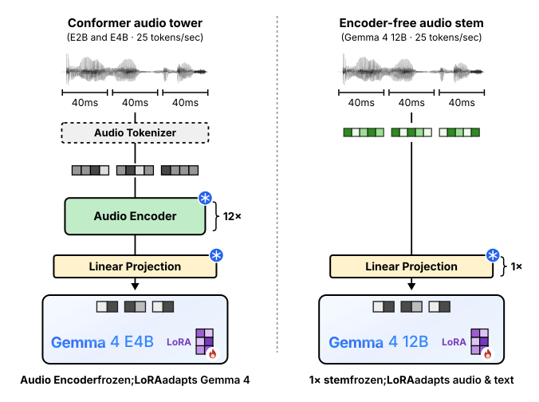
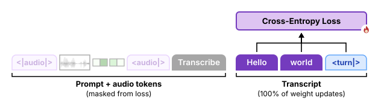
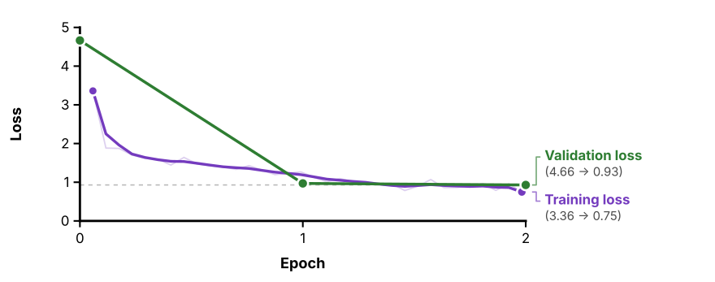

# Audio fine-tuning

Three models in the Gemma 4 family (E2B, E4B, and 12B) understand audio natively alongside text and images. You can fine-tune these checkpoints on custom audio datasets for low-resource speech recognition, regional dialect adaptation, medical dictation, and spoken question answering.

---

## 1. Two architectures

Just like vision, Gemma 4 processes audio through either a dedicated audio encoder (E2B and E4B) or no encoder at all (12B). As with vision, note how everything is frozen except the adapters:



In both cases, the audio is sliced into 40 ms windows (25 audio soft tokens per second). They are then processed differently depending on the model:

1. **Audio encoder** *(E2B and E4B)*: It slices the 16 kHz audio into 40 ms segments and extracts features via the audio tokenizer. They are then passes through a frozen 12-layer audio encoder before being projected into the Gemma model.
2. **Encoder-free** *(12B)*: Has no separate audio encoder. Instead, identical 40 ms audio segments pass through a frozen linear projection layer straight into the 12B model.


As with the vision examples, it is advised to start by keeping the audio encoder frozen and only train LoRA adapters on the language layers.

---

## 2. Masking tokens

When preparing audio datasets for Gemma 4, each clip is resampled to 16 kHz mono and expanded into a sequence of audio soft tokens wrapped between `<|audio|>`{.token-multi} and `<audio|>`{.token-multi} tokens. During training, every prompt and audio token before the assistant response is masked out of the loss calculation:



As with vision, this allows the model to focus all of its updates on the output rather than attempting to guess the input. 

When training, here are some guidelines:

1. **Resample to 16,000 Hz mono**: Gemma 4's audio processor expects 16 kHz single-channel waveforms. Resample 44.1 kHz or 48 kHz recordings to 16 kHz and average stereo channels to mono.
2. **Keep clips to 30 seconds or less**: The audio encoders support a maximum of 30 seconds, so split longer recordings at silence boundaries into 10 to 30 second clips.
3. **Mask prompt and audio tokens**: Exclude all system, user, and audio soft tokens from the training loss so the model only learns to predict the text transcript.

---

## 3. Set up the environment

We will fine-tune Gemma 4 on the Welsh (`cy_gb`) split of [`google/fleurs`](https://huggingface.co/datasets/google/fleurs) so it can learn to recognize Welsh. This task is commonly referred to as automatic speech recognition (ASR).

Install the Hugging Face post-training, quantization, multimodal, and evaluation libraries:

```python { .notebook-cell }
# Install Hugging Face post-training, quantization, multimodal, and evaluation libraries
%pip install -q -U "transformers>=5.10.1" "trl>=0.16.0" "peft>=0.19.0" accelerate datasets bitsandbytes torchao
%pip install -q -U evaluate sacrebleu jiwer pillow soundfile librosa matplotlib tensorboard
```

If you plan to push your trained adapter to the Hugging Face Hub, log in with a write token:

```python { .notebook-cell }
# Optional: Uncomment if using gated checkpoints or pushing to the Hub
# from huggingface_hub import login
# login()
```

---

## 4. Prepare the dataset

To load the data, we make use of the `librosa` and `soundfile` libraries to decode the waveforms and store it in memory. This prevents us from needing to write thousands of `.wav` files to disk.


```python { .notebook-cell }
import io
import librosa
import numpy as np
import soundfile as sf
from datasets import Audio, load_dataset


# Decode raw audio bytes or file paths into a 16 kHz mono float32 waveform (<= 30s)
def decode_audio(audio_dict: dict) -> np.ndarray:
    if audio_dict.get("bytes"):
        waveform, sr = sf.read(io.BytesIO(audio_dict["bytes"]), dtype="float32")
    else:
        waveform, sr = sf.read(audio_dict["path"], dtype="float32")
    if waveform.ndim > 1:
        waveform = waveform.mean(axis=1)
    if sr != 16000:
        waveform = librosa.resample(waveform, orig_sr=sr, target_sr=16000)
    return waveform[: 16000 * 30]


# Load the Welsh FLEURS split and disable eager audio decoding
raw_dataset = load_dataset("google/fleurs", "cy_gb")
train_dataset = raw_dataset["train"].cast_column("audio", Audio(decode=False))
val_dataset = raw_dataset["validation"].select(range(100)).cast_column("audio", Audio(decode=False))
test_dataset = raw_dataset["test"].select(range(100)).cast_column("audio", Audio(decode=False))

sample0_wav = decode_audio(train_dataset[0]["audio"])
print(f"Splits: train={len(train_dataset)}, val={len(val_dataset)}, test={len(test_dataset)}")
print(f"Sample 0 duration: {len(sample0_wav) / 16000:.2f}s")
print(f"Sample 0 transcript: {train_dataset[0]['raw_transcription']}")
```

```{ .no-copy .output }
Splits: train=3427, val=100, test=100
Sample 0 duration: 12.06s
Sample 0 transcript: Gellir ei wneud yn denau iawn, a'i lynu ar fetal arall. Gellir ei wneud mor denau fel ei fod weithiau'n cael ei ddefnyddio i addurno'r lluniau wedi'u paentio â llaw mewn llyfrau o'r enw "llawysgrifau addurnedig".
```

---

## 5. Load the model


Load the instruction-tuned Gemma 4 checkpoint and multimodal processor in `bfloat16`:

```python { .notebook-cell .model-swap }
import torch
from transformers import AutoModelForMultimodalLM, AutoProcessor

model_id = "google/gemma-4-E2B-it"

# Load the multimodal base model in bfloat16 alongside its audio-capable processor
model = AutoModelForMultimodalLM.from_pretrained(
    model_id,
    dtype=torch.bfloat16,
    device_map="cuda",
)
processor = AutoProcessor.from_pretrained(model_id)
```

!!! note "Why bfloat16 LoRA for audio?"
    Uniform 4-bit NF4 quantization (`BitsAndBytesConfig(load_in_4bit=True)`) quantizes audio-critical projection layers and degrades speech recognition accuracy. Loading `E2B-it` in `bfloat16` with gradient checkpointing keeps audio projections at full precision and trains in ~11.9 GB of VRAM (for selective 4-bit quantization on smaller GPUs, see [Fine-tuning with Unsloth](unsloth.md)).

---

## 6. Evaluate the base model

Before we actually start with training, let's perform baseline evaluation. We will use the commonly used normalized Word Error Rate (WER) and Character Error Rate (CER) across 100 held-out Welsh recordings:

```python { .notebook-cell }
import jiwer

PROMPT_TEXT = (
    "Transcribe the following speech segment in Welsh into Welsh text.\n\n"
    "Follow these specific instructions for formatting the answer:\n"
    "* Only output the transcription, with no newlines.\n"
    "* When transcribing numbers, write the digits, i.e. write 1.7 and not one point seven, and write 3 instead of three."
)

asr_normalizer = jiwer.Compose(
    [jiwer.ToLowerCase(), jiwer.RemovePunctuation(), jiwer.RemoveMultipleSpaces(), jiwer.Strip()]
)


# Evaluate corpus Word Error Rate (WER) and Character Error Rate (CER) on held-out audio
def evaluate_welsh_asr(eval_model, eval_processor, dataset_split):
    eval_model.eval()
    stop_ids = [
        eval_processor.tokenizer.eos_token_id,
        eval_processor.tokenizer.convert_tokens_to_ids("<turn|>"),
    ]
    refs_raw, preds_raw = [], []

    for idx in range(len(dataset_split)):
        sample = dataset_split[idx]
        ref = sample["raw_transcription"].strip()
        messages = [
            {
                "role": "user",
                "content": [
                    {"type": "audio", "audio": "clip.wav"},
                    {"type": "text", "text": PROMPT_TEXT},
                ],
            }
        ]
        prompt = eval_processor.apply_chat_template(
            messages, tokenize=False, add_generation_prompt=True
        )
        inputs = eval_processor(
            text=[prompt],
            audio=[decode_audio(sample["audio"])],
            sampling_rate=16000,
            return_tensors="pt",
            padding=True,
        ).to(eval_model.device)

        with torch.no_grad():
            out = eval_model.generate(
                **inputs,
                max_new_tokens=128,
                do_sample=False,
                pad_token_id=eval_processor.tokenizer.pad_token_id,
                eos_token_id=stop_ids,
            )

        pred = eval_processor.tokenizer.decode(
            out[0][inputs.input_ids.shape[1] :], skip_special_tokens=True
        )
        pred = pred.split("<turn|>")[0].split("\n")[0].strip()
        refs_raw.append(ref)
        preds_raw.append(pred)

    norm_refs = [asr_normalizer(r) for r in refs_raw]
    norm_preds = [asr_normalizer(p) for p in preds_raw]
    corpus_wer = jiwer.wer(norm_refs, norm_preds) * 100.0
    corpus_cer = jiwer.cer(norm_refs, norm_preds) * 100.0
    metrics = {
        "wer_pct": round(corpus_wer, 2),
        "cer_pct": round(corpus_cer, 2),
    }
    return metrics, refs_raw, preds_raw


# Measure zero-shot Welsh transcription accuracy before LoRA training
before_metrics, refs, before_preds = evaluate_welsh_asr(model, processor, test_dataset)
print("Before LoRA (100 unseen Welsh clips):", before_metrics)
print("Sample #0 ground truth :", refs[0])
print("Sample #0 zero-shot    :", before_preds[0])
```

```{ .no-copy .output }
Before LoRA (100 unseen Welsh clips): {'wer_pct': 71.21, 'cer_pct': 29.63}
Sample #0 ground truth : Mae'r term saffari mewn defnydd cyffredinol yn cyfeirio at deithio dros dir i weld bywyd gwyllt syfrdanol Affrica, yn enwedig ar safana.
Sample #0 zero-shot    : Mar ten swfary, mae'n ddefnyddiol yn cyfderio astaethiad ostod i wal bywyd gwll syfratonnol Africa yn ywedig ar sffana.
```

Without any fine-tuning, the model approximates Welsh phonetics and results in a **71.21%** Word Error Rate across the 100 unseen clips. Something we can improve upon!

---

## 7. Train the model

Next, let's define the LoRA adapters and target the same layers as we always do (language layers) while freezing the audio encoder:

```python { .notebook-cell }
from peft import LoraConfig, get_peft_model

# Attach rank-32 LoRA adapters to the language layers while freezing audio/vision towers
peft_config = LoraConfig(
    r=32,
    lora_alpha=64,
    lora_dropout=0.0,
    bias="none",
    target_modules=[
        "q_proj",
        "k_proj",
        "v_proj",
        "o_proj",
        "gate_proj",
        "up_proj",
        "down_proj",
    ],
    exclude_modules=r"model\.(vision_tower|audio_tower)\..*",
    task_type="CAUSAL_LM",
)
model = get_peft_model(model, peft_config)
model.print_trainable_parameters()
```

```{ .no-copy .output }
trainable params: 48,316,416 || all params: 5,152,613,920 || trainable%: 0.9377
```

One last thing before we can train: we need a data collator to create audio/text batches and apply the masking to the input prompts:

```python { .notebook-cell }
target_tokens = processor.tokenizer.encode("<|turn>model\n", add_special_tokens=False)
target_len = len(target_tokens)
audio_token_ids = {256000, 258881, 258883}


# Build audio-text batches and mask prompt, padding, and audio soft tokens from the loss
def collate_fn(examples):
    texts, audios = [], []
    for example in examples:
        messages = [
            {
                "role": "user",
                "content": [
                    {"type": "audio", "audio": "clip.wav"},
                    {"type": "text", "text": PROMPT_TEXT},
                ],
            },
            {
                "role": "assistant",
                "content": [{"type": "text", "text": example["raw_transcription"].strip()}],
            },
        ]
        full_text = processor.apply_chat_template(
            messages, add_generation_prompt=False, tokenize=False
        )
        texts.append(full_text.strip())
        audios.append(decode_audio(example["audio"]))

    batch = processor(
        text=texts,
        audio=audios,
        sampling_rate=16000,
        return_tensors="pt",
        padding=True,
    )
    labels = batch["input_ids"].clone()

    for i in range(labels.size(0)):
        row_tokens = batch["input_ids"][i].tolist()
        for idx in range(len(row_tokens) - target_len, -1, -1):
            if row_tokens[idx : idx + target_len] == target_tokens:
                labels[i, : idx + target_len] = -100
                break
        else:
            labels[i, :] = -100

    labels[labels == processor.tokenizer.pad_token_id] = -100
    for tok_id in audio_token_ids:
        labels[labels == tok_id] = -100
    batch["labels"] = labels
    return batch
```

We can train the model! Let's configure `SFTConfig` for two epochs:

```python { .notebook-cell }
from trl import SFTConfig, SFTTrainer

output_dir = "gemma-4-welsh-asr"

# Set the training hyperparameters for audio SFT
sft_config = SFTConfig(
    output_dir=output_dir,
    per_device_train_batch_size=4,
    per_device_eval_batch_size=4,
    gradient_accumulation_steps=2,
    num_train_epochs=2,
    learning_rate=1e-4,
    lr_scheduler_type="cosine",
    warmup_steps=0.05,
    bf16=True,
    gradient_checkpointing=True,
    gradient_checkpointing_kwargs={"use_reentrant": False},
    max_length=2048,
    eval_strategy="epoch",
    eval_on_start=True,
    save_strategy="no",
    remove_unused_columns=False,
    dataset_kwargs={"skip_prepare_dataset": True},
    logging_steps=25,
    report_to="none",
)

# Initialize and run the audio trainer
trainer = SFTTrainer(
    model=model,
    processing_class=processor,
    train_dataset=train_dataset,
    eval_dataset=val_dataset,
    data_collator=collate_fn,
    args=sft_config,
)

trainer.train()

final_model_path = f"{output_dir}/final_model"
trainer.save_model(final_model_path)
AutoProcessor.from_pretrained(model_id).save_pretrained(final_model_path)
```

```{ .no-copy .output }
[858/858 30:25, Epoch 2/2]

| Epoch | Training Loss | Validation Loss | Mean Token Accuracy |
|---|---|---|---|
| 0 | — | 4.6640 | 0.5865 |
| 1 | 1.2644 | 0.9693 | 0.7708 |
| 2 | 0.7478 | 0.9296 | 0.7873 |
```

<!-- notebook:skip-start -->
??? info "Inspect the training curve"
    
<!-- notebook:skip-end -->

---

## 8. Evaluate the fine-tuned model

We free the pipeline from GPU memory and load in our trained checkpoint so we can evaluate it on the unseen recordings:

```python { .notebook-cell }
import gc
from peft import PeftModel

# Free training memory and reload the saved LoRA adapter for inference
del trainer, model
gc.collect()
torch.cuda.empty_cache()

base_model = AutoModelForMultimodalLM.from_pretrained(
    model_id, dtype=torch.bfloat16, device_map="cuda"
)
eval_model = PeftModel.from_pretrained(base_model, final_model_path)
eval_processor = AutoProcessor.from_pretrained(final_model_path)

# Evaluate the fine-tuned adapter on the 100 unseen Welsh test clips
after_metrics, _, after_preds = evaluate_welsh_asr(eval_model, eval_processor, test_dataset)
print("Before LoRA (100 unseen Welsh clips):", before_metrics)
print("After LoRA  (100 unseen Welsh clips):", after_metrics)

print("\n--- Unseen Test Recording #0 ---")
print("Ground Truth:", refs[0])
print("Before LoRA :", before_preds[0])
print("After LoRA  :", after_preds[0])
```

```{ .no-copy .output }
Before LoRA (100 unseen Welsh clips): {'wer_pct': 71.21, 'cer_pct': 29.63}
After LoRA  (100 unseen Welsh clips): {'wer_pct': 49.28, 'cer_pct': 22.24}

--- Unseen Test Recording #0 ---
Ground Truth: Mae'r term saffari mewn defnydd cyffredinol yn cyfeirio at deithio dros dir i weld bywyd gwyllt syfrdanol Affrica, yn enwedig ar safana.
Before LoRA : Mar ten swfary, mae'n ddefnyddiol yn cyfderio astaethiad ostod i wal bywyd gwll syfratonnol Africa yn ywedig ar sffana.
After LoRA  : Mae'r Term Saffari, mewn defnydd cyffredinol, yn cyfeirio at steithio dros dro i'w wylbwyd gwyllt sefylladol Affrica, yn enwedig ar Safana.
```

The scores are looking much better now with only two epochs and updating a small number of weights:

| Metric | Before LoRA | After LoRA | Change |
|---|---|---|---|
| **Word Error Rate (WER, lower is better)** | 71.21% | **49.28%** | **-21.93 pp** |
| **Character Error Rate (CER, lower is better)** | 29.63% | **22.24%** | **-7.39 pp** |

---

## What's next

<div class="card-grid">
<a class="card" href="vision-qlora.md">
  <span class="card-icon">{{ icon('lucide/eye') }}</span>
  <div class="card-title">Vision fine-tuning</div>
  <p class="card-desc">Fine-tune Gemma 4 on custom images, charts, receipts, and documents using selectable vision token budgets.</p>
</a>
<a class="card" href="preference-alignment.md">
  <span class="card-icon">{{ icon('lucide/sliders-horizontal') }}</span>
  <div class="card-title">Preference optimization</div>
  <p class="card-desc">Shape your model's tone and conciseness using chosen and rejected response pairs.</p>
</a>
<a class="card" href="reinforcement-learning.md">
  <span class="card-icon">{{ icon('lucide/brain') }}</span>
  <div class="card-title">Verifiable rewards</div>
  <p class="card-desc">Train Gemma 4's thinking channel using verifiable reward functions.</p>
</a>
<a class="card" href="export.md">
  <span class="card-icon">{{ icon('lucide/rocket') }}</span>
  <div class="card-title">Export</div>
  <p class="card-desc">Export your fine-tuned E2B, E4B, or 12B model to LiteRT-LM for on-device audio inference or vLLM for servers.</p>
</a>
</div>
