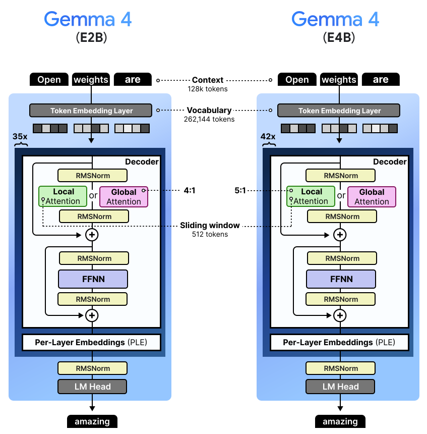
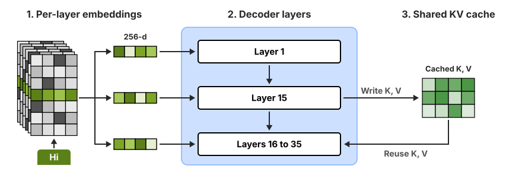
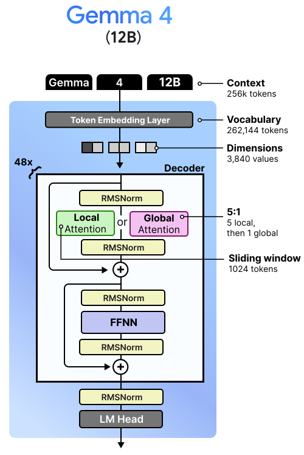
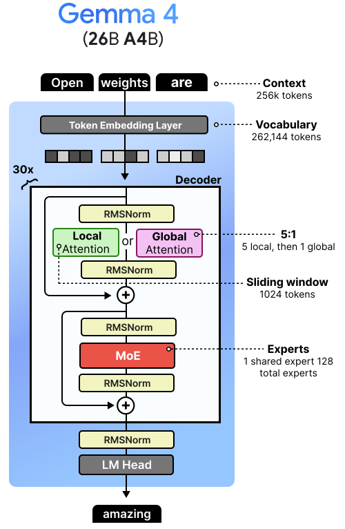
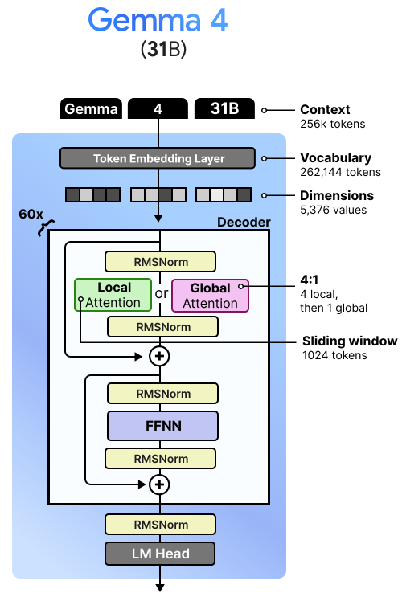
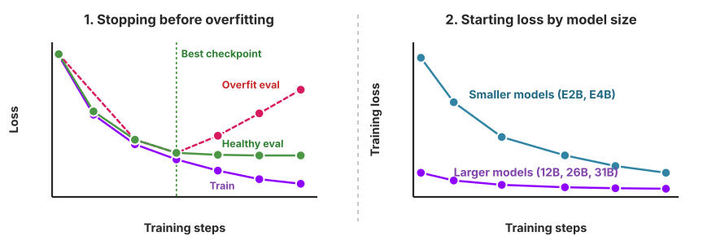

# Best practices

All five Gemma 4 models share the same 262,144-token vocabulary, chat template, and reasoning tokens. However, they are built on four different architectures under the hood.

Knowing their architecture will help you pick the right training pipeline and parameters before you start training.

---

## 1. Choosing a Gemma 4 model

Each Gemma 4 model has a slightly different architecture based on their size.

### Gemma 4 E2B and E4B

Gemma 4 E2B and E4B are compact dense models built for fast iteration and edge devices. The "E" stands for **effective parameters**. Only about 2B and 4B parameters are loaded into VRAM for computation, while the remaining lookup embeddings stay in flash storage.

These are called **per-layer embeddings** and increase the amount of knowledge the model can hold without slowing it down. To further improved performance, they share the KV-cache across layers. Here's an example:

Note how the input token `"Hi"` travels through the model:

1. **Per-layer embeddings:** A lookup table contains a 256-dimensional vector for each token and for layer. That information is added at the end of each decoder.
2. **Shared KV cache:** The first 15 layers compute and story the Keys and Values in the cache (i.e., KV-cache) so that layers after that can reuse them instead of having to compute new ones. 

When fine-tuning E2B or E4B, follow two rules:

- **Keep per-layer embeddings frozen during LoRA:** Standard LoRA targets the attention and MLP projections. Do not unfreeze or save the per-layer embedding table during supervised fine-tuning, or your VRAM usage will increase significantly.
- **Train in `bfloat16` when possible:** The audio encoder in E2B and E4B can overflow `float16` during attention masking. Use `bfloat16` on modern GPUs, or use Unsloth on older `float16` GPUs (such as the Tesla T4) to prevent overflow automatically.

### Gemma 4 12B

Gemma 4 12B is an encoder-free multimodal model that removes separate vision and audio towers:

When fine-tuning 12B, keep two architectural details in mind:

- **Direct patch and audio projection:** Instead of running a separate vision or audio encoder, 12B passes image patches and audio waveforms through lightweight linear projections straight into the decoder.
- **Unified multimodal adaptation:** Because text, vision, and audio tokens share the same decoder layers from the start, applying LoRA to the standard attention and MLP projections will affect three modalities during training.

### Gemma 4 26B A4B

Gemma 4 26B A4B is a Mixture-of-Experts (MoE) model. The "A" stands for **active parameters**. The model has 26B total parameters loaded in memory, but only 4B are activated for each token:

This sparse design changes how you configure fine-tuning:

- **1 shared + 128 routed experts:** Every layer runs one always-on shared expert alongside 128 routed experts, picking the top 8 routed experts for each token.
- **Keep the router frozen:** Do not apply LoRA to the router during supervised fine-tuning. Training the router on small datasets causes tokens to select only a few experts, which hurts quality.
- **Prefer 16-bit LoRA when memory allows:** Quantizing all 128 routed experts to 4-bit can slightly shift top-8 routing choices, so `bfloat16` LoRA is preferred when VRAM allows. See the [MoE fine-tuning guide](moe-finetune.md) for both 16-bit and 4-bit setups.

### Gemma 4 31B

Gemma 4 31B is the largest dense model in the Gemma 4 family.

Because 31B is a large dense model, keep two points in mind when training:

- **Fits on a 24 GB GPU with QLoRA:** Using 4-bit quantization and gradient checkpointing, you can fine-tune 31B in about 18 to 22 GB of VRAM. See [(Q)LoRA](qlora.md).
- **Watch for early memorization:** Because 31B has high capacity, it can memorize small datasets quickly. Use weight decay (such as `0.01`) and evaluate frequently.

---

## 2. Recommended hyperparameters

Different training stages need very different learning rates. For example, a standard LoRA learning rate (`2e-4`) is ten times too high for full fine-tuning (`1e-5`) and will quickly degrade pretrained weights.

Use this table as your starting point:

| Hyperparameter | LoRA / QLoRA SFT | Full fine-tuning | Continued pre-training | Preference optimization | Verifiable rewards |
| :--- | :--- | :--- | :--- | :--- | :--- |
| **Base checkpoint** | `-it` | `-it` or pre-trained | Pre-trained (no `-it`) | `-it` | `-it` |
| **Learning rate** | `1e-4` to `2e-4` | `1e-5` to `2e-5` | `5e-5` (LoRA) / `1e-5` (Full) | `5e-6` to `1e-4` (LoRA) / `5e-7` (Full) | `5e-6` to `1.5e-4` (LoRA) / `1e-6` (Full) |
| **Embedding LR** | Frozen | Same as main LR | `1e-5` (2x to 5x lower) | Frozen | Frozen |
| **Effective batch size** | `16` to `32` | `32` to `64` | `64` to `256` (packed) | `16` to `32` pairs | `16` to `64` (`4` to `8` gens) |
| **LR scheduler** | Cosine | Cosine | Cosine | Cosine | Cosine |
| **Warmup ratio** | `3%` to `5%` | `5%` to `10%` | `5%` to `10%` | `10%` | `5%` to `10%` |
| **Epochs** | `1` to `3` | `1` to `2` | `1` | `1` | `1` to `2` |
| **Optimizer** | 8-bit AdamW | Fused AdamW | 8-bit AdamW | 8-bit AdamW | 8-bit AdamW |
| **Weight decay** | `0.01` | `0.01` to `0.1` | `0.01` | `0.01` | `0.01` |
| **Max grad norm** | `1.0` | `1.0` | `1.0` | `1.0` | `0.1` to `0.5` |

!!! important "Keep tied embeddings enabled"
    All Gemma 4 models share weights between the input token embeddings and the output language modeling head, saving over 1 GB of memory across the 262K vocabulary. When saving a checkpoint or resizing the vocabulary, make sure weight tying is enabled.

---

## 3. Reading your loss curves

You training and validation losses will give you valuable information during training. Of note are two patterns that are worthwhile to take into account:

1. **Stopping before overfitting:** Training loss will keep dropping for as many epochs as you run. Once the model starts memorizing your training set, validation loss turns upward. It helps to hold out 5% to 10% of your data for validation. You typically choose the checkpoint with the lowest validation loss.
2. **Higher starting loss on E2B and E4B:** On the exact same dataset, smaller models (E2B and E4B) often start at a noticeably higher training loss than larger models (12B, 26B A4B, and 31B) before converging into a similar range as training progresses.

!!! tip "Why smaller models start with a higher loss"
    All five Gemma 4 models predict over the same 262,144-token vocabulary. Because E2B and E4B have a smaller hidden capacity than the larger models, they start out less confident on unfamiliar domain or multimodal tasks and spread probability across more tokens. This results in a much higher initial cross-entropy loss. Do not stop your run or raise the learning rate when you see a high starting loss on E2B or E4B. It is a healthy run if it drops steadily during training.

---

## 4. Dataset

The dataset is an important component for training, perhaps even more so tuning parameters. Here are some common pitfalls to take into account:

- **Dataset size**: A LoRA SFT typically requires only **500 to 5,000** examples. A full SFT benefits from around **10,000** examples. Continued pre-training on a new domain or language needs **tens of millions to billions** of tokens. So choose both the method and dataset size carefully.
- **Mix in 5% to 15% replay data**: It often helps to add a small amount of general conversational examples in your training to prevent from overfitting to your task. The model might regress otherwise on other tasks, such as conversations.
- **Prevent RAG boilerplate bleed:** If every training example includes a retrieved passage and answers with *"According to the provided document..."*, the fine-tuned model will repeat that phrase even when no documents are shared. [Custom chat templates](custom-chat-template.md) demonstrates how you can prevent this behavior.
- **Freeze multimodal towers instead of deleting them:** On text-only training pipelines, skip `vision_tower` and `audio_tower` in LoRA (`exclude_modules=r"model\.(vision_tower|audio_tower)\..*"`) rather than stripping those weights from the checkpoint so the model retains its vision and audio capabilities at inference time.

---

## 5. Checklist before you train

Before launching a training job, check these four items:

1. **Match precision and attention to your GPU:** Use `bfloat16` on newer GPUs (RTX 30/40/50-series, L4, A100, H100). Keep PyTorch's default scaled dot-product attention (SDPA), as Gemma 4's global attention layers use a 512 head dimension that standalone FlashAttention-2 does not support.
2. **Mask prompt tokens in SFT:** Only compute loss on assistant responses (`-100` on user and system turns), which we cover in the [dataset formatting guide](datasets-formatting.md).
3. **Include the turn stop token:** Gemma 4 ends assistant turns with `<turn|>`{.token-turn} (token ID `106`), not just `<eos>` (token ID `1`). Make sure your generation settings stop on both tokens when evaluating.
4. **Keep reasoning examples in your mix:** If you want your model to keep using its thinking channel, make sure at least 50% of your SFT examples include reasoning traces.

## What's next

<a class="card" href="datasets-formatting.md">
  {{ icon('lucide/braces') }}
  
Dataset formatting

  
Format chat turns, mask prompt loss with -100, and train with thinking tokens.

</a>
<a class="card" href="qlora.md">
  {{ icon('lucide/zap') }}
  
(Q)LoRA

  
Run an end-to-end LoRA or QLoRA fine-tuning job with TRL and PEFT.

</a>
<a class="card" href="moe-finetune.md">
  {{ icon('lucide/split') }}
  
MoE fine-tuning

  
Train Gemma 4 26B A4B efficiently using Split-LoRA, grouped GEMM, and a frozen router.

</a>
<a class="card" href="full-finetune.md">
  {{ icon('lucide/cpu') }}
  
Full fine-tuning

  
Update 100% of model weights in bfloat16 with cosine warmup and regularization.

</a>

--8<-- "glossary.md"
