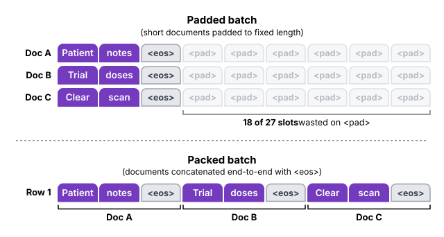
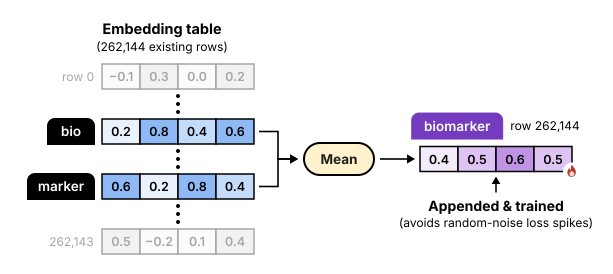
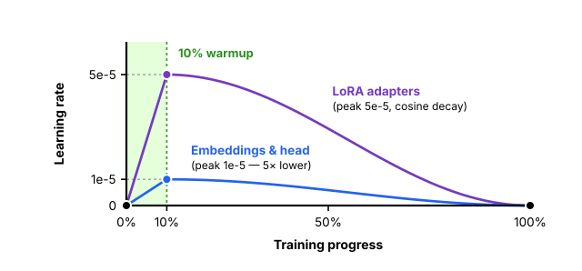
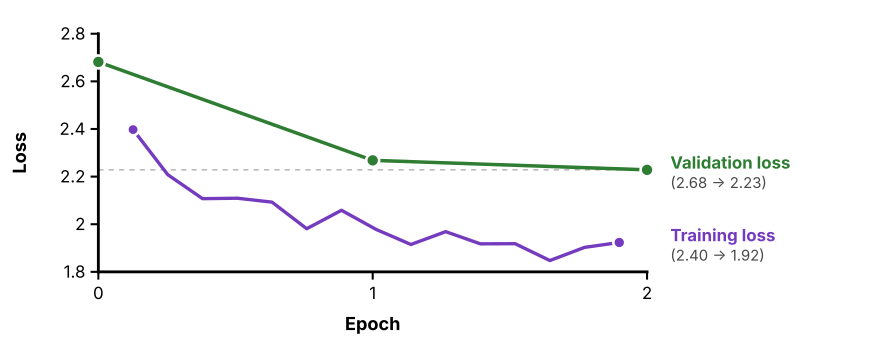

# Continued pre-training

When you want Gemma 4 to learn from a large collection of unlabeled text, such as internal source code, medical papers, legal contracts, or a new language, supervised fine-tuning on a few thousand question-answer pairs is not always enough.

Instead, you can run continued pre-training on the raw documents first, and then follow up with a short supervised fine-tuning stage so the model knows how to chat. Be aware though that continued pre-training is generally more advanced since it requires additional supervised fine-tuning stages (potentially including reinforcement learning) to get the same or better performance compared to their `-it` counterparts.

!!! tip "Start from a base checkpoint"
    Continued pre-training teaches the model to predict the next token across long documents. Always start from a pretrained base checkpoint (such as `google/gemma-4-E2B` or `google/gemma-4-12B`) rather than an instruction-tuned (`-it`) checkpoint. If you perform continued pre-training on an `-it` model, it will overwrite `<turn|>`{.token-turn} end-of-turn probabilities and causes endless generation. Once continued pre-training finishes, run [Custom chat templates](custom-chat-template.md) or [(Q)LoRA](qlora.md) to make the model follow instructions.

---

## 1. Packing sequences to remove padding

Documents vary in length. Some notes are 50 tokens long, while full articles span several thousand tokens.

If you pad every short document out to a fixed length with padding tokens, most of each batch is wasted on empty slots. Sequence packing joins documents end-to-end, separates them with end-of-sequence tokens, and packs them into full rows with no padding:



**Doc A**, **Doc B**, and **Doc C** sit back-to-back in a single packed row separated by `<eos>`{.token-BosEos} tokens, so every slot in the batch carries real text instead of `<pad>`{.token-BosEos} tokens.

---

## 2. Extending the vocabulary

Before adding new tokens, check how many tokens Gemma 4 produces per word on your text. Because Gemma 4 already has a 262,144-token multilingual vocabulary, it handles over 140 languages, code, and scientific text out of the box.

You only need to add new tokens in one of these cases:

- **Domain strings:** Chemical SMILES strings, gene markers, or custom code symbols get split into 6 to 10 tiny pieces.
- **Underrepresented scripts:** Everyday words in your target language regularly split into 3 or more tokens.

When you add new tokens to the vocabulary, the model appends new rows to its input embedding table and its tied output head.

If those new rows start as random noise, they produce unstable predictions on the first step and cause loss spikes. Instead, subword mean initialization splits each new word into its existing subwords and initializes the new row as their average:



Averaging the existing rows for "bio" and "marker" (`[0.2, 0.8, 0.4, 0.6]` and `[0.6, 0.2, 0.8, 0.4]`) gives the new "biomarker" row (`[0.4, 0.5, 0.6, 0.5]`) a reasonable starting vector before training begins.

!!! info "Custom tokens on E2B and E4B vs. resizing on 12B+"
    Gemma 4 E2B and E4B store extra token representations in per-layer embedding tables alongside the main embedding table. Because `resize_token_embeddings()` only resizes the main table, only call `resize_token_embeddings()` on **12B**, **26B A4B**, or **31B**. To add up to **6,227** custom routing, source, or domain tokens on **any** Gemma 4 model reuse their built-in `<unused0>`..`<unused6226>` slots in place as shown in [Unused tokens](unused-tokens.md).

---

## 3. Learning rate

When you unfreeze the embedding table and output head alongside your LoRA adapters, you are training two different kinds of weights at once:

1. **LoRA adapters:** Small low-rank matrices that learn well at 5e-5.
2. **Embeddings:** A 262,144-row lookup table shared between the input and output. Updating this table at 5e-5 shifts token representations too quickly.

To keep training stable, use two optimizer groups and set the embedding learning rate five times lower (1e-5) than the LoRA adapter learning rate (5e-5):



Notice how both parameter groups warm up over the first 10% of steps and then follow the same cosine decay shape, with the embeddings peaking five times lower than the adapters.

!!! tip "Mix in 5% to 10% general text"
    Training only on narrow domain text can cause the model to lose general language skills. Mixing 5% to 10% general text (such as Wikipedia) into your dataset keeps everyday language quality intact.

---

## 4. Set up the environment

Let's adapt `google/gemma-4-E2B` to **Faroese** (a North Germanic language spoken by roughly 75,000 people) using Faroese Wikipedia mixed with a 10% English Wikipedia replay buffer. By adding English data to the mix, we prevent the model from decreasing in performance on English.

We start again by installing the post-training and evaluation libraries:

```python { .notebook-cell }
# Install Hugging Face post-training, quantization, multimodal, and evaluation libraries
%pip install -q -U "transformers>=5.10.1" "trl>=0.16.0" "peft>=0.19.0" accelerate datasets bitsandbytes torchao
%pip install -q -U evaluate sacrebleu jiwer pillow soundfile librosa matplotlib tensorboard
```

If you plan to push your trained adapter to the Hugging Face Hub, log in with a write token:

```python { .notebook-cell }
from huggingface_hub import login

# Optional: uncomment to push your trained adapter to the Hugging Face Hub
# login()
```

---

## 5. Prepare the dataset

For continued pre-training, `SFTTrainer` expects a plain `"text"` column rather than chat `"messages"`. Below, we load [Faroese Wikipedia](https://huggingface.co/datasets/wikimedia/wikipedia) (`20231101.fo`) and use 1,800 articles for training plus 50 unseen articles for evaluation. We also add 220 English Wikipedia that we can use to stabilize the training.

```python { .notebook-cell }
from datasets import Dataset, concatenate_datasets, load_dataset

# Load Faroese Wikipedia and keep articles longer than 500 characters
fo_raw = load_dataset("wikimedia/wikipedia", "20231101.fo", split="train")
fo_clean = fo_raw.filter(lambda x: len(x["text"]) > 500)
print(f"Faroese articles >500 chars: {len(fo_clean)}")

# Format 1,800 Faroese articles for training and hold out 50 unseen articles for evaluation
fo_train = fo_clean.select(range(1800)).map(
    lambda x: {"text": f"# {x['title']}\n\n{x['text'][:3000]}"},
    remove_columns=fo_clean.column_names,
)
fo_heldout_raw = fo_clean.select(range(1800, 1850))
fo_eval = fo_heldout_raw.map(
    lambda x: {"text": f"# {x['title']}\n\n{x['text'][:3000]}"},
    remove_columns=fo_clean.column_names,
)

# Stream 220 English Wikipedia articles (200 for the 10% replay buffer, 20 for evaluation)
en_rows = list(
    load_dataset("wikimedia/wikipedia", "20231101.en", split="train", streaming=True).take(220)
)
en_train = Dataset.from_list(
    [{"text": f"# {r['title']}\n\n{r['text'][:3000]}"} for r in en_rows[:200]]
)
en_eval = Dataset.from_list(
    [{"text": f"# {r['title']}\n\n{r['text'][:3000]}"} for r in en_rows[200:220]]
)

# Combine Faroese and English training sets
train_dataset = concatenate_datasets([fo_train, en_train]).shuffle(seed=42)

print(f"Total documents: {len(train_dataset)} train | {len(fo_eval)} Faroese eval | {len(en_eval)} English eval")
print(f"Sample preview:\n{fo_train[0]['text'][:280]}...")
```

```{ .no-copy .output }
Faroese articles >500 chars: 6261
Total documents: 2000 train | 50 Faroese eval | 20 English eval
Sample preview:
# Føroyar

Føroyar (danskt: Færøerne; 62° norðurbreidd, 7° vesturlongd) eru oyggjaland í Norðuratlantshavi. Føroyar eru partur av Norðurlondum, staddar í Norðurevropa og eru limur í Ríkisfelagsskapinum. Føroya íbúgvar verða nevndir føroyingar, og tungumál føroyinga er føroyskt. F...
```

---

## 6. Load the model

To configure the LoRA as we did before and load in the pre-trained base checkpoint:

```python { .notebook-cell .model-swap }
import torch
from transformers import AutoTokenizer, AutoModelForMultimodalLM, BitsAndBytesConfig
from peft import LoraConfig, get_peft_model, prepare_model_for_kbit_training

# Use the pretrained base checkpoint (without the -it suffix)
model_id = "google/gemma-4-E2B"

# Configure 4-bit NF4 quantization
bnb_config = BitsAndBytesConfig(
    load_in_4bit=True,
    bnb_4bit_use_double_quant=True,
    bnb_4bit_quant_type="nf4",
    bnb_4bit_compute_dtype=torch.bfloat16,
    bnb_4bit_quant_storage=torch.bfloat16,
)

# Load the base model and tokenizer
model = AutoModelForMultimodalLM.from_pretrained(
    model_id,
    dtype=torch.bfloat16,
    device_map="auto",
    quantization_config=bnb_config,
)
tokenizer = AutoTokenizer.from_pretrained(model_id)
model = prepare_model_for_kbit_training(model)
```

<!-- notebook:skip-start -->
??? note "Optional: Adding new tokens on 12B, 26B A4B, or 31B"
    If you are training Gemma 4 12B, 26B A4B, or 31B and want to add custom domain tokens with subword mean initialization, split each new token into its existing subwords before resizing the embedding table:

    ```python
    new_domain_tokens = ["<|chemical_smiles|>", "biomarker_panel", "cytokine_release"]
    old_vocab_size = len(tokenizer)

    # Encode each new token with existing subwords before extending the tokenizer
    subword_ids = [tokenizer.encode(tok, add_special_tokens=False) for tok in new_domain_tokens]
    num_added = tokenizer.add_tokens(new_domain_tokens)
    print(f"Added {num_added} new tokens to vocabulary.")

    # Resize embed_tokens and the tied lm_head, then average constituent subword rows
    model.resize_token_embeddings(len(tokenizer))
    with torch.no_grad():
        embed_weight = model.get_input_embeddings().weight
        for offset, ids in enumerate(subword_ids):
            if ids:
                embed_weight[old_vocab_size + offset] = embed_weight[ids].mean(dim=0)
    ```

    When you resize embeddings on 12B, 26B A4B, or 31B, uncomment `modules_to_save=["embed_tokens", "lm_head"]` and `ensure_weight_tying=True` in `LoraConfig` below so the new rows are trained and saved with your adapter.
<!-- notebook:skip-end -->

We configure LoRA with `r = 32` and `lora_alpha = 64` across all seven text decoder projections while skipping the vision and audio towers (`exclude_modules`):

```python { .notebook-cell }
# Attach rank-32 LoRA adapters to all seven decoder projections
peft_config = LoraConfig(
    r=32,
    lora_alpha=64,
    lora_dropout=0.0,
    bias="none",
    target_modules=[
        "q_proj",
        "k_proj",
        "v_proj",
        "o_proj",
        "gate_proj",
        "up_proj",
        "down_proj",
    ],
    exclude_modules=r"model\.(vision_tower|audio_tower)\..*",
    task_type="CAUSAL_LM",
    # Uncomment on 12B, 26B A4B, or 31B when adding new tokens or unfreezing embeddings:
    # modules_to_save=["embed_tokens", "lm_head"],
    # ensure_weight_tying=True,
)
model = get_peft_model(model, peft_config)
model.print_trainable_parameters()
```

```{ .no-copy .output }
trainable params: 48,316,416 || all params: 5,152,613,920 || trainable%: 0.9377
```

---

## 7. Evaluate the base model

We can already build the `SFTTrainer` and evaluate it on our held out documents before training to establish a baseline. There are a bunch of parameters added, but the following are of note:

* We use parameter groups to that we can assign different learning rates to LoRA layers (`5e-5`) compared to embeddings (`1e-5`).
* We enable `packing=True` to optimize the GPU usage
* We pass both evaluation splits (`{"faroese": fo_eval, "english": en_eval}`) to track overfitting

```python { .notebook-cell }
from torch.optim import AdamW
from trl import SFTConfig, SFTTrainer

lora_lr = 5e-5
embedding_lr = 1e-5

# Group LoRA parameters at 5e-5 and any unfrozen embeddings at 1e-5
embed_params, lora_params = [], []
for name, param in model.named_parameters():
    if not param.requires_grad:
        continue
    if "embed_tokens" in name or "lm_head" in name:
        embed_params.append(param)
    else:
        lora_params.append(param)

optimizer_groups = [{"params": lora_params, "lr": lora_lr, "weight_decay": 0.01}]
if embed_params:
    optimizer_groups.append({"params": embed_params, "lr": embedding_lr, "weight_decay": 0.0})
optimizer = AdamW(optimizer_groups, fused=True)

# Set the configuration for packed continued pre-training
args = SFTConfig(
    output_dir="gemma-4-faroese-cpt",
    dataset_text_field="text",
    max_length=1024,
    packing=True,                   # Pack training documents end-to-end with <eos> separators
    eval_packing=False,             # Evaluate each held-out article individually
    num_train_epochs=2,
    per_device_train_batch_size=4,
    gradient_accumulation_steps=4,
    learning_rate=lora_lr,
    warmup_steps=0.10,
    lr_scheduler_type="cosine",
    max_grad_norm=1.0,
    bf16=True,
    logging_steps=10,
    eval_strategy="epoch",
    eval_on_start=True,
    save_strategy="epoch",
    report_to="tensorboard",
    seed=42,
)

# Define the trainer with separate Faroese and English validation splits
trainer = SFTTrainer(
    model=model,
    args=args,
    train_dataset=train_dataset,
    eval_dataset={"faroese": fo_eval, "english": en_eval},
    processing_class=tokenizer,
    optimizers=(optimizer, None),
)
```

Because LoRA initializes matrix `B` to zero, calling `trainer.evaluate()` before `trainer.train()` measures exact cross-entropy loss (`math.exp(loss)` = perplexity) on the unmodified `google/gemma-4-E2B` checkpoint:

```python { .notebook-cell }
import math


# Generate an 80-token continuation from the opening words of an unseen article
def continue_article(article_row):
    model.eval()
    prefix = f"# {article_row['title']}\n\n" + " ".join(article_row["text"].split()[:18])
    inputs = tokenizer(prefix, return_tensors="pt").to(model.device)
    with torch.no_grad():
        outputs = model.generate(**inputs, max_new_tokens=80, do_sample=False, use_cache=True)
    continuation = tokenizer.decode(
        outputs[0][inputs["input_ids"].shape[1] :], skip_special_tokens=True
    )
    return prefix, continuation


# Measure baseline Faroese and English perplexity via trainer.evaluate()
base_eval = trainer.evaluate()
fo_ppl_before = math.exp(base_eval["eval_faroese_loss"])
en_ppl_before = math.exp(base_eval["eval_english_loss"])
print(f"Held-out Faroese perplexity (before CPT): {fo_ppl_before:.2f}")
print(f"Held-out English perplexity (before CPT): {en_ppl_before:.2f}\n")

for idx in (1, 4):
    prefix, cont = continue_article(fo_heldout_raw[idx])
    print(f"--- Prefix ---\n{prefix}")
    print(f"--- Continuation (before CPT) ---\n{cont.strip()}\n")
```

```{ .no-copy .output }
Held-out Faroese perplexity (before CPT): 14.61
Held-out English perplexity (before CPT): 8.74

--- Prefix ---
# Buenos Aires

Buenos Aires er høvuðsstaður og størsti býur í Argentina. Í Buenos Aires og økinum rundanum búgva 12.741.364 fólk.Næstan
--- Continuation (before CPT) ---
10% av allra íbúgva í Buenos Aires.

# Skráseting

Buenos Aires er skrásettur í 6. de Enero, Buenos Aires, Argentina.

# Skráseting

Buenos Aires er skrásettur í 6. de Enero, Buenos Aires, Argentina.

# Skráseting

Buenos Aires er

--- Prefix ---
# John F. Kennedy

John Fitzgerald "Jack" Kennedy (29. mai 1917 – 22. november 1963) var 35. og yngsti forseti, amerikanarar nakrantíð
--- Continuation (before CPT) ---
. Hann var kjörin í forsetaflokki Demókrata, og var einn af fyrstu forsetum sem var kjörin í forsetaflokki Demókrata. Hann var einnig fyrsti forseti sem var kjörin í forsetaflokki Demókrata.

Kennedy var einn af fyrstu forset
```

There are several failure modes before continued pre-training: 

* The base model starts at a much higher Faroese perplexity than English.
* The base model tends to use **Icelandic** vocabulary (`allra`, `kjörin`, `einn af`, `sem`).
* The base model gets stuck repeating clauses and headings.

---

## 8. Train the model

We can now run the continued pre-training pipeline and save the resulting adapter:

```python { .notebook-cell }
# Run packed continued pre-training and save the adapter
model.train()
trainer.train()
trainer.save_model()
```

```{ .no-copy .output }
[158/158 19:54, Epoch 2/2]

| Epoch | Training Loss | Faroese Loss | English Loss |
|---|---|---|---|
| 0 | — | 2.6816 | 2.1676 |
| 1 | 2.0575 | 2.2682 | 2.0842 |
| 2 | 1.9228 | 2.2284 | 2.0825 |
```

<!-- notebook:skip-start -->
??? info "Inspect the training curve"
    
<!-- notebook:skip-end -->

---

## 9. Evaluate the fine-tuned model

To evaluate the model, we re-run `trainer.evaluate()` and generate continuations on the same two unseen Faroese articles:

```python { .notebook-cell }
# Re-evaluate held-out Faroese and English perplexity after training
post_eval = trainer.evaluate()
fo_ppl_after = math.exp(post_eval["eval_faroese_loss"])
en_ppl_after = math.exp(post_eval["eval_english_loss"])

print(
    f"Held-out Faroese perplexity: {fo_ppl_before:.2f} -> {fo_ppl_after:.2f} "
    f"({fo_ppl_after - fo_ppl_before:+.2f})"
)
print(
    f"Held-out English perplexity: {en_ppl_before:.2f} -> {en_ppl_after:.2f} "
    f"({en_ppl_after - en_ppl_before:+.2f})\n"
)

for idx in (1, 4):
    prefix, cont = continue_article(fo_heldout_raw[idx])
    print(f"--- Prefix ---\n{prefix}")
    print(f"--- Continuation (after CPT) ---\n{cont.strip()}\n")
```

```{ .no-copy .output }
Held-out Faroese perplexity: 14.61 -> 9.30 (-5.31)
Held-out English perplexity: 8.74 -> 8.01 (-0.72)

--- Prefix ---
# Buenos Aires

Buenos Aires er høvuðsstaður og størsti býur í Argentina. Í Buenos Aires og økinum rundanum búgva 12.741.364 fólk.Næstan
--- Continuation (after CPT) ---
10% av fólkinum í Argentina búgva í Buenos Aires.

Søga

Buenos Aires varð grundlagað í 1536 av Pedro de Mendoza, sum varð sendur av kongi av Spania til at leita eftir gulli í Argentina. Í 1580 varð býurin settur undir kong

--- Prefix ---
# John F. Kennedy

John Fitzgerald "Jack" Kennedy (29. mai 1917 – 22. november 1963) var 35. og yngsti forseti, amerikanarar nakrantíð
--- Continuation (after CPT) ---
. Hann varð valdur til forseti í 1960, og hann varð myrdur í Dallas í Texas í 1963.

Kennedy varð føddur í Boston í Massachusetts, og hann varð uppvaksin í New York City. Hann var sonur Joseph Kennedy, eini av teimum ríkastu fólkum í USA, og
```

The performance looks good, with the perplexity on the held-out Faroes dropping from `14.61` to `9.30` while English perplexity remains relatively stable. As a result, the model can now continues in better Faroese than it did before!

Once your continued pre-training run finishes, you can turn the model into a chat assistant in two steps:

1. Merge the adapter into the base model with `merge_and_unload()`, as shown in the [(Q)LoRA](qlora.md) guide.
2. Run supervised fine-tuning on example conversations. You can either use Gemma 4's standard chat template or adding a ChatML template in [Custom chat templates](custom-chat-template.md) so the model learns to answer questions.

---

## What's next

<div class="card-grid">
<a class="card" href="custom-chat-template.md">
  <span class="card-icon">{{ icon('lucide/notebook-pen') }}</span>
  <div class="card-title">Custom chat templates</div>
  <p class="card-desc">Add a ChatML template to your domain base model and train clean multi-turn chat.</p>
</a>
<a class="card" href="unused-tokens.md">
  <span class="card-icon">{{ icon('lucide/type') }}</span>
  <div class="card-title">Unused tokens</div>
  <p class="card-desc">Add up to 6,227 single-token domain terms or routing tags across all five Gemma 4 sizes.</p>
</a>
<a class="card" href="qlora.md">
  <span class="card-icon">{{ icon('lucide/sliders-horizontal') }}</span>
  <div class="card-title">(Q)LoRA</div>
  <p class="card-desc">Run supervised fine-tuning on an instruction-tuned checkpoint with TRL and PEFT.</p>
</a>
<a class="card" href="preference-alignment.md">
  <span class="card-icon">{{ icon('lucide/sparkles') }}</span>
  <div class="card-title">Preference optimization</div>
  <p class="card-desc">Align your instruction-tuned model using chosen and rejected response pairs.</p>
</a>
</div>

--8<-- "glossary.md"
