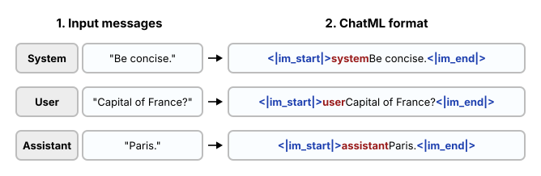
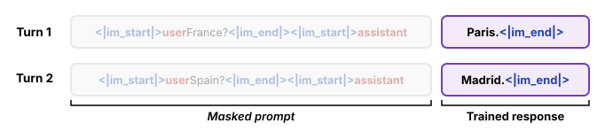
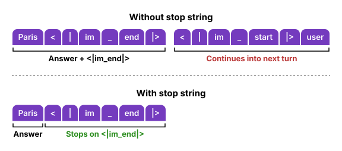
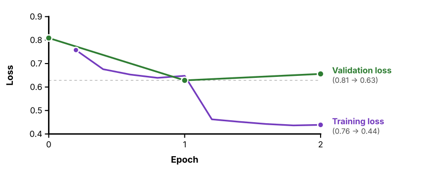

# Custom chat templates


Pre-trained Gemma 4 checkpoints (`google/gemma-4-E2B` through `google/gemma-4-31B`) only know how to continue documents. They ship with `tokenizer.chat_template = None`, so if you ask a question, the model treats your prompt like a web page and keeps writing instead of answering and stopping.

For most assistant tasks, starting from the instruction-tuned (`-it`) checkpoint and keeping Gemma 4's built-in chat template is the fastest path. You only need a custom chat template in two cases:

- **After continued pre-training:** You adapted a base model to a new language or domain in [Continued pre-training](continued-pretraining.md), and now want to turn it into a chat assistant.
- **Matching an existing serving format:** Your stack already expects a shared open format across models rather than Gemma 4's default `<|turn>`{.token-turn} ... `<turn|>`{.token-turn} markers.

In this guide, we add a **ChatML** template (`<|im_start|>` and `<|im_end|>`) to `google/gemma-4-E2B` and train it on multi-turn conversations with QLoRA.

---

## 1. Choosing a chat format

When you post-train a base model, you can pick any clear turn format as long as you use the exact same template during training and inference.

A popular vendor-neutral choice is **ChatML**, used across models such as Liquid AI's LFM3, NVIDIA's Nemotron 3, and Hugging Face's SmolLM. It wraps every message between `<|im_start|>` and `<|im_end|>`:



You can use ChatML easily in Gemma 4 since the start and end tokens use subwords that are already in Gemma 4's vocabulary.
---

## 2. Masking user turns

In a multi-turn conversation, computing loss on every token wastes updates on memorizing system instructions and user questions.

Instead, we wrap each assistant reply inside Jinja2 `...` tags. That tells the trainer to mask out the prompt and compute loss only on the assistant's answers:



---

## 3. Stopping at the end of a turn

In Gemma 4's tokenizer, `<|im_end|>` is six regular tokens (`<`, `|`, `im`, `_`, `end`, `|>`) rather than a single special end-of-sequence ID.

During training, the model will learn to use that six-token sequence at the end of every answer. However, during inference the generator only watches for `<eos>` (`ID 1`) by default, so you need to pass `"<|im_end|>"` as a stop string:



Without a stop string, the model finishes writing `<|im_end|>` and continues to generate `<|im_start|>user` while continuing the generation. Passing `stop_strings=["<|im_end|>"]` in Transformers (or `stop=["<|im_end|>"]` in vLLM) stops generation as soon as `<|im_end|>` is generated.

---

## 4. Set up the environment

We install the Hugging Face post-training and evaluation libraries as always:

```python { .notebook-cell }
# Install Hugging Face post-training, quantization, multimodal, and evaluation libraries
%pip install -q -U "transformers>=5.10.1" "trl>=0.16.0" "peft>=0.19.0" accelerate datasets bitsandbytes torchao
%pip install -q -U evaluate sacrebleu jiwer pillow soundfile librosa matplotlib tensorboard
```

If you plan to push your adapter to the Hugging Face Hub, log in with a write token:

```python { .notebook-cell }
from huggingface_hub import login

# Optional: uncomment to push your trained adapter to the Hugging Face Hub
# login()
```

---

## 5. Add a chat template

To add a chat template, we start by loading the pre-trained `google/gemma-4-E2B` tokenizer. Then, we double check that it indeed has no chat template, and add a ChatML Jinja2 template with `` tags around assistant replies:

```python { .notebook-cell .model-swap }
from transformers import AutoTokenizer

# Load the pre-trained base tokenizer (without the -it suffix)
model_id = "google/gemma-4-E2B"
tokenizer = AutoTokenizer.from_pretrained(model_id)
print(f"Initial chat_template: {tokenizer.chat_template}")

# Add a ChatML template with  markers around assistant turns
CHATML_TEMPLATE = (
    "{{ bos_token }}"
    ""
    "<|im_start|>{{ message['role'] }}\n"
    ""
    "{{ message['content'] }}<|im_end|>\n"
    ""
    "{{ message['content'] }}<|im_end|>\n"
    ""
    ""
    ""
    "<|im_start|>assistant\n"
    ""
)
tokenizer.chat_template = CHATML_TEMPLATE

# Preview a 2-turn conversation and check the assistant token mask
sample_messages = [
    {"role": "system", "content": "Be concise."},
    {"role": "user", "content": "What is the capital of France?"},
    {"role": "assistant", "content": "Paris."},
    {"role": "user", "content": "And Spain?"},
    {"role": "assistant", "content": "Madrid."},
]
print("\nFormatted prompt:\n" + tokenizer.apply_chat_template(sample_messages, tokenize=False))

encoded = tokenizer.apply_chat_template(
    sample_messages,
    tokenize=True,
    return_dict=True,
    return_assistant_tokens_mask=True,
)
print(f"Total tokens: {len(encoded['input_ids'])} | Trained tokens: {sum(encoded['assistant_masks'])}")
```

```{ .no-copy .output }
Initial chat_template: None

Formatted prompt:
<bos><|im_start|>system
Be concise.<|im_end|>
<|im_start|>user
What is the capital of France?<|im_end|>
<|im_start|>assistant
Paris.<|im_end|>
<|im_start|>user
And Spain?<|im_end|>
<|im_start|>assistant
Madrid.<|im_end|>

Total tokens: 88 | Trained tokens: 16
```

As shown above, there's no chat template within the base model and it also shows what the ChatML template would look like. 

---

## 6. Prepare the dataset

We use the `everyday-conversations` split of [SmolTalk](https://huggingface.co/datasets/HuggingFaceTB/smoltalk), a collection of short multi-turn dialogues. Each row already contains a `messages` list of alternating `user` and `assistant` turns, so we simply prepend a system message:

```python { .notebook-cell }
from datasets import load_dataset

SYSTEM_PROMPT = "You are a helpful, concise assistant."


def add_system_turn(example):
    return {
        "messages": [{"role": "system", "content": SYSTEM_PROMPT}] + example["messages"]
    }


# Load multi-turn dialogues and prepend the system prompt
dataset = load_dataset("HuggingFaceTB/smoltalk", "everyday-conversations")
train_dataset = dataset["train"].select(range(1200)).map(
    add_system_turn, remove_columns=["full_topic"]
)
eval_dataset = dataset["test"].map(
    add_system_turn, remove_columns=["full_topic"]
)

print(f"Conversations: {len(train_dataset)} train | {len(eval_dataset)} test")
print(f"Messages in first conversation: {len(train_dataset[0]['messages'])}")
```

```{ .no-copy .output }
Conversations: 1200 train | 119 test
Messages in first conversation: 9
```

---

## 7. Load the model

We can now load `google/gemma-4-E2B` in 4-bit NF4 precision and add the LoRA adapters across the seven linear projections in each text layer, just like in [(Q)LoRA](qlora.md):

```python { .notebook-cell }
import torch
from transformers import AutoModelForMultimodalLM, BitsAndBytesConfig
from peft import LoraConfig, get_peft_model, prepare_model_for_kbit_training

# Load the pre-trained base checkpoint in 4-bit NF4
bnb_config = BitsAndBytesConfig(
    load_in_4bit=True,
    bnb_4bit_use_double_quant=True,
    bnb_4bit_quant_type="nf4",
    bnb_4bit_compute_dtype=torch.bfloat16,
    bnb_4bit_quant_storage=torch.bfloat16,
)

model = AutoModelForMultimodalLM.from_pretrained(
    model_id,
    dtype=torch.bfloat16,
    device_map="auto",
    quantization_config=bnb_config,
)
model = prepare_model_for_kbit_training(model)

# Attach rank-16 LoRA adapters to the text decoder layers
peft_config = LoraConfig(
    r=16,
    lora_alpha=32,
    lora_dropout=0.0,
    bias="none",
    target_modules=[
        "q_proj",
        "k_proj",
        "v_proj",
        "o_proj",
        "gate_proj",
        "up_proj",
        "down_proj",
    ],
    exclude_modules=r"model\.(vision_tower|audio_tower)\..*",
    task_type="CAUSAL_LM",
)
model = get_peft_model(model, peft_config)
model.print_trainable_parameters()
```

```{ .no-copy .output }
trainable params: 24,158,208 || all params: 5,128,455,712 || trainable%: 0.4711
```

---

## 8. Evaluate the base model

Before we train the model, let's first define a small helper that formats a conversation, stops generation on `"<|im_end|>"`, and checks how the unmodified base model responds before training:

```python { .notebook-cell }
def generate_reply(messages, max_new_tokens=96):
    was_checkpointing = model.is_gradient_checkpointing
    if was_checkpointing:
        model.gradient_checkpointing_disable()
    model.eval()

    prompt_text = tokenizer.apply_chat_template(
        messages, tokenize=False, add_generation_prompt=True
    )
    inputs = tokenizer(prompt_text, return_tensors="pt").to(model.device)
    with torch.no_grad():
        output_ids = model.generate(
            **inputs,
            max_new_tokens=max_new_tokens,
            do_sample=False,
            stop_strings=["<|im_end|>"],
            tokenizer=tokenizer,
            pad_token_id=tokenizer.pad_token_id,
        )
    if was_checkpointing:
        model.gradient_checkpointing_enable()

    new_ids = output_ids[0][inputs["input_ids"].shape[1] :]
    raw_text = tokenizer.decode(new_ids, skip_special_tokens=True)
    stopped = "<|im_end|>" in raw_text
    clean_reply = raw_text.split("<|im_end|>")[0].strip()
    return clean_reply, stopped, len(new_ids)


# Test the raw base model before training
turn_1 = [
    {"role": "system", "content": SYSTEM_PROMPT},
    {"role": "user", "content": "What are three easy indoor plants for beginners?"},
]
reply_before, stopped_before, tokens_before = generate_reply(turn_1, max_new_tokens=60)
print(f"Stopped on <|im_end|>: {stopped_before} ({tokens_before} tokens)")
print(f"Reply before training:\n{reply_before}")
```

```{ .no-copy .output }
Stopped on <|im_end|>: False (60 tokens)
Reply before training:
1. **Pothos (Epipremnum aureum)**:
- **Description**: A popular and easy-to-care-for plant that thrives in low light conditions.
- **Care Tips**:
- **Light**: Thrives in low to medium light.
- **
```

This baseline shows that the base model ignores `<|im_end|>`, starts writing a bulleted article, and gets cut off at the 60-token limit.

---

## 9. Train the model

Now, we can train the model:

```python { .notebook-cell }
from trl import SFTConfig, SFTTrainer

sft_args = SFTConfig(
    output_dir="gemma-4-chatml",
    max_length=1024,
    assistant_only_loss=True,
    num_train_epochs=2,
    per_device_train_batch_size=4,
    gradient_accumulation_steps=4,
    learning_rate=2e-4,
    warmup_steps=0.05,
    lr_scheduler_type="cosine",
    bf16=True,
    logging_steps=15,
    eval_strategy="epoch",
    eval_on_start=True,
    save_strategy="epoch",
    report_to="tensorboard",
    seed=42,
)

trainer = SFTTrainer(
    model=model,
    args=sft_args,
    train_dataset=train_dataset,
    eval_dataset=eval_dataset,
    processing_class=tokenizer,
)
model.train()
trainer.train()
```

```{ .no-copy .output }
[150/150 08:28, Epoch 2/2]

| Epoch | Training Loss | Validation Loss | Mean Token Accuracy |
|---|---|---|---|
| 0 | — | 0.8088 | 0.7574 |
| 1 | 0.6465 | 0.6284 | 0.8045 |
| 2 | 0.4388 | 0.6559 | 0.8054 |
```

<!-- notebook:skip-start -->
??? info "Inspect the training curve"
    
<!-- notebook:skip-end -->

---

## 10. Evaluate the fine-tuned model

Let's run a two-turn conversation on the trained model to verify that it answers concisely, remembers context on Turn 2, and stops on `<|im_end|>` both times. We first ask:

> *"What are three easy indoor plants for beginners?"*

and then follow up with:

> *"Which of those needs the least sunlight?"*

```python { .notebook-cell }
# Turn 1: ask our initial question
reply_1, stopped_1, tokens_1 = generate_reply(turn_1)
print(f"[Turn 1] Stopped on <|im_end|>: {stopped_1} ({tokens_1} tokens)")
print(f"Assistant: {reply_1}\n")

# Turn 2: follow up using the model's first reply
turn_2 = turn_1 + [
    {"role": "assistant", "content": reply_1},
    {"role": "user", "content": "Which of those needs the least sunlight?"},
]
reply_2, stopped_2, tokens_2 = generate_reply(turn_2)
print(f"[Turn 2] Stopped on <|im_end|>: {stopped_2} ({tokens_2} tokens)")
print(f"Assistant: {reply_2}")
```

```{ .no-copy .output }
[Turn 1] Stopped on <|im_end|>: True (35 tokens)
Assistant: For beginners, I recommend Snake Plant, Spider Plant, and Pothos. They're easy to care for and thrive in low light conditions.

[Turn 2] Stopped on <|im_end|>: True (48 tokens)
Assistant: The Snake Plant needs very little sunlight, making it ideal for low-light areas. The Spider Plant can tolerate some indirect light, while the Pothos can handle low light, but prefers bright, indirect light.
```

It works! We gave the base model a chat template and the model is now reasonably capable of following instructions. In practice, you might want to train on significantly more data to make sure that the model can follow instructions in all kinds of different situations, ranging from short to long conversations and tasks.

There are three things we need to save:

* The model
* The tokenizer
* The generation configuration

```python { .notebook-cell }
model.generation_config.stop_strings = ["<|im_end|>"]

trainer.save_model("gemma-4-chatml")
tokenizer.save_pretrained("gemma-4-chatml")
model.generation_config.save_pretrained("gemma-4-chatml")
```

!!! tip "Serving with vLLM or OpenAI-compatible APIs"
    When serving a merged checkpoint with `vllm serve`, save `tokenizer.save_pretrained(merged_dir)` alongside the merged weights so vLLM picks up `chat_template.jinja` automatically, and pass `stop: ["<|im_end|>"]` in your `/v1/chat/completions` requests.


---

## What's next

<div class="card-grid">
<a class="card" href="continued-pretraining.md">
  <span class="card-icon">{{ icon('lucide/book-open') }}</span>
  <div class="card-title">Continued pre-training</div>
  <p class="card-desc">Adapt a base checkpoint to raw domain text or a new language before running chat SFT.</p>
</a>
<a class="card" href="unused-tokens.md">
  <span class="card-icon">{{ icon('lucide/type') }}</span>
  <div class="card-title">Unused tokens</div>
  <p class="card-desc">Turn Gemma 4's reserved token slots into single-token routing tags, source tags, and domain terms.</p>
</a>
<a class="card" href="preference-alignment.md">
  <span class="card-icon">{{ icon('lucide/sparkles') }}</span>
  <div class="card-title">Preference optimization</div>
  <p class="card-desc">Merge your SFT adapter and align responses with DPO on chosen and rejected pairs.</p>
</a>
<a class="card" href="export.md">
  <span class="card-icon">{{ icon('lucide/rocket') }}</span>
  <div class="card-title">Export</div>
  <p class="card-desc">Deploy merged checkpoints to vLLM, GGUF (llama.cpp and Ollama), and LiteRT-LM.</p>
</a>
</div>
