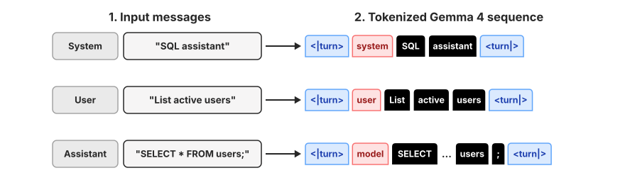
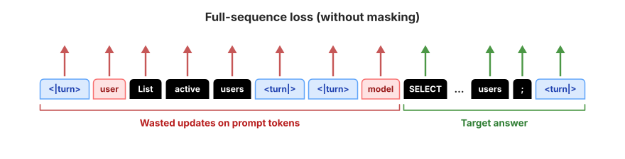
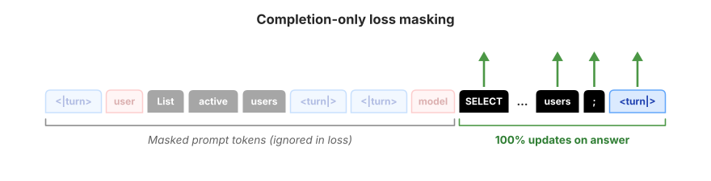
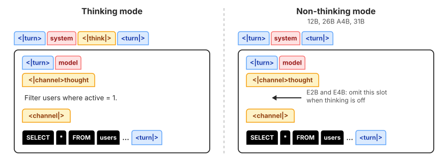
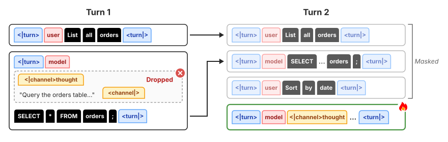

# Dataset formatting

Fine-tuning a model to follow instructions, reason step by step, or call tools requires formatting your training examples with the same control tokens used during inference. It also requires masking prompt tokens so the model only computes loss on its own responses.

This guide covers how Gemma 4 structures conversations, reasoning traces, multi-turn history, and tool calls for supervised fine-tuning.

---

## 1. The Gemma 4 chat template

With Gemma 4, each message in a conversation (system, user, and assistant) is wrapped in turn tokens before tokenization:

Every turn starts with `<|turn>`{.token-turn} followed immediately by the role and a newline, and ends with `<turn|>`{.token-turn}. Note that the assistant role in a standard conversation dataset maps to the `model`{.token-role} token.

Here are the main control tokens used in Gemma 4:

| Control token | Purpose |
| :--- | :--- |
| <code class="token-turn">&lt;&#124;turn&gt;</code> ... <code class="token-turn">&lt;turn&#124;&gt;</code> | Opens and closes every conversation turn. |
| `system`{.token-role}, `user`{.token-role}, `model`{.token-role} | Declares the speaker role right after <code class="token-turn">&lt;&#124;turn&gt;</code>. |
| <code class="token-think">&lt;&#124;think&#124;&gt;</code> | Enables reasoning mode. |
| <code class="token-think">&lt;&#124;channel&gt;thought</code> ... <code class="token-think">&lt;channel&#124;&gt;</code> | Wraps the model's internal reasoning trace. |
| <code class="token-tool">&lt;&#124;tool&gt;</code> ... <code class="token-tool">&lt;tool&#124;&gt;</code> | Wraps function definitions available to the model. |
| <code class="token-tool">&lt;&#124;tool_call&gt;</code> ... <code class="token-tool">&lt;tool_call&#124;&gt;</code> | Wraps a function call generated by the model. |
| <code class="token-tool">&lt;&#124;tool_response&gt;</code> ... <code class="token-tool">&lt;tool_response&#124;&gt;</code> | Returns the output of a tool back to the model. |
| <code class="token-tool">&lt;&#124;"&#124;&gt;</code> | Delimits string values inside structured tool blocks. |

For more information about these control tokens, see [Prompt formatting](../get-started/prompt-formatting.md).

---

## 2. Masking prompt tokens

In language modeling, the loss is computed on every token in the sequence. This works well for continued pre-training on raw documents. But in supervised fine-tuning, where each example starts with a system prompt, tool definitions, and the user's questions, this is not the case. 

If you compute loss on the whole sequence without masking, your model will focus a lot of its training on memorizing the prompt:

In the example above, most of the updates train the model to predict the user's question instead of the SQL answer. When your dataset includes long system prompts or retrieved documents, unmasked prompt tokens can make up over 90% of the loss.

To fix this, use **completion-only loss masking**, which masks every token except for the answer tokens:

The prompt tokens still run through the forward pass so the model can attend to the full question, but they are ignored when computing the loss. Now 100% of the weight updates focus on the model's answer and closing turn token. In Hugging Face TRL, structuring text examples into `prompt` and `completion` keys masks the prompt automatically, while vision and audio tasks use a small custom collator to also mask image and audio soft tokens.

---

## 3. Training with thinking tokens

Gemma 4 models can reason inside a `<|channel>thought`{.token-think} ... `<channel|>`{.token-think} block before writing their final answer. When preparing an SFT dataset, you can format examples for **thinking mode** or **non-thinking mode**:

The two modes work as follows:

1. **Thinking mode:** The system turn includes `<|think|>`{.token-think}, and the model turn starts with a thought block containing the reasoning steps before the final answer.
2. **Non-thinking mode:** When `<|think|>`{.token-think} is omitted from the system turn, **E2B** and **E4B** omit any thought-related tokens, while **12B**, **26B A4B**, and **31B** place an empty thought block before the final answer.

If you fine-tune only on direct answers without thought blocks, the model will gradually stop using its thinking channel even when prompted to reason.

To keep reasoning strong during supervised fine-tuning:

- **Combine reasoning and direct examples:** Include examples with thought blocks alongside direct-answer examples in your training dataset.
- **Generate reasoning traces when your dataset only has final answers:** If your dataset only contains questions and ground-truth answers, prompt **Gemma 4 31B** with thinking enabled on your training questions, keep the responses whose final answer matches your ground-truth label, and include those generated thought blocks in your training data.

---

## 4. Multi-turn conversations

In a multi-turn chat, the model might write hundreds of reasoning tokens during **Turn 1** before giving a short final answer.

When **Turn 2** starts, Gemma 4 drops the thought block from Turn 1 and keeps only the final answer in the conversation history:

This process works as follows:

1. **Turn 1:** The user asks "List all orders" and the model generates a thought block followed by its final answer (`SELECT * FROM orders;`).
2. **Turn 2:** Only the user prompt and the final answer from Turn 1 are carried into Turn 2's prompt history (and masked from the loss). Turn 1's thought block is dropped, while Turn 2's new model response keeps its thought block for training.

Dropping earlier thoughts keeps multi-turn context windows short and matches how inference engines format chat history at runtime.

!!! note "Thoughts when calling tools"
    It is important to note that the exception is tool calling. Within a single multi-step turn, thoughts generated before and after a tool call should be preserved. This helps the model track why certain tools were called.

---

## 5. Tool-calling datasets

Gemma 4 uses dedicated control tokens to format function definitions, tool calls, and tool outputs inside the conversation.

Here is how a tool-calling trajectory is structured inside a training example:

<pre><code>&lt;|turn&gt;system
&lt;|think|&gt;
&lt;|tool&gt;declaration:get_stock{description:&lt;|"|&gt;Look up available units for a product SKU.&lt;|"|&gt;,parameters:{properties:{sku:{description:&lt;|"|&gt;Product SKU&lt;|"|&gt;,type:&lt;|"|&gt;STRING&lt;|"|&gt;}},required:[&lt;|"|&gt;sku&lt;|"|&gt;],type:&lt;|"|&gt;OBJECT&lt;|"|&gt;}}&lt;tool|&gt;&lt;turn|&gt;
&lt;|turn&gt;user
How many units of SKU-9042 are in stock?&lt;turn|&gt;
&lt;|turn&gt;model
&lt;|channel&gt;thought
I need to check the inventory for SKU-9042.
&lt;channel|&gt;&lt;|tool_call&gt;call:get_stock{sku:&lt;|"|&gt;SKU-9042&lt;|"|&gt;}&lt;tool_call|&gt;&lt;|tool_response&gt;response:get_stock{value:&lt;|"|&gt;{"available_units": 142}&lt;|"|&gt;}&lt;tool_response|&gt;&lt;|channel&gt;thought
The tool returned 142 units.
&lt;channel|&gt;There are 142 units of SKU-9042 in stock.&lt;turn|&gt;</code></pre>

Note that the tool call, the tool response, and the follow-up answer are merged into a single model turn. When masking tool-calling trajectories for supervised fine-tuning, mask the system turn, user turns, and the tool response so the model only computes loss on its own thoughts, tool calls, and final answers.

## What's next

<a class="card" href="qlora.md">
  {{ icon('lucide/zap') }}
  
(Q)LoRA

  
Train an adapter on your formatted dataset with TRL and PEFT on a single GPU.

</a>
<a class="card" href="full-finetune.md">
  {{ icon('lucide/cpu') }}
  
Full fine-tuning

  
Update 100% of Gemma 4 weights in bfloat16 with completion-only loss masking.

</a>
<a class="card" href="preference-alignment.md">
  {{ icon('lucide/sparkles') }}
  
Preference optimization

  
Format chosen and rejected pairs for DPO, ORPO, and KTO.

</a>
<a class="card" href="reinforcement-learning.md">
  {{ icon('lucide/brain') }}
  
Verifiable rewards

  
Train thinking chains with GRPO and verifiable reward functions.

</a>

--8<-- "glossary.md"
