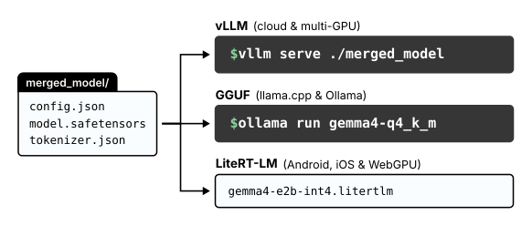

# Export

Once training and adapter merging are complete, your `merged_model/` directory (`config.json`, `model.safetensors`, `tokenizer.json`) can be served directly on GPU clusters or used on desktop, Apple Silicon, and mobile devices.




---

## 1. vLLM

[vLLM](../deployment/vllm.md) serves Hugging Face SafeTensors directories directly, or can dynamically attach unmerged LoRA adapters at request time:

=== "Option A: Serve a merged checkpoint"
    If you merged your LoRA adapter into the base weights with `merge_and_unload()` or ran full fine-tuning, point `vllm serve` at your `merged_model/` folder:

    ```bash
    # Serve merged E2B or E4B on a single GPU
    vllm serve ./merged_model \
        --dtype bfloat16 \
        --max-model-len 32768

    # Serve merged 26B A4B or 31B across 2 GPUs with Tensor Parallelism
    vllm serve ./merged_model \
        --dtype bfloat16 \
        --tensor-parallel-size 2 \
        --max-model-len 32768
    ```

=== "Option B: Serve multiple LoRA adapters"
    If you kept your LoRA adapter separate, load the official frozen Gemma 4 base checkpoint once and attach multiple adapters with `--enable-lora`:

    ```bash
    # Serve one shared base checkpoint with multiple per-request LoRA adapters
    vllm serve google/gemma-4-E4B-it \
        --enable-lora \
        --max-lora-rank 32 \
        --lora-modules sql-adapter=./gemma-4-text-to-sql medical-adapter=./gemma-4-medical-lora
    ```

    Pass `"model": "sql-adapter"` or `"model": "medical-adapter"` in your OpenAI-compatible API request to pick the adapter per request.

---

## 2. GGUF

To run your fine-tuned Gemma 4 model locally with [llama.cpp](../deployment/llamacpp.md) or [Ollama](../deployment/ollama.md), you can convert it to a `.gguf` file in 16-bit and quantize it to 4-bit with:

```bash
# Convert Hugging Face SafeTensors directory to FP16 GGUF
python llama.cpp/convert_hf_to_gguf.py ./merged_model \
    --outfile model-f16.gguf \
    --outtype f16

# Quantize FP16 GGUF to 4-bit Q4_K_M
./llama.cpp/build/bin/llama-quantize \
    model-f16.gguf \
    model-q4_k_m.gguf \
    Q4_K_M
```

---

## 3. LiteRT-LM


To run your small models (Gemma 4 E2B and E4B) on mobile devices with LiteRT-LM, export your checkpoint to a `.litertlm` bundle. Passing `--externalize_embedder` separates Gemma 4's Per-Layer Embeddings table so the active transformer weights can run in 4-bit precision on the mobile GPU or NPU without exhausting device memory.

Install `litert-torch-nightly` and `litert-lm`, export `./merged_model`, and test the bundle locally:

```bash
# Install LiteRT conversion and CLI tools
uv tool install litert-torch-nightly litert-lm

# Export the merged checkpoint with externalized Per-Layer Embeddings
litert-torch export_hf \
    --model=./merged_model \
    --output_dir=./litert_out \
    --externalize_embedder \
    --jinja_chat_template_override=litert-community/gemma-4-E2B-it-litert-lm

# Run a quick local smoke test on the exported bundle
litert-lm run ./litert_out/model.litertlm --prompt="What is the capital of France?"
```

For Android, iOS, C++, and Python integration steps, see the [LiteRT-LM deployment guide](../deployment/litert.md).

---

## What's next

<div class="card-grid">
<a class="card" href="../deployment/index.md">
  <span class="card-icon">{{ icon('lucide/rocket') }}</span>
  <div class="card-title">Run Gemma</div>
  <p class="card-desc">Deploy fine-tuned Gemma 4 checkpoints with vLLM, Ollama, llama.cpp, Google Cloud, or LiteRT-LM.</p>
</a>
<a class="card" href="scaling.md">
  <span class="card-icon">{{ icon('lucide/boxes') }}</span>
  <div class="card-title">Scaling</div>
  <p class="card-desc">Shard training across multi-GPU nodes with FSDP2 and recover 4-bit accuracy with TorchAO QAT.</p>
</a>
<a class="card" href="unsloth.md">
  <span class="card-icon">{{ icon('lucide/zap') }}</span>
  <div class="card-title">Unsloth</div>
  <p class="card-desc">Speed up single-GPU LoRA and export directly to GGUF with a single helper call.</p>
</a>
<a class="card" href="gemma-trainer.md">
  <span class="card-icon">{{ icon('lucide/wrench') }}</span>
  <div class="card-title">Gemma trainer skill</div>
  <p class="card-desc">Let an AI coding agent set up, validate, and run local Gemma 4 fine-tuning workflows for you.</p>
</a>
</div>

--8<-- "glossary.md"
