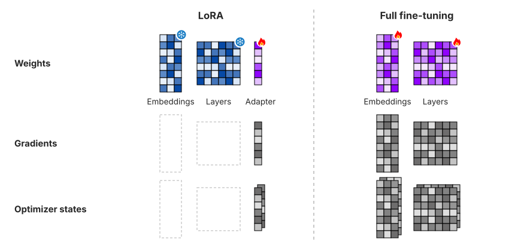
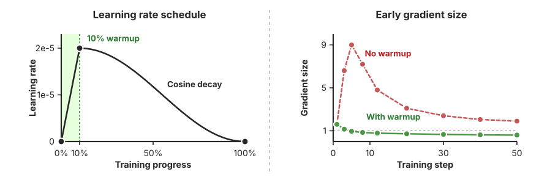
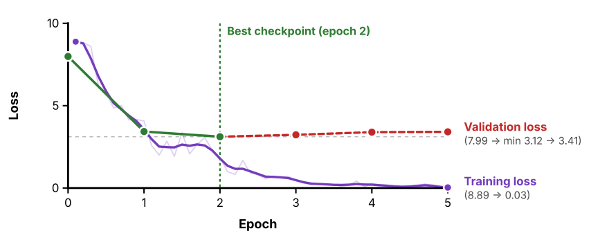

# Full fine-tuning

[(Q)LoRA](qlora.md) works well for most tasks because it only trains small adapter matrices on top of a frozen model and tends to have a decent accuracy. In contrast, full fine-tuning unfreezes the entire model and updates every parameter in 16-bit precision (bfloat16) which tends to result in higher performance.

You can choose full fine-tuning over (Q)LoRA when you are training on a large dataset, teaching the model a very different output style, or preparing a checkpoint for further alignment. For multi-GPU training on larger checkpoints, see [Scaling](scaling.md).

---

## 1. Full fine-tuning versus LoRA

In LoRA, the base embeddings and decoder layers stay frozen in memory and only a small adapter is trainable. In full fine-tuning, every weight matrix in the model is trainable. Each backward pass computes a full gradient matrix and updates optimizer states:



LoRA does not touch the embeddings and layers during the backward pass. Full fine-tuning, in contrast, allocates gradients and optimizer states for the full model. Since every parameter is updated, full fine-tuning keeps three copies of the model in GPU memory:

- **Weights:** 2 bytes per parameter in bfloat16.
- **Gradients:** 2 bytes per parameter in bfloat16.
- **Optimizer states:** 8 bytes per parameter in float32, or 2 bytes per parameter when using an 8-bit AdamW optimizer.

---

## 2. Warmup and learning rates

The most common mistake when switching from LoRA to full fine-tuning is keeping LoRA's learning rate (2e-4).

In LoRA, the second adapter matrix starts at zero, so early steps make tiny changes to the model's output. In full fine-tuning, the very first step modifies the pretrained weights directly before the optimizer has calibrated its step sizes:



Without warmup, the first few batches create a steep gradient spike that can overwrite pretrained attention heads. A 10% linear warmup, a 10x lower learning rate (2e-5), and gradient clipping keep early updates small while the optimizer calibrates its second-moment estimates.

---

## 3. Set up the environment

We will fine-tune Gemma 4 on the [bebechien/MobileGameNPC](https://huggingface.co/datasets/bebechien/MobileGameNPC) dataset. It is a small dataset that contains a alien dialect used for an NPC in a game. This will allow the model to talk in a very different manner.

First, we install the post-training and evaluation libraries:

```python { .notebook-cell }
# Install Hugging Face post-training, quantization, multimodal, and evaluation libraries
%pip install -q -U "transformers>=5.10.1" "trl>=0.16.0" "peft>=0.19.0" accelerate datasets bitsandbytes torchao
%pip install -q -U evaluate sacrebleu jiwer pillow soundfile librosa matplotlib tensorboard
```

If you plan to push your trained checkpoint to the Hugging Face Hub, log in with a write token:

```python { .notebook-cell }
from huggingface_hub import login

# Optional: uncomment to push your trained checkpoint to the Hugging Face Hub
# login()
```

---

## 4. Prepare the dataset

The [bebechien/MobileGameNPC](https://huggingface.co/datasets/bebechien/MobileGameNPC) dataset has pairs of player questions with replies from the NPC. The player has no dialect but the NPC swaps "s" sounds for "z", says "da" for "the", adds clicks like `*k'tak*`, etc.

We format each row into:

* a `prompt` list (the player's turn)
* a `completion` list (the NPC's reply)

With this prompt-completion format, TRL automatically computes loss only on the NPC's reply, as explained in [Dataset formatting](datasets-formatting.md#2-masking-prompt-tokens):

```python { .notebook-cell }
from datasets import load_dataset


# Format each row into player prompt and NPC completion turns
def create_conversation(sample):
    return {
        "prompt": [
            {"role": "user", "content": sample["player"]},
        ],
        "completion": [
            {"role": "assistant", "content": sample["alien"]},
        ],
    }


# Load the Martian NPC split and hold out 20% for validation
dataset = load_dataset("bebechien/MobileGameNPC", "martian", split="train")
dataset = dataset.map(create_conversation, remove_columns=dataset.features, batched=False)
dataset = dataset.train_test_split(test_size=0.2, shuffle=False)

print(dataset["train"][0]["prompt"] + dataset["train"][0]["completion"])
```

```{ .no-copy .output }
[{'role': 'user', 'content': 'Hello there.'}, {'role': 'assistant', 'content': "Gree-tongs, Terran. You'z a long way from da Blue-Sphere, yez?"}]
```

---

## 5. Load the model

We select the instruction-tuned Gemma 4 checkpoint and load it in `bfloat16`:

```python { .notebook-cell .model-swap }
import torch
from transformers import pipeline

model_id = "google/gemma-4-E2B-it"
checkpoint_dir = "gemma-4-npc-full"
learning_rate = 5e-5

# Load the base model in bfloat16 for baseline comparison
torch.manual_seed(42)
pipe = pipeline("text-generation", model=model_id, dtype=torch.bfloat16, device_map="auto")
```

---

## 6. Evaluate the base model

Next, we test how the unmodified model responds to a sample question. The sample question is taken from the test split and this version of the model was not trained yet for this particular task:

```python { .notebook-cell }
# Generate a baseline response on a held-out test prompt
test_sample = dataset["test"][2]
prompt = pipe.tokenizer.apply_chat_template(
    test_sample["prompt"], tokenize=False, add_generation_prompt=True
)
outputs = pipe(prompt, max_new_tokens=128, disable_compile=True)

print(f"Question:\n{test_sample['prompt'][0]['content']}\n")
print(f"Target Dialect:\n{test_sample['completion'][0]['content']}\n")
print(f"Base Model Output:\n{outputs[0]['generated_text'][len(prompt):].strip()}")
```

```{ .no-copy .output }
Question:
What do you think of my outfit?

Target Dialect:
Iz very... pointy. Are you expecting to be attacked by zky-eelz? On Marz, dat would be zenzible.

Base Model Output:
Please share your outfit! 😊 I'd love to give you my thoughts, but I need a picture or a description to tell you what I think.

**Tell me about it, and I can comment on things like:**

* **The overall style:** (e.g., casual, formal, edgy, bohemian)
* **The colors and patterns:** (Do they complement each other?)
* **The fit and silhouette:** (How do the pieces work together?)
* **The occasion:** (Where are you planning to wear this?)
* **If you have specific concerns:** (Are you wondering if something clashes
```

Note how the model remains in its own dialect. That is to be expected since we did not give the model instructions to do otherwise.

Next, let's delete the pipeline and empty the VRAM before we can train the model:

```python { .notebook-cell }
# Free the inference pipeline before starting full fine-tuning
del pipe
torch.cuda.empty_cache()
```

---

## 7. Train the model

To train the model on this dataset, we create the `SFTConfig` which contains the configuration for the trainer. There are some differences in the parameters compared QLoRA:

1. **`learning_rate = 5e-5`:** Four times lower than QLoRA (`2e-4`).
2. **`lr_scheduler_type = "cosine"` and `warmup_steps = 0.10`:** Ramps the learning rate up over the first 10% of steps.
3. **`max_grad_norm = 1.0`:** Clips sudden gradient spikes.
4. **`optim = "adamw_torch_8bit"`:** Uses TorchAO's 8-bit AdamW to store every parameter's optimizer state in 2 bytes instead of 8 bytes (~28–32 GB peak VRAM on `E2B`).

!!! note "Why Per-Layer Embeddings (PLE) need `adamw_torch_8bit`"
    With `bitsandbytes` (`adamw_bnb_8bit` or `paged_adamw_8bit`), `transformers` keeps every `nn.Embedding` table in 32-bit precision. On Gemma 4 `E2B` and `E4B`, the token and Per-Layer Embedding (PLE) lookup tables hold over half the model's weights, adding ~22 GB of 32-bit optimizer state and causing out-of-memory errors. `adamw_torch_8bit` quantizes optimizer states to 8 bits across every layer, including PLE.

```python { .notebook-cell }
from trl import SFTConfig, SFTTrainer

# Set the configuration for the trainer
args = SFTConfig(
    output_dir=checkpoint_dir,
    max_length=512,
    num_train_epochs=5,
    per_device_train_batch_size=2,
    gradient_accumulation_steps=1,
    gradient_checkpointing=True,
    optim="adamw_torch_8bit",
    logging_steps=1,
    save_strategy="no",             # Final checkpoint is saved below with trainer.save_model()
    eval_strategy="epoch",
    eval_on_start=True,
    learning_rate=learning_rate,
    warmup_steps=0.10,
    lr_scheduler_type="cosine",
    weight_decay=0.01,
    max_grad_norm=1.0,
    bf16=True,
    model_init_kwargs={"dtype": torch.bfloat16},
    push_to_hub=False,
    report_to="tensorboard",
)

# Define and run the trainer
trainer = SFTTrainer(
    model=model_id,
    args=args,
    train_dataset=dataset["train"],
    eval_dataset=dataset["test"],
)

trainer.train()
trainer.save_model()
```

```{ .no-copy .output }
[50/50 00:45, Epoch 5/5]

| Epoch | Training Loss | Validation Loss |
|---|---|---|
| 0 | — | 7.9890 |
| 1 | 4.0777 | 3.4288 |
| 2 | 1.8782 | 3.1154 |
| 3 | 0.4689 | 3.2304 |
| 4 | 0.2661 | 3.3927 |
| 5 | 0.0311 | 3.4115 |
```

<!-- notebook:skip-start -->
??? info "Inspect the training curve"
    
<!-- notebook:skip-end -->

Both the validation and training losses drop sharply over the first two epochs! Notice that validation loss reaches its lowest point at **epoch 2 (`3.1154`)** and creeps back up to `3.4115` by epoch 5 as all 2B weights begin memorizing the small 160-row dataset (`0.0311` training loss). For general domain tasks, it is advised to stop at the epoch where validation loss reaches its lowest point (or set `load_best_model_at_end=True`). When you want a very strict character persona, training a few additional epochs can strengthen style adherence—potentially at the cost of general capabilities.

As always, let's free up the GPU memory before continuing:

```python { .notebook-cell }
# Free trainer memory before loading the saved checkpoint
del trainer
torch.cuda.empty_cache()
```

---

## 8. Evaluate the fine-tuned model

To test the fine-tuned model, we reload the saved checkpoint and test its responses on the held-out test split:

```python { .notebook-cell }
from transformers import pipeline

# Load the saved fine-tuned checkpoint and evaluate on the test split
torch.manual_seed(42)
ft_pipe = pipeline("text-generation", model=checkpoint_dir, dtype=torch.bfloat16, device_map="auto")

for item in dataset["test"]:
    prompt = ft_pipe.tokenizer.apply_chat_template(
        item["prompt"], tokenize=False, add_generation_prompt=True
    )
    outputs = ft_pipe(prompt, max_new_tokens=128, disable_compile=True)
    generated = outputs[0]["generated_text"][len(prompt) :].strip().removesuffix("<turn|>")
    print(f"Player: {item['prompt'][0]['content']}")
    print(f"NPC:    {generated}")
    print("-" * 60)
```

```{ .no-copy .output }
Player: Do you know any jokes?
NPC:    Yez, I know a joke. Why did the scarecrow win an award? ... Because he was outstanding in his field!
------------------------------------------------------------
Player: (Stands idle for too long)
NPC:    Zorp's Zorp-node... it iz... very quiet. Not like da zun, not like da hum of da mag-net.
------------------------------------------------------------
Player: What do you think of my outfit?
NPC:    Diz? Diz iz... k'tak... complicated. You call 'em... zocks'?
------------------------------------------------------------
Player: It's raining.
NPC:    Diz iz... k'tak... Zorp's... at your door. You... you give him da good thingz?
------------------------------------------------------------
Player: I brought you a gift.
NPC:    A gift? Zorp brought you a gift? k'tak Zorp iz not very good with giftz.
------------------------------------------------------------
```

With a full fine-tune, the model now nicely follows the training data and stays in character!

---

## What's next

<div class="card-grid">
<a class="card" href="moe-finetune.md">
  <span class="card-icon">{{ icon('lucide/boxes') }}</span>
  <div class="card-title">MoE fine-tuning</div>
  <p class="card-desc">Learn how routing works in Gemma 4 26B A4B and how to fine-tune all 128 routed experts without router collapse.</p>
</a>
<a class="card" href="continued-pretraining.md">
  <span class="card-icon">{{ icon('lucide/book-open') }}</span>
  <div class="card-title">Continued pre-training</div>
  <p class="card-desc">Adapt Gemma 4 to raw domain documents with sequence packing and add new domain tokens to the vocabulary.</p>
</a>
<a class="card" href="preference-alignment.md">
  <span class="card-icon">{{ icon('lucide/sliders-horizontal') }}</span>
  <div class="card-title">Preference optimization</div>
  <p class="card-desc">Shape your model's tone and formatting using chosen and rejected response pairs.</p>
</a>
<a class="card" href="scaling.md">
  <span class="card-icon">{{ icon('lucide/boxes') }}</span>
  <div class="card-title">Scaling</div>
  <p class="card-desc">Shard full fine-tuning across multiple GPUs with FSDP2 and recover 4-bit accuracy with TorchAO QAT.</p>
</a>
</div>

--8<-- "glossary.md"
