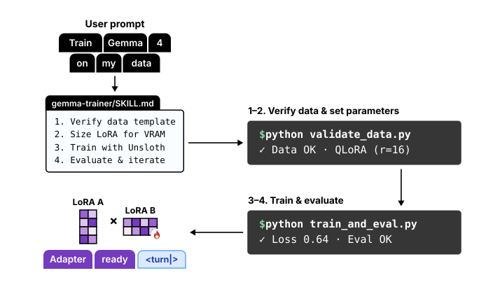

# Gemma trainer skill

The **`gemma-trainer`** skill from [`google-gemma/gemma-skills`][gemma-skills-repo] gives AI coding agents—such as Gemini CLI, Claude Code, Cursor, and Antigravity—up-to-date working knowledge of Gemma 4 fine-tuning. Instead of piecing together boilerplate from scratch, describe your dataset and goal in plain English and your agent will validate your data format, size hyperparameters to your GPU, run training, and evaluate the result.

---

## 1. Install the skill

Install `gemma-trainer` into your coding agent's skills directory:

=== "skills CLI"

    ```bash
    # Install the gemma-trainer skill from google-gemma/gemma-skills
    npx skills add google-gemma/gemma-skills --skill gemma-trainer
    ```

=== "Antigravity CLI"

    ```bash
    # Install the full Gemma Skills bundle
    agy plugin install https://github.com/google-gemma/gemma-skills
    ```

See [Gemma Skills](../resources/gemma-skills.md) for how to list and manage other skills in the repository, such as `gemma-dev`.

---

## 2. How the skill works

When you ask your coding agent to fine-tune a Gemma 4 model, `gemma-trainer` guides the session through four stages before and after training:



1. **Verify the dataset and template**: Inspects your local `JSONL`, `CSV`, `Parquet`, or Hugging Face dataset, formats turns with `<|turn>` and `<turn|>`, and enables completion-only loss masking so prompt tokens do not dilute weight updates.
2. **Match model and GPU memory**: Checks your available VRAM, selects a compatible Gemma 4 checkpoint (catching modality mismatches automatically, such as routing speech tasks to audio-capable `E2B`, `E4B`, or `12B` rather than text-and-vision `26B A4B` or `31B`), and proposes LoRA rank, batch size, and learning rate for review before launching.
3. **Run the training recipe**: Generates a clean standalone Python training script—using [Unsloth](unsloth.md) for fast single-GPU runs or Hugging Face TRL and PEFT for custom setups and multi-GPU [scaling](scaling.md)—and tracks training and validation loss.
4. **Evaluate and export**: Runs before-and-after evaluation on held-out examples and exports your adapter or merged checkpoint to Hugging Face, `GGUF`, or `LiteRT-LM`.

---

## 3. Supported workflows

`gemma-trainer` covers the full post-training lifecycle across this documentation suite:

| Goal | What it does | Guide |
| :--- | :--- | :--- |
| **New language** | Packs raw domain text with a replay mix to prevent forgetting | [Continued pre-training](continued-pretraining.md) |
| **Custom formats** | Sets up custom chat templates or single-token routing tags | [Custom chat templates](custom-chat-template.md) · [Unused tokens](unused-tokens.md) |
| **Task tuning** | Trains a lightweight LoRA or 4-bit QLoRA adapter on a single GPU | [(Q)LoRA](qlora.md) |
| **Full-weight shift** | Updates all model weights using memory-efficient 8-bit AdamW | [Full fine-tuning](full-finetune.md) |
| **MoE tuning** | Adapts all 128 routed experts while keeping the router frozen | [MoE fine-tuning](moe-finetune.md) |
| **Vision tasks** | Extracts structured data from images, receipts, and documents | [Vision fine-tuning](vision-qlora.md) |
| **Audio tasks** | Fine-tunes speech transcription and audio understanding | [Audio fine-tuning](audio-qlora.md) |
| **Style and tone** | Aligns responses on chosen and rejected preference pairs | [Preference optimization](preference-alignment.md) |
| **Verifiable tasks** | Rewards concise reasoning and exact answers on math or code | [Verifiable rewards](reinforcement-learning.md) |
| **Scaling and export** | Shards multi-GPU runs and exports to vLLM, GGUF, or LiteRT-LM | [Scaling](scaling.md) · [Export](export.md) |

---

## 4. Example prompts

Once installed, prompt your coding agent directly in your project folder:

- **Supervised fine-tuning on local data**:
  > *"Fine-tune Gemma 4 E4B on `./data/support_tickets.jsonl` to classify ticket priority and draft concise replies. Validate the dataset first and size QLoRA for a 24 GB GPU."*
- **Multimodal vision extraction**:
  > *"Train Gemma 4 E2B to extract structured JSON line items from the receipt images in `./invoices/` and evaluate exact-match accuracy before and after training."*
- **Reasoning with verifiable rewards**:
  > *"Run GRPO on Gemma 4 E2B using my SQL benchmark so it reasons inside `<|thought>` blocks and gets rewarded when queries execute and match the expected rows."*
- **On-device export**:
  > *"Merge my trained Gemma 4 E2B LoRA adapter and convert it to GGUF Q4_K_M and LiteRT-LM for mobile deployment."*

---

## What's next

<div class="card-grid">
<a class="card" href="index.md">
  <span class="card-icon">{{ icon('lucide/graduation-cap') }}</span>
  <div class="card-title">Fine-tuning overview</div>
  <p class="card-desc">Explore the interactive pipeline map to pick a training stage, method, and checkpoint.</p>
</a>
<a class="card" href="qlora.md">
  <span class="card-icon">{{ icon('lucide/sliders-horizontal') }}</span>
  <div class="card-title">(Q)LoRA</div>
  <p class="card-desc">Walk through the Hugging Face TRL and PEFT code behind a LoRA fine-tuning run.</p>
</a>
<a class="card" href="unsloth.md">
  <span class="card-icon">{{ icon('lucide/zap') }}</span>
  <div class="card-title">Unsloth</div>
  <p class="card-desc">Swap in Unsloth's fused kernels for faster single-GPU training on 16–40 GB GPUs.</p>
</a>
<a class="card" href="export.md">
  <span class="card-icon">{{ icon('lucide/rocket') }}</span>
  <div class="card-title">Export</div>
  <p class="card-desc">Export your fine-tuned model to vLLM, GGUF, or LiteRT-LM for deployment.</p>
</a>
</div>

--8<-- "glossary.md"
