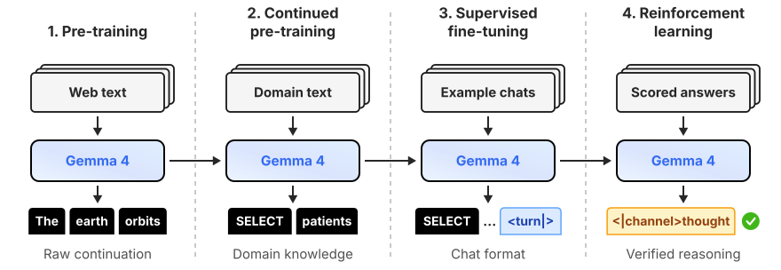
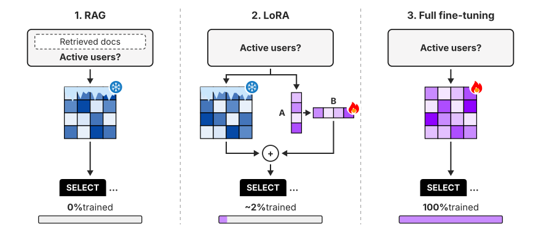
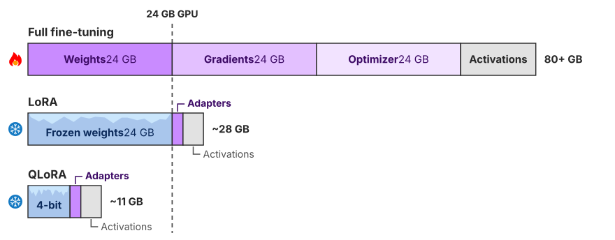
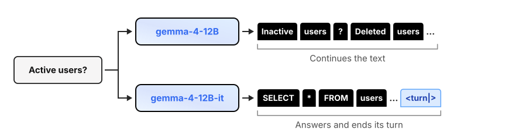

# Fine-tuning overview

Gemma 4 can reason through problems, call tools, and understand images and audio. Fine-tuning allows you to teach it things it did not know before like domain-specific terminology, a new language or corpus, and capabilities outside of it current skillset.
These sets of pages will guide you through fine-tuning, from continued pre-Training and supervised fine-Tuning all the way to reinforcement learning and multi-gpu training.

Fine-tuning is not trivial and might get overwhelming quickly. This page helps you find your way, starting with a map of common paths you can take for fine-tuning Gemma 4 based on specific tasks.

<div class="tmap" id="gemma-tuning-map">
  <div class="tmap-canvas">
    <div class="tmap-stage">
      <div class="tmap-stage__meta">
        <span class="tmap-pill">Foundations</span>
        <span class="tmap-stage__name">Before you train</span>
        <span class="tmap-stage__hint">Models, settings, turn masks</span>
      </div>
      <div class="tmap-nodes">
        <a class="tmap-node" data-guide="best-practices" href="best-practices.md">
          <div class="tmap-node__top"><span class="tmap-node__title">Best practices</span></div>
          <span class="tmap-node__desc">Pick a model size, learning rate, and dataset setup.</span>
        </a>
        <a class="tmap-node" data-guide="datasets-formatting" href="datasets-formatting.md">
          <div class="tmap-node__top"><span class="tmap-node__title">Dataset formatting</span></div>
          <span class="tmap-node__desc">Format chat turns and mask prompt tokens from the loss.</span>
        </a>
      </div>
    </div>

    <div class="tmap-stage">
      <div class="tmap-stage__meta">
        <span class="tmap-pill">Stage 1</span>
        <span class="tmap-stage__name">Base models</span>
        <span class="tmap-stage__hint">Pre-trained checkpoints (no -it)</span>
      </div>
      <div class="tmap-nodes">
        <a class="tmap-node" data-guide="continued-pretraining" href="continued-pretraining.md">
          <div class="tmap-node__top"><span class="tmap-node__title">Continued pre-training</span></div>
          <span class="tmap-node__desc">Pack unlabeled domain text with a 10% replay buffer.</span>
        </a>
        <a class="tmap-node" data-guide="custom-chat-template" href="custom-chat-template.md">
          <div class="tmap-node__top"><span class="tmap-node__title">Custom chat templates</span></div>
          <span class="tmap-node__desc">Turn a base checkpoint into a chat model with ChatML.</span>
        </a>
      </div>
    </div>

    <div class="tmap-stage">
      <div class="tmap-stage__meta">
        <span class="tmap-pill">Stage 2</span>
        <span class="tmap-stage__name">Supervised tuning</span>
        <span class="tmap-stage__hint">Tasks, modalities, custom tokens</span>
      </div>
      <div class="tmap-nodes tmap-nodes--three">
        <a class="tmap-node" data-guide="qlora" href="qlora.md">
          <div class="tmap-node__top"><span class="tmap-node__title">(Q)LoRA</span></div>
          <span class="tmap-node__desc">Train a 4-bit or 16-bit adapter on a single GPU.</span>
        </a>
        <a class="tmap-node" data-guide="full-finetune" href="full-finetune.md">
          <div class="tmap-node__top"><span class="tmap-node__title">Full fine-tuning</span></div>
          <span class="tmap-node__desc">Update every weight in bfloat16 with 8-bit AdamW.</span>
        </a>
        <a class="tmap-node" data-guide="moe-finetune" href="moe-finetune.md">
          <div class="tmap-node__top"><span class="tmap-node__title">MoE fine-tuning</span></div>
          <span class="tmap-node__desc">Adapt all 128 routed experts while keeping the router frozen.</span>
          <div class="tmap-node__tags"><span class="tmap-tag">26B A4B only</span></div>
        </a>
        <a class="tmap-node" data-guide="vision-qlora" href="vision-qlora.md">
          <div class="tmap-node__top"><span class="tmap-node__title">Vision fine-tuning</span></div>
          <span class="tmap-node__desc">Train on images, receipts, and documents with soft-token budgets.</span>
        </a>
        <a class="tmap-node" data-guide="audio-qlora" href="audio-qlora.md">
          <div class="tmap-node__top"><span class="tmap-node__title">Audio fine-tuning</span></div>
          <span class="tmap-node__desc">Train speech transcription in bfloat16 LoRA.</span>
          <div class="tmap-node__tags"><span class="tmap-tag">E2B, E4B, 12B only</span></div>
        </a>
        <a class="tmap-node" data-guide="unused-tokens" href="unused-tokens.md">
          <div class="tmap-node__top"><span class="tmap-node__title">Unused tokens</span></div>
          <span class="tmap-node__desc">Map routing or source tags to single reserved token slots.</span>
        </a>
      </div>
    </div>

    <div class="tmap-stage">
      <div class="tmap-stage__meta">
        <span class="tmap-pill">Stage 3</span>
        <span class="tmap-stage__name">Reinforcement learning</span>
        <span class="tmap-stage__hint">Preferences, verifiable rewards</span>
      </div>
      <div class="tmap-nodes">
        <a class="tmap-node" data-guide="preference-alignment" href="preference-alignment.md">
          <div class="tmap-node__top"><span class="tmap-node__title">Preference optimization</span></div>
          <span class="tmap-node__desc">Shape style and conciseness on chosen vs. rejected pairs.</span>
        </a>
        <a class="tmap-node" data-guide="reinforcement-learning" href="reinforcement-learning.md">
          <div class="tmap-node__top"><span class="tmap-node__title">Verifiable rewards</span></div>
          <span class="tmap-node__desc">Boost math, code, or SQL accuracy with GRPO reward checks.</span>
        </a>
      </div>
    </div>

    <div class="tmap-stage">
      <div class="tmap-stage__meta">
        <span class="tmap-pill">Stage 4</span>
        <span class="tmap-stage__name">Deployment</span>
        <span class="tmap-stage__hint">Multi-GPU sharding, serving</span>
      </div>
      <div class="tmap-nodes">
        <a class="tmap-node" data-guide="scaling" href="scaling.md">
          <div class="tmap-node__top"><span class="tmap-node__title">Scaling</span></div>
          <span class="tmap-node__desc">Shard multi-GPU runs with FSDP2 and recover 4-bit accuracy with QAT.</span>
        </a>
        <a class="tmap-node" data-guide="export" href="export.md">
          <div class="tmap-node__top"><span class="tmap-node__title">Export</span></div>
          <span class="tmap-node__desc">Serve merged checkpoints in vLLM, GGUF, Ollama, or LiteRT-LM.</span>
        </a>
        <a class="tmap-node" data-guide="unsloth" href="unsloth.md">
          <div class="tmap-node__top"><span class="tmap-node__title">Unsloth</span></div>
          <span class="tmap-node__desc">Accelerate single-GPU 4-bit runs and export directly to GGUF.</span>
        </a>
        <a class="tmap-node" data-guide="gemma-trainer" href="gemma-trainer.md">
          <div class="tmap-node__top"><span class="tmap-node__title">Gemma trainer</span></div>
          <span class="tmap-node__desc">Let a coding agent configure, run, and evaluate local jobs.</span>
        </a>
      </div>
    </div>
  </div>
</div>

!!! example "Using a coding agent?"

    Install the [gemma-trainer](gemma-trainer.md) skill so your agent can prepare your data, pick settings for your GPU, and run fine-tuning for you:

    ```bash
    npx skills add google-gemma/gemma-skills --skill gemma-trainer --global
    ```

---

## 1. The four training stages

LLMs are typically trained in stages. In each stage, the model often sees different kind of data and focuses on different tasks:



Here is what happens at each stage:

1. **Pre-training:** The model trains on a large corpus of web text, code, images, and audio to predict the next token. The resulting pre-trained checkpoint can continue any document you give it, but it does not follow instructions.
2. **Continued pre-training:** You continue training on raw text from your domain, such as medical literature, a new language, or an internal codebase. The model picks up domain knowledge, terminology, and phrasing. See [Continued pre-training](continued-pretraining.md).
3. **Supervised fine-tuning:** You train on example conversations, each pairing a prompt with the exact response you want. See [(Q)LoRA](qlora.md) and [Full fine-tuning](full-finetune.md).
4. **Reinforcement learning:** Instead of imitating a single target answer, the model learns from scored outputs. In preference optimization, it compares chosen and rejected answers. With verifiable rewards, a reward function grades each answer the model generates. See [Preference optimization](preference-alignment.md) and [Verifiable rewards](reinforcement-learning.md).

You rarely need all four stages. Most teams start from the instruction-tuned (`-it`) checkpoint, which already follows instructions, and run supervised fine-tuning or reinforcement learning on top.

---

## 2. RAG, LoRA, or full fine-tuning

Before you start training, ask yourself whether you actually need to update the weights at all, and if so, whether you need to update all of the model weights.



There are generally three approaches to improving your model:

- **RAG** *(Retrieval-Augmented Generation)*: Leaves the model weights untouched and injects retrieved documents directly into the prompt.
- **LoRA** *(Low-Rank Adaptation)*: Freezes the base model and trains two small low-rank matrices alongside each layer, updating only about 1% to 2% of the parameters. **QLoRA** *(Quantized Low-Rank Adaptation)* uses the exact same adapter technique while storing the frozen base weights in 4-bit precision to save GPU memory.
- **Full fine-tuning:** Unfreezes and updates 100% of the model weights during backpropagation.

Use this table to match your goal to the right approach:

| Goal | Approach | Reasoning |
| :--- | :--- | :--- |
| Facts that change often, like live inventory or user records | **RAG** | Updating a search index takes seconds. Weights should learn skills, not changing facts. |
| A new language or a large domain corpus | **Continued pre-training** | Deep domain shifts benefit from training on raw text before instruction tuning. |
| A new output format, persona, tool schema, or task skill | **Supervised fine-tuning** | Small adapters learn new behavior from a modest chat dataset on a single GPU. |
| Moving a large model's reasoning into E2B or E4B | **Supervised fine-tuning**  | Train the compact model on reasoning traces generated by 31B. |
| Strict correctness, like verifiable code, math, or SQL | **Reinforcement learning** | Preference pairs or reward functions catch mistakes that supervised fine-tuning misses. |

!!! tip "Combine RAG and LoRA"
    RAG and fine-tuning complement each other nicely. A pattern that you see quite often is to fine-tune Gemma 4 using LoRA, so it learns your domain and then you can use RAG to give it more recent information.

---

## 3. GPU memory

Training requires significantly more GPU memory than inference. For every parameter you train, the GPU must store three values:

- **The weight itself:** 2 bytes per parameter in `bfloat16`.
- **Its gradient:** How much the weight should change during the backward pass, another 2 bytes.
- **Optimizer states:** AdamW, and optimizer, tracks two running averages per trained weight. 2 bytes with an 8-bit optimizer, or 8 bytes in 32-bit precision.

On top of those come the **activations**. These are the intermediate values from the forward pass kept in memory and are used to compute gradients during the backward pass.

Together, they give us the following overview when applied to **Gemma 4 12B**:



Each method changes how much memory those components use:

As you can see, different training techniques require different amounts of VRAM. The table below shows peak GPU memory (VRAM) across all five Gemma 4 models at a sequence length of 2,048 tokens:

<table>
<thead>
<tr>
<th>Model</th>
<th>Parameters</th>
<th>QLoRA</th>
<th>Full fine-tuning</th>
</tr>
</thead>
<tbody>

<tr>
<td>{{ size.full_name }}</td>
<td>{{ size.parameters }}</td>
<td>{{ size.training_memory.qlora_unsloth }}</td>
<td>{{ size.training_memory.full_bf16 }}</td>
</tr>

</tbody>
</table>

---

## 4. Pre-trained or instruction-tuned

Every Gemma 4 model size is released in two checkpoints:

- **Pre-trained** (no suffix), such as `google/gemma-4-12B`.
- **Instruction-tuned** (`-it` suffix), such as `google/gemma-4-12B-it`.

A pre-trained model was only trained to continue documents and will generally not respond to instructions. In contrast, an instruction-tuned model will follow instructions, recognizes when to stop, and what the user turns and the model turns are.



As such, the `google/gemma-4-12B-it` is a checkpoint that was fine-tuned from the pre-trained `google/gemma-4-12B` checkpoint. In most cases, users will start from `google/gemma-4-12B-it` and fine-tune it further. 

Use this rule of thumb when picking a checkpoint:

- **Start from the `-it` checkpoint for almost everything:** Use the `-it` checkpoint for supervised fine-tuning, tool use, vision and audio tuning, DPO, and GRPO. You build on top of existing instruction-following behavior instead of teaching it from scratch.
- **Start from the pre-trained checkpoint for continued pre-training or custom chat formats:** Use a pre-trained checkpoint when you want to train on large amounts of data, add a new domain or language, or when you want to add your own chat template. This requires a significant amount of compute as it generally involves a lot of data to perform various stages of full tuning (continued pre-training, supervised fine-tuning, reinforcement learning, etc.).

---

## 5. Training frameworks

Gemma 4 works out of the box with various tools frequently used in the ecosystem:

<!-- Generated from data/frameworks.yml -- edit that file, not this grid. -->



<ul class="engine-grid engine-grid--detailed">



  <li><a class="engine" href="../{{ page }}{{ path.url }}"
         target="_blank" rel="noopener"
          data-model="{{ path.pinned }}">
    <span class="engine-mark" aria-hidden="true">
      {{ icon(fw.icon, 'engine-logo') }}{{ path.get('mark') or fw.mark }}
    </span>
    <span class="engine-body">
      <span class="engine-name">{{ path.label }} ↗</span>
      <span class="engine-blurb">{{ path.blurb }}</span>
    </span>
  </a></li>

</ul>


{{ paths(["transformers-peft", "unsloth-gemma4", "axolotl", "vertex-ai", "gke"]) }}

---

## What's next

<div class="card-grid">
<a class="card" href="best-practices.md">
  <span class="card-icon">{{ icon('lucide/sliders-horizontal') }}</span>
  <div class="card-title">Best practices</div>
  <p class="card-desc">Compare the five Gemma 4 models and pick learning rates and dataset settings.</p>
</a>
<a class="card" href="datasets-formatting.md">
  <span class="card-icon">{{ icon('lucide/braces') }}</span>
  <div class="card-title">Dataset formatting</div>
  <p class="card-desc">Format chat turns, mask prompt tokens, and train with thinking tokens.</p>
</a>
<a class="card" href="qlora.md">
  <span class="card-icon">{{ icon('lucide/zap') }}</span>
  <div class="card-title">(Q)LoRA</div>
  <p class="card-desc">Run your first fine-tuning job on a single GPU with TRL and PEFT.</p>
</a>
<a class="card" href="moe-finetune.md">
  <span class="card-icon">{{ icon('lucide/split') }}</span>
  <div class="card-title">MoE fine-tuning</div>
  <p class="card-desc">Fine-tune the 26B A4B model with Split-LoRA, grouped GEMM, and a frozen router.</p>
</a>
</div>
