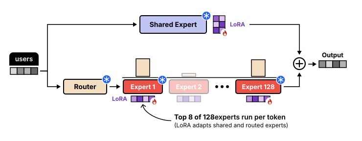
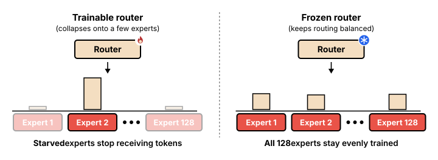
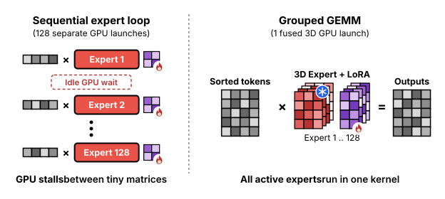
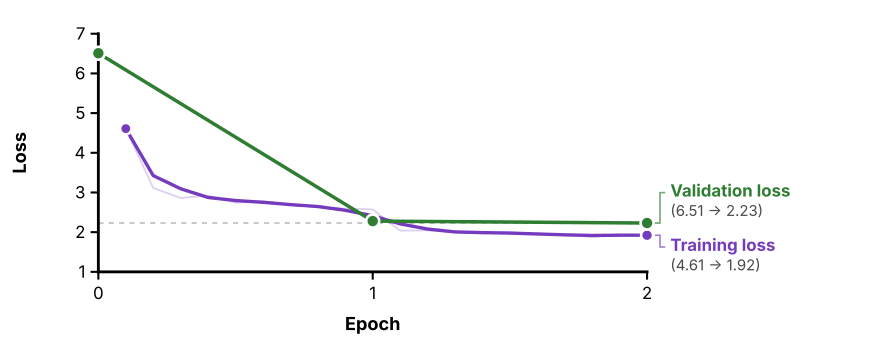

# MoE fine-tuning

Gemma 4 26B A4B is a Mixture-of-Experts (MoE) model with 26B total parameters, but it only activates 4B parameters per token.

Compared to dense models, training a Mixture-of-Experts model requires two important things to take into account. First, you must keep the router frozen so it does not send every token to the same few experts. Second, you should target the fused 3D expert tensors so all 128 routed experts receive LoRA updates.

---

## 1. Mixture of Experts

In a dense model like Gemma 4 12B or 31B, every token runs through the same feed-forward network. In Gemma 4 26B A4B, each layer splits that step into two parallel paths:

1. **Shared expert:** One always-on MLP that processes every token.
2. **Routed experts:** A bank of 128 smaller MLPs controlled by a router, which picks 8 experts for each token.



When you fine-tune 26B A4B with LoRA, you attach LoRA adapters to both the shared expert and the 128 routed experts. The router itself stays frozen.

---

## 2. Freezing the router

During pre-training across trillions of tokens, the router learns to spread work evenly across all 128 experts. Fine-tuning on a small dataset can disturb that routing:

1. **Training the router causes collapse:** If during training only a few experts are chosen often, then only those experts will continue to receive updates while the rest are not trained.
2. **4-bit quantization vs. 16-bit precision:** Because capacity is split across 128 smaller expert matrices, rounding all of them to 4-bit NF4 introduces minor activation shifts that change the router's choices in later layers.



---

## 3. Speeding up training with grouped GEMM

Gemma 4 26B A4B stores its 128 routed experts as fused 3D parameter tensors (`experts.gate_up_proj` and `experts.down_proj`) rather than 128 separate linear layers.

If a trainer loops over all 128 experts one by one, the GPU spends most of its time waiting. Grouped matrix multiplication (grouped GEMM) sorts tokens by expert ID and runs all active experts in a single GPU launch:



Batching all active experts into a single launch keeps the GPU busy instead of needing to wait between each of them.

---

## 4. Set up the environment

We fine-tune `google/gemma-4-26B-A4B-it` on the [google/smol](https://huggingface.co/datasets/google/smol) benchmark across five low-resource Indigenous and African languages (**Quechua**, **Guarani**, **Ewe**, **Akan**, and **Bambara**). Out of the box, 26B A4B translates high-resource languages fluently, but on low-resource languages it often leaves English phrases untranslated or falls into repetition loops. Adapting all 128 routed experts lets the model specialize across all five languages simultaneously on a single GPU.

First, we install the post-training and evaluation libraries:

```python { .notebook-cell }
# Install Hugging Face post-training, quantization, multimodal, and evaluation libraries
%pip install -q -U "transformers>=5.10.1" "trl>=0.16.0" "peft>=0.19.0" accelerate datasets bitsandbytes torchao
%pip install -q -U evaluate sacrebleu jiwer pillow soundfile librosa matplotlib tensorboard
```

If you plan to push your trained adapter to the Hugging Face Hub, log in with a write token:

```python { .notebook-cell }
from huggingface_hub import login

# Optional: uncomment to push your trained adapter to the Hugging Face Hub
# login()
```

---

## 5. Prepare the dataset

Next up is loading the data, namely [google/smol](https://huggingface.co/datasets/google/smol) which contains pairs of translations from five low-resource languages. We choose a subset, namely `smolsent` which contains sentences across various languages and allows us to choose the five low-resource languages. We will keep 4,000 training examples and 315 held-out test examples:

```python { .notebook-cell }
from datasets import concatenate_datasets, load_dataset

LANGUAGES = {
    "smolsent__en_qu": "Quechua",
    "smolsent__en_gn": "Guarani",
    "smolsent__en_ee": "Ewe",
    "smolsent__en_ak": "Akan",
    "smolsent__en_bm": "Bambara",
}


# Format each translation pair into prompt and completion turns
def to_chat(sample, lang):
    return {
        "prompt": [
            {
                "role": "system",
                "content": (
                    f"You are a fluent {lang} translator. Translate the user's "
                    f"English sentence into natural {lang}. Output only the translation."
                ),
            },
            {"role": "user", "content": sample["src"]},
        ],
        "completion": [{"role": "assistant", "content": sample["trg"]}],
    }


# Build non-overlapping training (rows 0..799) and held-out test (rows 800+) splits
train_parts, eval_parts, test_by_lang = [], [], {}
for subset, lang in LANGUAGES.items():
    ds = load_dataset("google/smol", subset, split="train")
    formatted = ds.map(lambda row: to_chat(row, lang), remove_columns=ds.column_names)
    train_parts.append(formatted.select(range(800)))
    eval_parts.append(formatted.select(range(800, len(formatted))))
    test_by_lang[lang] = formatted.select(range(800, 820))

train_dataset = concatenate_datasets(train_parts).shuffle(seed=3407)
eval_dataset = concatenate_datasets(eval_parts)
print(f"Train size: {len(train_dataset)} | Eval size: {len(eval_dataset)}")
```

```{ .no-copy .output }
Train size: 4000 | Eval size: 315
```

---

## 6. Load the model

To attach the low-rank adapters to all 128 experts, we load the model and set `target_parameters` to target `"experts.gate_up_proj"` and `"experts.down_proj"`. These represent the experts themselves and will make sure that the router remains frozen.

!!! tip "Running on a 24–40 GB GPU?"
    Standard `bitsandbytes` 4-bit quantization skips fused 3D expert tensors, so this `bfloat16` Hugging Face setup needs ~56 GB of VRAM (an 80 GB GPU, or multiple GPUs via [FSDP2](scaling.md)). To train `26B A4B` in ~21 GB on a single 24–40 GB GPU, swap this loading cell with `FastVisionModel(..., load_in_4bit=True)` from [Fine-tuning with Unsloth](unsloth.md) and keep the rest of the notebook unchanged.

```python { .notebook-cell }
import torch
from transformers import AutoModelForMultimodalLM, AutoProcessor
from peft import LoraConfig, get_peft_model

model_id = "google/gemma-4-26B-A4B-it"

# Load the 26B A4B model in bfloat16 and its processor
model = AutoModelForMultimodalLM.from_pretrained(
    model_id,
    dtype=torch.bfloat16,
    device_map="auto",
)
processor = AutoProcessor.from_pretrained(model_id)

# Attach LoRA to attention, the shared expert, and all 128 routed 3D expert tensors
peft_config = LoraConfig(
    r=16,
    lora_alpha=32,
    lora_dropout=0.0,
    bias="none",
    target_modules=[
        "q_proj",
        "k_proj",
        "v_proj",
        "o_proj",
        "gate_proj",
        "up_proj",
        "down_proj",
    ],
    target_parameters=[
        "experts.gate_up_proj",
        "experts.down_proj",
    ],
    exclude_modules=r"(model\.(vision_tower|audio_tower)\..*|.*router.*)",
    task_type="CAUSAL_LM",
)
model = get_peft_model(model, peft_config)
```

We can verify that the router (`router.proj`) is frozen while the attention and expert adapters are trainable:

```python { .notebook-cell }
# Confirm that 0 router parameters are marked trainable
trainable_params = sum(p.numel() for p in model.parameters() if p.requires_grad)
all_params = sum(p.numel() for p in model.parameters())
router_trainable = [n for n, p in model.named_parameters() if p.requires_grad and "router" in n]

print(f"Trainable params: {trainable_params:,} / {all_params:,} ({100 * trainable_params / all_params:.2f}%)")
print(f"Trainable router parameters (must be 0): {len(router_trainable)}")
```

```{ .no-copy .output }
Trainable params: 494,376,960 / 26,300,310,832 (1.88%)
Trainable router parameters (must be 0): 0
```

As you can see, there is a small portion of the model's parameters that are trainable whereas none of the router parameters can be trained.

---

## 7. Evaluate the base model

Before training, we create a baseline by evaluating across 100 held-out test sentences (20 per language) using `evaluate.load("chrf")` (character n-gram F-score, the standard metric for morphologically rich low-resource languages). Because LoRA initializes its output matrix `B` to zero, running inference before `trainer.train()` evaluates the unmodified base model directly:

```python { .notebook-cell }
import evaluate

# Load the standard chrF translation metric
chrf = evaluate.load("chrf")
stop_ids = [processor.tokenizer.eos_token_id, processor.tokenizer.convert_tokens_to_ids("<turn|>")]


# Evaluate corpus chrF across 20 unseen test sentences per language
def evaluate_translations(tag):
    model.eval()
    orig_padding = processor.tokenizer.padding_side
    processor.tokenizer.padding_side = "left"
    all_preds, all_refs, scores = [], [], {}

    for lang, subset in test_by_lang.items():
        prompts = [
            processor.apply_chat_template(p, tokenize=False, add_generation_prompt=True)
            for p in subset["prompt"]
        ]
        refs = [c[0]["content"] for c in subset["completion"]]
        inputs = processor(text=prompts, return_tensors="pt", padding=True).to(model.device)
        with torch.no_grad():
            outputs = model.generate(
                **inputs, max_new_tokens=128, do_sample=False, eos_token_id=stop_ids, use_cache=True
            )

        prompt_len = inputs["input_ids"].shape[1]
        preds = [
            processor.decode(seq[prompt_len:], skip_special_tokens=True).split("\n")[0].strip()
            for seq in outputs
        ]
        scores[lang] = chrf.compute(predictions=preds, references=refs)["score"]
        all_preds.extend(preds)
        all_refs.extend(refs)
        print(f"  [{tag}] {lang:10s} chrF = {scores[lang]:5.2f}")

    processor.tokenizer.padding_side = orig_padding
    overall = chrf.compute(predictions=all_preds, references=all_refs)["score"]
    print(f"  [{tag}] OVERALL    chrF = {overall:5.2f}")
    return overall, scores


base_overall, base_lang = evaluate_translations("BEFORE")
```

```{ .no-copy .output }
  [BEFORE] Quechua    chrF = 28.56
  [BEFORE] Guarani    chrF = 24.23
  [BEFORE] Ewe        chrF = 19.09
  [BEFORE] Akan       chrF = 26.01
  [BEFORE] Bambara    chrF = 12.00
  [BEFORE] OVERALL    chrF = 22.02
```

This is our baseline. Let's see if we can improve it!

---

## 8. Train the model

We now switch the model back to training mode and train for 2 epochs (`500` optimizer steps at an effective batch size of `16`):

```python { .notebook-cell }
from trl import SFTConfig, SFTTrainer

model.train()

# Set the configuration for the trainer
args = SFTConfig(
    output_dir="gemma-4-26b-a4b-smol-lora",
    max_length=512,
    num_train_epochs=2,
    per_device_train_batch_size=4,
    gradient_accumulation_steps=4,
    gradient_checkpointing=True,
    gradient_checkpointing_kwargs={"use_reentrant": False},
    optim="adamw_torch_8bit",
    learning_rate=2e-4,
    warmup_steps=0.05,
    lr_scheduler_type="cosine",
    weight_decay=0.01,
    max_grad_norm=1.0,
    bf16=True,
    logging_steps=25,
    eval_strategy="epoch",
    eval_on_start=True,
    save_strategy="epoch",
    report_to="tensorboard",
    seed=3407,
)

# Define and run the trainer
trainer = SFTTrainer(
    model=model,
    args=args,
    train_dataset=train_dataset,
    eval_dataset=eval_dataset,
    processing_class=processor.tokenizer,
)

trainer.train()
trainer.save_model()
```

```{ .no-copy .output }
[500/500 29:55, Epoch 2/2]

| Epoch | Training Loss | Validation Loss |
|---|---|---|
| 0 | — | 6.5089 |
| 1 | 2.5725 | 2.2794 |
| 2 | 1.9231 | 2.2304 |
```

<!-- notebook:skip-start -->
??? info "Inspect the training curve"
    
<!-- notebook:skip-end -->

---

## 9. Evaluate the fine-tuned model

After training, we can re-run `evaluate_translations` on the same 100 unseen test sentences to measure how much adapting the shared and 128 routed experts improved translation quality across all five languages:

```python { .notebook-cell }
# Re-evaluate chrF across the 100 unseen test sentences after fine-tuning
after_overall, after_lang = evaluate_translations("AFTER")

print("\nSummary (chrF):")
for lang in LANGUAGES.values():
    b, a = base_lang[lang], after_lang[lang]
    print(f"  {lang:10s}: {b:5.2f} -> {a:5.2f} ({a - b:+5.2f})")
print(f"  {'OVERALL':10s}: {base_overall:5.2f} -> {after_overall:5.2f} ({after_overall - base_overall:+5.2f})")
```

```{ .no-copy .output }
  [AFTER] Quechua    chrF = 36.95
  [AFTER] Guarani    chrF = 35.55
  [AFTER] Ewe        chrF = 27.98
  [AFTER] Akan       chrF = 31.16
  [AFTER] Bambara    chrF = 15.72
  [AFTER] OVERALL    chrF = 29.60

Summary (chrF):
  Quechua   : 28.56 -> 36.95 (+8.39)
  Guarani   : 24.23 -> 35.55 (+11.32)
  Ewe       : 19.09 -> 27.98 (+8.89)
  Akan      : 26.01 -> 31.16 (+5.15)
  Bambara   : 12.00 -> 15.72 (+3.73)
  OVERALL   : 22.02 -> 29.60 (+7.57)
```

We get a decent quality boost all around, with a `+7.57` `chrF` overall!


After evaluation, you can merge the adapter into the model through `.merge_and_unload`:

<!-- notebook:skip-start -->
```python
# Merge the trained MoE LoRA adapter directly into the bfloat16 model and save
merged_model = model.merge_and_unload()
merged_model.save_pretrained("gemma-4-26b-a4b-smol-merged", safe_serialization=True, max_shard_size="4GB")
AutoProcessor.from_pretrained(model_id).save_pretrained("gemma-4-26b-a4b-smol-merged")
```
<!-- notebook:skip-end -->

---

## What's next

<div class="card-grid">
<a class="card" href="continued-pretraining.md">
  <span class="card-icon">{{ icon('lucide/book-open') }}</span>
  <div class="card-title">Continued pre-training</div>
  <p class="card-desc">Teach Gemma 4 new domain text and languages using sequence packing and subword initialization.</p>
</a>
<a class="card" href="vision-qlora.md">
  <span class="card-icon">{{ icon('lucide/eye') }}</span>
  <div class="card-title">Vision fine-tuning</div>
  <p class="card-desc">Fine-tune 26B A4B on custom document, chart, and visual question answering datasets.</p>
</a>
<a class="card" href="reinforcement-learning.md">
  <span class="card-icon">{{ icon('lucide/brain') }}</span>
  <div class="card-title">Verifiable rewards</div>
  <p class="card-desc">Train 26B A4B's thinking channel on math, logic, and SQL tasks with verifiable reward functions.</p>
</a>
<a class="card" href="scaling.md">
  <span class="card-icon">{{ icon('lucide/boxes') }}</span>
  <div class="card-title">Scaling</div>
  <p class="card-desc">Shard 26B A4B across multiple GPUs with FSDP2 and recover 4-bit accuracy with TorchAO QAT.</p>
</a>
</div>

--8<-- "glossary.md"
