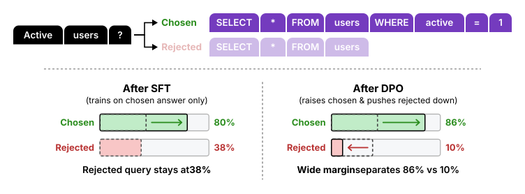
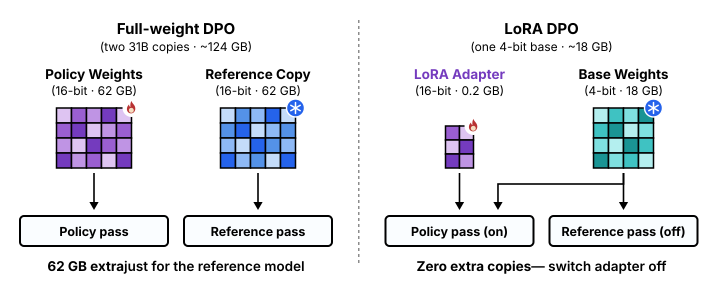
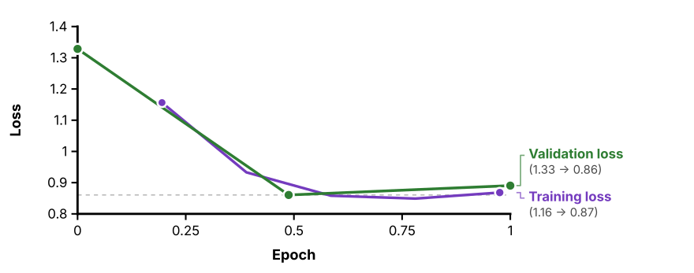

# Preference optimization

Supervised fine-tuning (SFT) shows Gemma 4 what a good answer looks like but not what a bad answer looks like. As a result, training with SFT can result in overfitting on the task.

Preference optimization trains on pairs instead. For every prompt, you give the model one answer you prefer (chosen) and one you do not (rejected). This guide shows how a reinforcement learning technique called Direct Preference Optimization (DPO) learns from those pairs, how LoRA avoids loading a second copy of the model, and how to run DPO end to end with Hugging Face TRL.

---

## 1. Learning from chosen and rejected answers

In SFT, each training example is a prompt with one target answer. The loss pushes that answer up. However, the model never sees any answers that you want to the model to stop generating.

Direct Preference Optimization (DPO) trains on a prompt with two answers. Take the SQL assistant: for the prompt "Active users?", the chosen query filters on active users, while the rejected query forgets the filter and returns every user. 


During training, the model learns to increase the likelihood of accepted answers and decreases the likelihood of rejected answers:



DPO measures every update against a frozen copy of the starting model, called the reference model, to make sure the model doesn't drift too far from it. We assume that the original model is a great model that we want to improve, so it is important that it does not forget things it already did well. The beta regularization setting controls this. A small value gives the model more room to change whereas a higher value keeps it closer to the original. Because the loss works directly on your pairs, DPO needs no separate reward model and no reinforcement learning loop, which makes it much simpler than classic Reinforcement Learning from Human Feedback (RLHF; [Rafailov et al., 2023](https://arxiv.org/abs/2305.18290)).

---

## 2. Sharing the reference model with LoRA

Every DPO step scores the chosen and rejected answers twice. Once with the model you are training and once with the reference model. In full fine-tuning, those are two separate copies of Gemma 4 in GPU memory. For Gemma 4 31B in bfloat16, the second copy alone takes about 62 GB.

With LoRA, the reference model comes for free! The base weights never change during training, so switching the adapter off gives you back the original model:



Note how **LoRA DPO** holds one frozen base and a small adapter, with no second copy. For every batch, the trainer runs the model once with the adapter on (the trainable model) and once with the adapter off (the reference model).

---

## 3. Choosing between DPO, ORPO, and KTO

Hugging Face TRL supports three preference methods, each with their own benefits. Pick the one that matches the feedback you have:

| Method | Data you need | Reference pass | Best for |
| :--- | :--- | :--- | :--- |
| **DPO** (`DPOTrainer`) | Prompt, chosen, and rejected answers | Yes, adapter off with LoRA | Tone, length, and safety after SFT |
| **ORPO** (`ORPOTrainer`) | Prompt, chosen, and rejected answers | No | SFT and preference alignment in one run |
| **KTO** (`KTOTrainer`) | Prompt, completion, and a binary label | Yes, adapter off with LoRA | Thumbs-up and thumbs-down feedback from users |

Arguably, the most common method is DPO, so we will be focusing on that one. The following settings matter most for using DPO on Gemma 4:

- **Learning rate**: Use `5e-6` to `5e-5` for standard LoRA DPO on large on-policy datasets (`5e-5` to `1e-4` with anchored `apo_zero` loss on sub-1,000-pair runs), and `5e-7` for full fine-tuning. Full-weight SFT rates on unanchored DPO quickly push the model too far from the reference.
- **Epochs**: One epoch is usually enough. Repeating the same preference pairs for a second epoch causes validation loss to climb and reward accuracy to drop as the adapter memorizes surface shortcuts.
- **Length desensitization (`ld_alpha`) and beta**: Keep `beta=0.1` as your starting KL anchor. When chosen and rejected answers differ sharply in length (for example, conciseness alignment on off-policy pairs), set `ld_alpha=0.1` so token count alone cannot dominate the summed log-ratio.

!!! tip "Running DPO after a LoRA SFT stage"
    When `DPOTrainer` trains with a single LoRA adapter (`ref_model=None`), it computes reference log-probabilities by temporarily disabling the active LoRA adapter. If you already trained a domain LoRA adapter during SFT, **merge that SFT adapter into the base checkpoint first** (`model.merge_and_unload()`) and attach a fresh LoRA adapter for DPO.

---

## 4. Set up the environment

We start by installing the post-training and evaluation libraries:

```python { .notebook-cell }
# Install Hugging Face post-training, quantization, multimodal, and evaluation libraries
%pip install -q -U "transformers>=5.10.1" "trl>=0.16.0" "peft>=0.19.0" accelerate datasets bitsandbytes torchao
%pip install -q -U evaluate sacrebleu jiwer pillow soundfile librosa matplotlib tensorboard
```

If you plan to push your aligned adapter to the Hugging Face Hub, log in with a write token:

```python { .notebook-cell }
from huggingface_hub import login

# Optional: uncomment to push your aligned adapter to the Hugging Face Hub
# login()
```

---

## 5. Prepare the dataset

For this example, we are going to be using human-rated conciseness pairs from [`nvidia/HelpSteer2`](https://huggingface.co/datasets/nvidia/HelpSteer2). It is a dataset that aligns models to become more helpful, factually correct, and coherent. Although this is not needed for the various Gemma models, it shows how you can steer a style preference—such as reducing the verbosity of the output—without hurting quality. This dataset has scores on `helpfulness`, `correctness`, and `verbosity`.

To prepare our chosen/rejected pairs, we keep only answers that are accurate and helpful (`>= 3`), then pair the concise answer (`chosen`) against the overly verbose one (`rejected`):

```python { .notebook-cell }
from collections import defaultdict
from datasets import Dataset, load_dataset

# Load HelpSteer2 and pair accurate concise answers against overly verbose ones
raw_dataset = load_dataset("nvidia/HelpSteer2")


def parse_prompt(text):
    parts = text.split("\n<extra_id_1>")
    messages = [{"role": "user", "content": parts[0].strip()}]
    for part in parts[1:]:
        role_line, content = part.split("\n", 1)
        role = "assistant" if role_line.strip().lower() == "assistant" else "user"
        messages.append({"role": role, "content": content.strip()})
    return messages


def build_concise_pairs(split_data):
    grouped = defaultdict(list)
    for row in split_data:
        grouped[row["prompt"]].append(row)

    pairs = []
    for prompt, rows in grouped.items():
        if len(rows) != 2:
            continue
        a, b = rows
        if min(a["correctness"], b["correctness"]) < 3 or min(a["helpfulness"], b["helpfulness"]) < 3:
            continue
        chosen, rejected = (a, b) if a["verbosity"] < b["verbosity"] else (b, a)
        chosen_words = len(chosen["response"].split())
        rejected_words = len(rejected["response"].split())
        if chosen["verbosity"] <= 1 and rejected["verbosity"] >= 2 and rejected_words > chosen_words:
            pairs.append(
                {
                    "prompt": parse_prompt(prompt),
                    "chosen": [{"role": "assistant", "content": chosen["response"]}],
                    "rejected": [{"role": "assistant", "content": rejected["response"]}],
                }
            )
    return Dataset.from_list(pairs)


# Build the training and validation preference splits
train_dataset = build_concise_pairs(raw_dataset["train"])
eval_dataset = build_concise_pairs(raw_dataset["validation"])

print(f"Train pairs: {len(train_dataset)} | Validation pairs: {len(eval_dataset)}")
print("Prompt:  ", train_dataset[0]["prompt"][-1]["content"][:120])
print(f"Chosen   ({len(train_dataset[0]['chosen'][0]['content'].split())} words):", train_dataset[0]["chosen"][0]["content"][:160])
print(f"Rejected ({len(train_dataset[0]['rejected'][0]['content'].split())} words):", train_dataset[0]["rejected"][0]["content"][:160])
```

```{ .no-copy .output }
Train pairs: 819 | Validation pairs: 47
Prompt:   c#
Chosen   (109 words): C# is a high-level, object-oriented programming language developed by Microsoft as part of its .NET initiative. It was created as a modern alternative to Java a
Rejected (250 words): C# (pronounced "C sharp") is a modern, object-oriented programming language developed by Microsoft. It is widely used for building various types of applications
```

---

## 6. Load the model

Now that we have created the dataset, let's load in the model to fine-tune:

```python { .notebook-cell .model-swap }
import torch
from transformers import AutoTokenizer, AutoModelForMultimodalLM, BitsAndBytesConfig
from peft import LoraConfig, PeftModel, prepare_model_for_kbit_training

model_id = "google/gemma-4-E2B-it"

# Configure 4-bit NF4 quantization
bnb_config = BitsAndBytesConfig(
    load_in_4bit=True,
    bnb_4bit_use_double_quant=True,
    bnb_4bit_quant_type="nf4",
    bnb_4bit_compute_dtype=torch.bfloat16,
    bnb_4bit_quant_storage=torch.bfloat16,
)

# Load the base model and tokenizer
model = AutoModelForMultimodalLM.from_pretrained(
    model_id,
    dtype=torch.bfloat16,
    device_map="auto",
    quantization_config=bnb_config,
)
tokenizer = AutoTokenizer.from_pretrained(model_id)
```

---

## 7. Evaluate the base model

Next, we create a helper function that generates responses so we can check how verbose the unmodified model is across our held-out validation prompts:

```python { .notebook-cell }
# Helper to generate deterministic responses across validation prompts
def generate_responses(eval_model, prompts, batch_size=16):
    eval_model.eval()
    orig_padding = tokenizer.padding_side
    tokenizer.padding_side = "left"
    stop_ids = [tokenizer.eos_token_id, tokenizer.convert_tokens_to_ids("<turn|>")]
    responses = []
    try:
        for i in range(0, len(prompts), batch_size):
            batch = prompts[i : i + batch_size]
            rendered = [
                tokenizer.apply_chat_template(p, tokenize=False, add_generation_prompt=True)
                for p in batch
            ]
            inputs = tokenizer(rendered, return_tensors="pt", padding=True).to(eval_model.device)
            prompt_len = inputs["input_ids"].shape[1]
            with torch.no_grad():
                outputs = eval_model.generate(
                    **inputs,
                    max_new_tokens=512,
                    do_sample=False,
                    eos_token_id=stop_ids,
                )
            for seq in outputs:
                responses.append(tokenizer.decode(seq[prompt_len:], skip_special_tokens=True).strip())
    finally:
        tokenizer.padding_side = orig_padding
    return responses


# Measure baseline response length before training
eval_prompts = [row["prompt"] for row in eval_dataset]
before_responses = generate_responses(model, eval_prompts)
before_words = [len(r.split()) for r in before_responses]
print(f"Baseline mean length across {len(before_words)} validation prompts: {sum(before_words)/len(before_words):.1f} words")
```

```{ .no-copy .output }
Baseline mean length across 47 validation prompts: 254.8 words
```

---

## 8. Train the model

To train the model, we start by defining the `LoraConfig` as we did in previous fine-tuning guides:

```python { .notebook-cell }
# Prepare the 4-bit model and configure LoRA adapters on the seven decoder projections
model = prepare_model_for_kbit_training(model)

peft_config = LoraConfig(
    r=16,
    lora_alpha=32,
    lora_dropout=0.0,
    bias="none",
    target_modules=[
        "q_proj",
        "k_proj",
        "v_proj",
        "o_proj",
        "gate_proj",
        "up_proj",
        "down_proj",
    ],
    exclude_modules=r"model\.(vision_tower|audio_tower)\..*",
    task_type="CAUSAL_LM",
)
```

For the training settings, we use `DPOConfig` to define the parameters. Much is similar to regular SFT with several differences to point out:

- `ld_alpha=0.1` down-weights tokens past the shared `min(|chosen|, |rejected|)` length so long rejected answers are not penalized purely for having more tokens.
- `loss_type=["apo_zero", "sft"]` with `loss_weights=[1.0, 0.1]` uses Anchored Preference Optimization (`apo_zero`) to push `rewards/chosen` above `0` and `rewards/rejected` below `0`, paired with a light `0.1` SFT weight so the model learns to emit `<turn|>` cleanly at the end of concise answers.


```python { .notebook-cell }
from trl import DPOConfig, DPOTrainer

# Set the configuration for the DPO trainer
dpo_args = DPOConfig(
    output_dir="gemma-4-dpo-concise",
    beta=0.1,                           # KL regularization strength against the reference model
    ld_alpha=0.1,                       # Length-desensitized DPO for asymmetric response lengths
    loss_type=["apo_zero", "sft"],      # Anchor chosen > 0, rejected < 0, plus light SFT on <turn|>
    loss_weights=[1.0, 0.1],
    learning_rate=1e-4,
    lr_scheduler_type="cosine",
    warmup_steps=0.10,                  # Values below 1 specify the warmup ratio
    num_train_epochs=1,                 # One epoch avoids memorizing off-policy pairs
    per_device_train_batch_size=2,
    per_device_eval_batch_size=2,
    gradient_accumulation_steps=4,
    max_length=1024,
    optim="adamw_bnb_8bit",
    weight_decay=0.01,
    max_grad_norm=1.0,
    bf16=True,
    logging_steps=20,
    eval_strategy="steps",
    eval_steps=50,
    eval_on_start=True,
    save_strategy="epoch",
    report_to="tensorboard",
)

# Define and run the DPO trainer
trainer = DPOTrainer(
    model=model,
    ref_model=None,                     # With peft_config, adapter-off base weights act as reference
    args=dpo_args,
    train_dataset=train_dataset,
    eval_dataset=eval_dataset,
    peft_config=peft_config,
    processing_class=tokenizer,
)

trainer.train()
trainer.save_model()
```

```{ .no-copy .output }
[103/103 08:47, Epoch 1/1]

| Step | Training Loss | Validation Loss | Rewards/chosen | Rewards/rejected | Rewards/accuracies | Rewards/margins |
|---|---|---|---|---|---|---|
| 0 (eval) | — | 1.3284 | 0.0000 | 0.0000 | 0.0000 | 0.0000 |
| 20 | 1.1564 | — | 0.2039 | -0.7938 | 0.8000 | 0.9976 |
| 40 | 0.9330 | — | 1.0321 | -2.7632 | 0.9313 | 3.7953 |
| 50 (eval) | — | 0.8606 | 1.6859 | -4.3396 | 0.9375 | 6.0255 |
| 60 | 0.8582 | — | 2.0880 | -3.0744 | 0.9500 | 5.1624 |
| 80 | 0.8490 | — | 3.0838 | -1.9389 | 0.9062 | 5.0226 |
| 100 | 0.8683 | 0.8920 | 4.3522 | -1.1215 | 0.9375 | 5.4737 |
| 103 (final eval) | — | 0.8905 | 4.3614 | -1.1049 | 0.9375 | 5.4662 |
```

<!-- notebook:skip-start -->
??? info "Inspect the training curve"
    
<!-- notebook:skip-end -->


Training all 819 pairs finishes in about 9 minutes on an A100 GPU. For larger datasets, scale `gradient_accumulation_steps` to reach 16 to 32 pairs per step, as listed in [Best practices](best-practices.md).

### How to read the DPO logs

DPO calls its log-probability shifts "rewards". Each reward measures how much more (above `0`) or less (below `0`) likely the trained adapter makes an answer **compared with the frozen starting model**, scaled by `beta`.

Because these numbers measure *change relative to the starting model* rather than absolute answer quality, every column starts at `0.0000` at step 0 (when the untrained adapter is still identical to the reference model—not because the base model gave bad answers!). As training progresses:

- **`rewards/chosen`** and **`rewards/rejected`** show how much more likely the concise answer became (and how much less likely the verbose answer became) relative to the starting checkpoint.
- **`rewards/margins`** is the gap between those two shifts (`chosen - rejected`).
- **`rewards/accuracies`** is the share of pairs where the adapter shifted toward the concise answer more than the verbose one.

<!-- notebook:skip-start -->
??? tip "Alternative: one-stage alignment with ORPOTrainer"
    If you have preference pairs but no SFT checkpoint yet, ORPO (Odds Ratio Preference Optimization) runs SFT on the chosen answers and pushes down the rejected answers in the same pass without a reference model:

    ```python
    from trl.experimental.orpo import ORPOConfig, ORPOTrainer

    orpo_args = ORPOConfig(
        output_dir="gemma-4-orpo",
        beta=0.1,                       # Weight of the odds-ratio preference penalty
        learning_rate=8e-6,
        lr_scheduler_type="cosine",
        warmup_steps=0.10,
        num_train_epochs=1,
        per_device_train_batch_size=1,
        gradient_accumulation_steps=8,
        max_length=1024,
        optim="adamw_bnb_8bit",
        bf16=True,
    )

    orpo_trainer = ORPOTrainer(
        model=model,
        args=orpo_args,
        train_dataset=train_dataset,
        eval_dataset=eval_dataset,
        peft_config=peft_config,
        processing_class=tokenizer,
    )
    orpo_trainer.train()
    ```
<!-- notebook:skip-end -->

---

## 9. Evaluate the fine-tuned model

We free up the GPU memory, load in the trained model, and compare it against the baseline:

```python { .notebook-cell }
# Free trainer memory and reload the saved adapter onto a fresh 4-bit base model
del trainer, model
torch.cuda.empty_cache()

base_model = AutoModelForMultimodalLM.from_pretrained(
    model_id,
    dtype=torch.bfloat16,
    device_map="auto",
    quantization_config=bnb_config,
)
aligned_model = PeftModel.from_pretrained(base_model, dpo_args.output_dir)

# Compare response lengths across the 47 held-out validation prompts
after_responses = generate_responses(aligned_model, eval_prompts)
after_words = [len(r.split()) for r in after_responses]
shorter_count = sum(1 for bw, aw in zip(before_words, after_words) if aw < bw)

mean_before = sum(before_words) / len(before_words)
mean_after = sum(after_words) / len(after_words)
pct_change = (mean_after - mean_before) / mean_before * 100

print(f"Before DPO mean length: {mean_before:.1f} words")
print(f"After DPO  mean length: {mean_after:.1f} words ({pct_change:.1f}%)")
print(f"Shorter responses on:   {shorter_count}/{len(before_words)} held-out validation prompts ({shorter_count / len(before_words) * 100:.1f}%)")

sample_idx = 5
print("\nPrompt:", eval_prompts[sample_idx][0]["content"])
print(f"\n--- Before DPO ({before_words[sample_idx]} words) ---")
print(before_responses[sample_idx][:489] + "\n...")
print(f"\n--- After DPO ({after_words[sample_idx]} words) ---")
print(after_responses[sample_idx])
```

```{ .no-copy .output }
Before DPO mean length: 254.8 words
After DPO  mean length: 198.3 words (-22.2%)
Shorter responses on:   41/47 held-out validation prompts (87.2%)

Prompt: do you know what Discord is?

--- Before DPO (348 words) ---
Yes, I do know what Discord is.

**Discord is a free, voice, video, and text chat application that is primarily used for community building and communication.**

Here's a breakdown of what it is and what it's used for:

### Key Features of Discord:

1. **Servers (The Core Concept):** Discord is organized around **servers**. A server is a private community or group created by a host. Members join servers based on shared interests (gaming, hobbies, study groups, specific fandoms, etc.).
...

--- After DPO (28 words) ---
Yes, I do. **Discord** is a very popular **free voice, video, and text chat app** that is primarily used by communities, gamers, and groups of people to communicate.
```

The results show that DPO steered the model toward noticeably shorter, more direct replies across the held-out prompts while keeping answers clear and accurate:

| Metric | Before DPO | After DPO | Change |
| :--- | :--- | :--- | :--- |
| **Mean response length** | 254.8 words | **198.3 words** | **-22.2%** |
| **Validation prompts shortened** | — | **41 / 47** | **87.2%** |

---

## What's next

<div class="card-grid">
<a class="card" href="reinforcement-learning.md">
  <span class="card-icon">{{ icon('lucide/brain') }}</span>
  <div class="card-title">Verifiable rewards</div>
  <p class="card-desc">Teach Gemma 4 to reason with GRPO and rewards that your code can check.</p>
</a>
<a class="card" href="qlora.md">
  <span class="card-icon">{{ icon('lucide/zap') }}</span>
  <div class="card-title">(Q)LoRA</div>
  <p class="card-desc">Run the supervised fine-tuning step that usually comes before DPO.</p>
</a>
<a class="card" href="datasets-formatting.md">
  <span class="card-icon">{{ icon('lucide/braces') }}</span>
  <div class="card-title">Dataset formatting</div>
  <p class="card-desc">Format chat turns and mask prompt tokens before you train.</p>
</a>
<a class="card" href="export.md">
  <span class="card-icon">{{ icon('lucide/rocket') }}</span>
  <div class="card-title">Export</div>
  <p class="card-desc">Merge your aligned adapter and export it to vLLM, GGUF, or LiteRT-LM.</p>
</a>
</div>

--8<-- "glossary.md"
