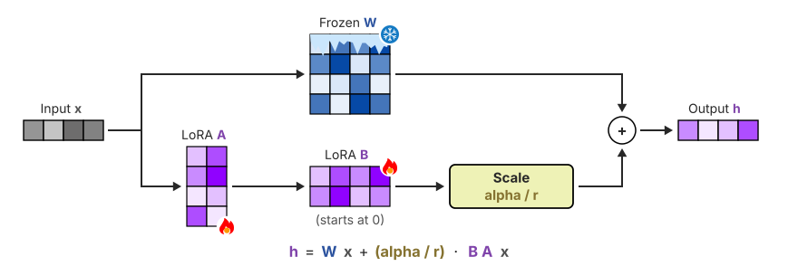
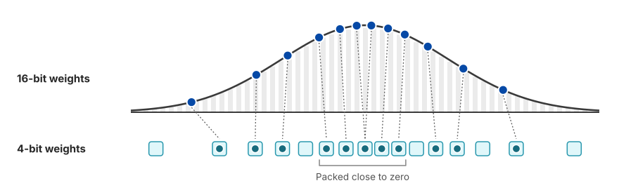
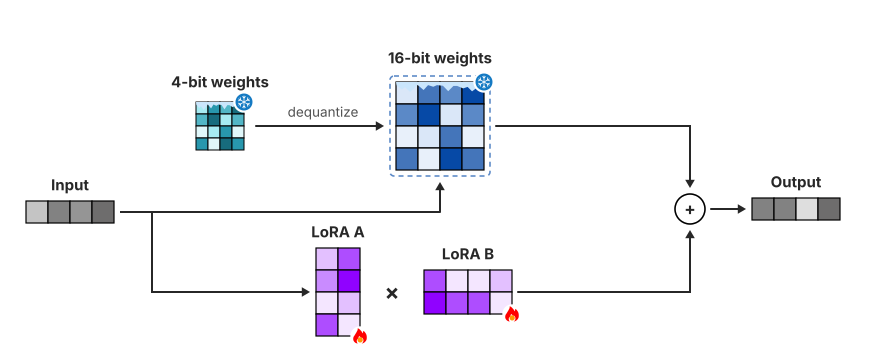
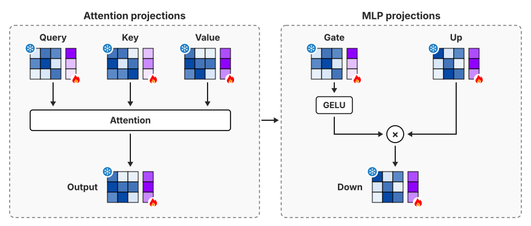
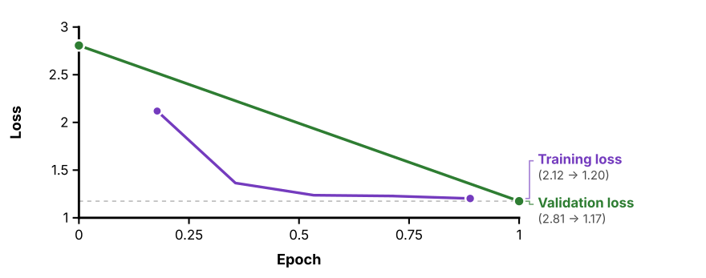
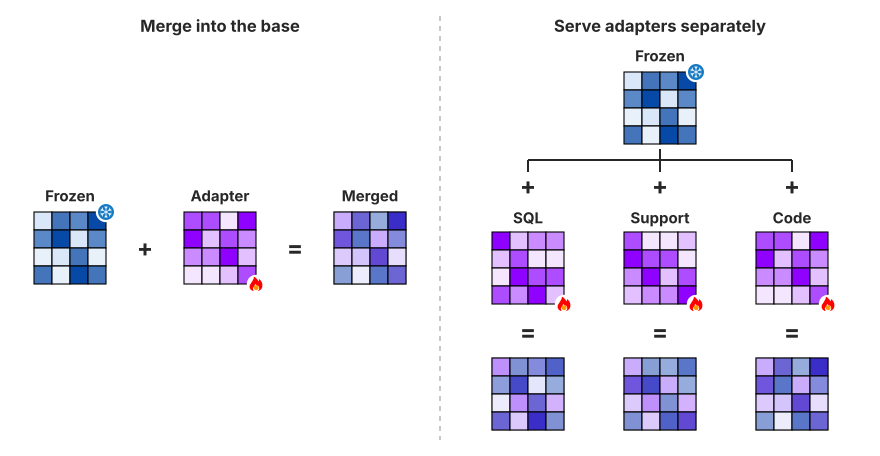

# (Q)LoRA

LoRA is the easiest way to customize Gemma 4. Instead of updating billions of weights, you freeze the model and train a small adapter next to each layer.

QLoRA goes one step further and stores the frozen model in 4 bits. That lets you fine-tune much larger models on a single GPU.

In this guide, we first look at how LoRA and QLoRA work and which layers to adapt. Then we fine-tune Gemma 4 to reason in a chosen language before answering in English.

---

## 1. How LoRA works

When you fine-tune with LoRA, you freeze the original weight matrix <span style="color: #2B529E; font-weight: 700;">W</span> and attach two small adapter matrices (<span style="color: #7F43AA; font-weight: 700;">A</span> and <span style="color: #7F43AA; font-weight: 700;">B</span>) beside it. Only these adapters receive updates, so you skip the gradients and optimizer states for billions of frozen weights.

Think of the frozen matrix <span style="color: #2B529E; font-weight: 700;">W</span> as a main highway carrying general language knowledge, and the LoRA adapter as a narrow side lane that learns only the adjustments for your task. Matrix <span style="color: #7F43AA; font-weight: 700;">A</span> compresses the input down to a small rank <span style="color: #857230; font-weight: 700;">r</span> (such as 16 or 32), and matrix <span style="color: #7F43AA; font-weight: 700;">B</span> projects it back up to the output size:



As shown in the equation at the bottom of the figure, the adapter output is multiplied by <span style="color: #857230; font-weight: 700;">alpha / r</span> before being added to the frozen layer. Two settings control this:

- **<span style="color: #857230; font-weight: 700;">r</span>** *(rank)*: The size of the adapter. Higher ranks add more trainable parameters and require more compute to train.
- **<span style="color: #857230; font-weight: 700;">alpha</span>:** Controls how strongly the adapter output is weighted. Setting <span style="color: #857230; font-weight: 700;">alpha</span> equal to <span style="color: #857230; font-weight: 700;">r</span> (a 1x multiplier) or twice <span style="color: #857230; font-weight: 700;">r</span> (a 2x multiplier) works well across all Gemma 4 models.

| Task type | Rank | Alpha | Notes |
| :--- | :--- | :--- | :--- |
| Formatting, tone, classification, JSON or SQL | `16` | `16` or `32` | Fast, low VRAM, low risk of overfitting. |
| Domain, multi-step reasoning, tool use | `32` | `32` or `64` | Good default across all Gemma 4 models. |
| Large domain shift or continued pre-training | `64` to `128` | `64` to `128` | Extra adapter capacity for new domains or languages. |

---

## 2. From LoRA to QLoRA

There is a catch with standard LoRA, however. The frozen weights still sit in GPU memory in 16-bit precision (bfloat16), which takes 2 bytes per weight. For Gemma 4 31B, that is about 60 GB before training even starts.

QLoRA ([Dettmers et al., 2023](https://arxiv.org/abs/2305.14314)) shrinks that frozen copy by storing every weight in just 4 bits, using a data type called NF4 (4-bit NormalFloat).

### How NF4 stores a weight in 4 bits

Four bits can only represent 16 different values. The NF4 format uses those 16 different values and matches them to how the trained weights were spread out. Generally, most are close to zero with a couple of relative outliers:



NF4 works on blocks of 64 weights that each get their own scale, so one large weight cannot stretch the values of a whole matrix. QLoRA also compresses those scales with a second round of quantization (double quantization), which saves roughly another 1.5 GB on 31B.

### How QLoRA trains with 4-bit weights

However, there is a problem. The matrix multiplications still run in 16-bit precision (bfloat16), which can be quite costly during training. QLoRA therefore dequantizes one layer at a time into temporary 16-bit weights, uses them for that layer, and frees them again:



Both the stored 4-bit weights and the unpacked 16-bit weights stay frozen. Only LoRA A and LoRA B receive updates, just like in regular LoRA.

In short, QLoRA trades some speed for a lot of memory:

| | LoRA | QLoRA |
| :--- | :--- | :--- |
| Frozen weights | bfloat16, 2 bytes each | NF4, about 0.5 bytes each |
| Adapters | bfloat16 | bfloat16 |
| Speed | Faster | Slower, since every layer is dequantized on each step |
| Use it when | The 16-bit model fits in memory | GPU memory is the bottleneck |

!!! note "Fine-tuning 26B A4B"
    The 26B A4B Mixture-of-Experts model stores its 128 routed experts as fused 3D parameter tensors and uses a learned router that must stay frozen during fine-tuning. [MoE fine-tuning](moe-finetune.md) walks through both 4-bit QLoRA (~21 GB VRAM) and 16-bit LoRA (~56 GB VRAM) setups with grouped GEMM.

---

## 3. Targeting layers

Every Gemma 4 decoder layer contains seven linear projections: four in attention and three in the feed-forward MLP block:



These projections work as follows:

1. **Attention projections:** The Query, Key, and Value projections feed the attention step, and the Output projection maps its result back to the residual stream.
2. **MLP projections:** The Gate projection goes through a GELU activation and is multiplied with the Up projection, then the Down projection maps the result back down.

Each frozen projection gets its own trainable LoRA adapter. Early LoRA recipes only adapted the Query and Value projections. The QLoRA paper found that adapting all seven linear projections is needed to match full 16-bit fine-tuning, and the extra adapters only add a small number of trainable weights.

---

## 4. Set up the environment

Let's fine-tune Gemma 4 to reason in a language other than English while still writing its final answer in English. Out of the box, `gemma-4-E2B-it` ignores instructions to reason in a different language and thinks in English or accidentally switches the final answer language instead.

First, we need to install various common training and evaluation libraries:

```python { .notebook-cell }
# Install Hugging Face post-training, quantization, multimodal, and evaluation libraries
%pip install -q -U "transformers>=5.10.1" "trl>=0.16.0" "peft>=0.19.0" accelerate datasets bitsandbytes torchao
%pip install -q -U evaluate sacrebleu jiwer pillow soundfile librosa matplotlib tensorboard
```

If you plan to push your trained adapter to the Hugging Face Hub, log in as follows:

```python { .notebook-cell }
from huggingface_hub import login

# Optional: uncomment to push your trained adapter to the Hugging Face Hub
# login()
```

---

## 5. Prepare the dataset

We use the [Multilingual-Thinking](https://huggingface.co/datasets/HuggingFaceH4/Multilingual-Thinking) dataset, which pairs 1,000 English prompts with step-by-step reasoning traces in French, German, Spanish, Italian, and English alongside final English responses.

Format each example into:

* `prompt` list (system and user turns)
* `completion` list (the assistant's `"reasoning_content"` and final `"content"`)
* `"chat_template_kwargs": {"enable_thinking": True}`

With this structure, TRL automatically places `<|think|>`{.token-think} in the system turn, wraps the reasoning trace in `<|channel>thought`{.token-think} ... `<channel|>`{.token-think}, and masks the prompt tokens from the loss, as we covered in [Dataset formatting](datasets-formatting.md#3-training-with-thinking-tokens):

```python { .notebook-cell }
from datasets import load_dataset


# Format each row into prompt and completion turns with thinking enabled
def create_conversation(sample):
    system_message = (
        f"reasoning language: {sample['reasoning_language']}\n\n{sample['developer']}"
    ).strip()
    return {
        "prompt": [
            {"role": "system", "content": system_message},
            {"role": "user", "content": sample["user"]},
        ],
        "completion": [
            {
                "role": "assistant",
                "reasoning_content": sample["analysis"],
                "content": sample["final"],
            },
        ],
        "chat_template_kwargs": {"enable_thinking": True},
    }


# Load the dataset and create a 90/10 train-test split
dataset = load_dataset("HuggingFaceH4/Multilingual-Thinking", split="train")
dataset = dataset.map(create_conversation, remove_columns=dataset.features)
dataset = dataset.train_test_split(test_size=0.1, seed=42)

for turn in dataset["train"][0]["prompt"] + dataset["train"][0]["completion"]:
    print({k: (v[:180] + "..." if len(v) > 180 else v) for k, v in turn.items()})
```

```{ .no-copy .output }
{'role': 'system', 'content': 'reasoning language: French\n\nyou are a chatbot assuming the role of a rogue space pirate in a distant galaxy'}
{'role': 'user', 'content': "Can you create a dramatic dialogue between two characters named John and Mary in a play, where they're discussing a serious issue that could potentially end their relationship?"}
{'role': 'assistant', 'reasoning_content': "D'accord, l'utilisateur souhaite un dialogue dramatique entre John et Marie abordant un problème sérieux susceptible de mettre fin à leur relation. Ils ont mentionné une pièce de t...", 'content': '**Title:** *Shattered Stars*  \n**Setting:** A dimly lit cargo hold on a rogue starship, *The Black Siren*. The hum of the engine pulses like a heartbeat. A viewport shows a distant...'}
```

---

## 6. Load the model

We then define a `BitsAndBytesConfig` that allows us to store the frozen weights in NF4 and run the temporary layer multiplications in blfoat16. We also load the model:

```python { .notebook-cell .model-swap }
import torch
from transformers import AutoProcessor, BitsAndBytesConfig

model_id = "google/gemma-4-E2B-it"

# Configure 4-bit NF4 quantization with bfloat16 compute
quantization_config = BitsAndBytesConfig(
    load_in_4bit=True,
    bnb_4bit_use_double_quant=True,
    bnb_4bit_quant_type="nf4",
    bnb_4bit_compute_dtype=torch.bfloat16,
    bnb_4bit_quant_storage=torch.bfloat16,
)

# Load the processor and tokenizer
processor = AutoProcessor.from_pretrained(model_id)
tokenizer = processor.tokenizer
```

The parameters work as follows:

* `bnb_4bit_quant_type="nf4"` picks the 16 NF4 levels
* `bnb_4bit_use_double_quant=True` compresses the block scales
* `bnb_4bit_compute_dtype=torch.bfloat16` sets the precision of the temporary copy.

Next, we define the adapters. The `LoraConfig` adds a rank-16 adapter to each of the seven linear projections in the language decoder while skipping the vision and audio encoders:

```python { .notebook-cell }
from peft import LoraConfig

# Configure LoRA adapters across the seven decoder projections
peft_config = LoraConfig(
    r=16,
    lora_alpha=32,
    lora_dropout=0.0,
    bias="none",
    target_modules=[
        "q_proj",
        "k_proj",
        "v_proj",
        "o_proj",
        "gate_proj",
        "up_proj",
        "down_proj",
    ],
    exclude_modules=r"model\.(vision_tower|audio_tower)\..*",
    task_type="CAUSAL_LM",
)
```

Setting `exclude_modules` keeps `peft` focused on the text decoder layers (`Gemma 4` wraps linear projections inside `vision_tower` and `audio_tower` with `Gemma4ClippableLinear`). The rank and alpha follow the recommendations in [section 1](#1-how-lora-works).

---

## 7. Evaluate the base model

Before training, let's check how the unmodified 4-bit model handles a held-out test prompt that asks for `French` reasoning on an English question. Use `processor.parse_response` with `skip_special_tokens=False` to separate the `<|channel>thought`{.token-think} block from the final answer:

```python { .notebook-cell }
from transformers import AutoModelForMultimodalLM

# Load the 4-bit base model for baseline evaluation
torch.manual_seed(42)
base_model = AutoModelForMultimodalLM.from_pretrained(
    model_id,
    quantization_config=quantization_config,
    device_map="auto",
)

# Format a held-out test prompt with thinking enabled and generate a baseline response
test_sample = dataset["test"][5]
prompt = processor.apply_chat_template(
    test_sample["prompt"],
    tokenize=False,
    add_generation_prompt=True,
    enable_thinking=True,
)
inputs = processor(text=prompt, return_tensors="pt").to(base_model.device)
input_len = inputs["input_ids"].shape[-1]

outputs = base_model.generate(**inputs, max_new_tokens=1024)
response = processor.decode(outputs[0][input_len:], skip_special_tokens=False)
result = processor.parse_response(response, prefix="")

print(f"System:\n{test_sample['prompt'][0]['content']}\n")
print(f"User:\n{test_sample['prompt'][1]['content']}\n")
print(f"Thoughts:\n{result['thinking']}\n")
print(f"Answer:\n{result['content']}")
```

```{ .no-copy .output }
System:
reasoning language: French

You are a virtual assistant that presents information in a conversational, casual tone

User:
Can you provide me with the details of your return policy, please?

Thoughts:
Thinking Process:

1.  **Analyze the Request:** The user is asking for the details of *my* return policy.
2.  **Identify My Persona/Nature:** I am a large language model (AI assistant). I do not sell physical products, run a business, or have a formal "return policy."
3.  **Determine the Core Conflict:** The user is treating me like a commercial entity. I need to gently correct this while maintaining a helpful, conversational tone.
4.  **Adopt the Required Tone:** Conversational, casual (in French, as requested by the reasoning instruction).
5.  **Formulate the Response Strategy:**
    *   Acknowledge the request directly.
    *   Explain *why* I don't have a policy (because I'm an AI).
    *   Pivot: Ask the user what they are referring to, or ask if they are looking for a policy related to something specific they might be thinking about.
6.  **Draft the Response (in French, casual tone):**

    *   *Initial thought (too formal):* Je suis un modèle d'IA et je n'ai pas de politique de retour.
    *   *Refining for conversational tone:* Ah, tu me demandes ma politique de retour ? Écoute, comme je suis une IA, je ne vends rien, donc je n'ai pas de politique de retour comme un magasin.
    *   *Adding a helpful closing:* Tu parles d'un produit ou d'un service en particulier ? Dis-m'en un peu plus !

7.  **Final Review:** Does it meet the requirements? Yes (French reasoning, conversational tone, addresses the request). (Self-Correction: Ensure the tone is friendly, not robotic.)

Answer:
Ah, tu me demandes ma politique de retour ? 😅

Écoute, comme je suis une intelligence artificielle, je ne vends rien de physique, donc je n'ai pas de politique de retour comme un magasin ! 😉

Tu parles peut-être d'un produit ou d'un service en particulier ? Dis-moi de quoi tu parles, et je pourrai peut-être t'aider à trouver l'information dont tu as besoin ! 😊
```

Notice that the base model gets the instruction backwards: it reasons in English inside `Thoughts` and replies to the English user in French.

Free the 4-bit inference model before starting the training run:

```python { .notebook-cell }
# Free GPU memory before starting training
del base_model, inputs, outputs
torch.cuda.empty_cache()
```

---

## 8. Train the model

Pass `model_id`, `quantization_config`, and `peft_config` directly to `SFTTrainer`. Because the dataset uses `prompt` and `completion` keys, TRL masks the prompt tokens (`-100`) and computes loss only on the reasoning trace and final answer:

```python { .notebook-cell }
from trl import SFTConfig, SFTTrainer

# Set the configuration for the trainer
args = SFTConfig(
    output_dir="gemma-4-multilingual-thinking",
    max_length=2048,
    num_train_epochs=1,               # Increase to 2 epochs for even stronger adherence
    per_device_train_batch_size=2,
    per_device_eval_batch_size=2,
    gradient_accumulation_steps=8,
    optim="paged_adamw_8bit",
    logging_steps=10,
    save_strategy="epoch",
    eval_strategy="epoch",
    eval_on_start=True,
    learning_rate=2e-4,
    weight_decay=0.01,
    warmup_steps=0.05,
    lr_scheduler_type="cosine",
    max_grad_norm=1.0,
    bf16=True,
    model_init_kwargs={"dtype": torch.bfloat16},
    push_to_hub=False,                # Set True to upload your adapter to the Hub
    report_to="tensorboard",
)

# Define and run the trainer
trainer = SFTTrainer(
    model=model_id,
    args=args,
    train_dataset=dataset["train"],
    eval_dataset=dataset["test"],
    processing_class=tokenizer,
    quantization_config=quantization_config,
    peft_config=peft_config,
)

trainer.train()
trainer.save_model()
```

```{ .no-copy .output }
[57/57 07:22, Epoch 1/1]

| Step | Training Loss | Validation Loss | Mean Token Accuracy |
|---|---|---|---|
| 0 (eval) | - | 2.8064 | 0.5827 |
| 10 | 2.1192 | - | 0.6125 |
| 20 | 1.3644 | - | 0.6525 |
| 30 | 1.2367 | - | 0.6746 |
| 40 | 1.2285 | - | 0.6808 |
| 50 | 1.2025 | - | 0.6854 |
| 57 | - | 1.1743 | 0.6889 |
```

<!-- notebook:skip-start -->
??? info "Inspect the training curve"
    
<!-- notebook:skip-end -->

With a sequence length of `2048` and `per_device_train_batch_size=2`, this run peaks at under 10 GB of VRAM and follows the [recommended LoRA hyperparameters](best-practices.md#2-recommended-hyperparameters).

Before you merge the adapter, let's first free the GPU memory:

```python { .notebook-cell }
# Free trainer memory before merging the adapter
del trainer
torch.cuda.empty_cache()
```

---

## 9. Merge the adapter

Because the base model stays frozen, `trainer.save_model()` only saves the small adapter (`adapter_model.safetensors`), not the full model. For deployment, you can merge it into the base weights or keep it separate:



Which option fits depends on how you deploy:

- **Merge** when you want a single model with no extra work at inference time. You also need a merged model before you export to GGUF for llama.cpp and Ollama, or to LiteRT-LM, which [Exporting fine-tuned models](export.md) covers.
- **Serve separately** when one GPU should serve many adapters. For example, vLLM can load one base model and switch adapters per request with `--enable-lora`.

To merge the adapter with the model, reload the base model in 16-bit and use `merge_and_unload()`:

```python { .notebook-cell }
from peft import PeftModel

# Load the base model in 16-bit precision for a clean mathematical merge
base_model = AutoModelForMultimodalLM.from_pretrained(
    model_id,
    low_cpu_mem_usage=True,
    dtype=torch.bfloat16,
    device_map="auto",
)

# Attach the trained LoRA adapter and fold B*A into the base weights
peft_model = PeftModel.from_pretrained(base_model, args.output_dir)
merged_model = peft_model.merge_and_unload()
merged_model.save_pretrained("merged_model", safe_serialization=True, max_shard_size="2GB")

processor.save_pretrained("merged_model")

del base_model, peft_model, merged_model
torch.cuda.empty_cache()
```

!!! warning "Merge into a 16-bit base"
    Always reload the base model in bfloat16 or float16 before you call `merge_and_unload()`. Merging into 4-bit weights adds rounding errors. You also need enough memory to hold the full 16-bit model.

---

## 10. Evaluate the fine-tuned model

We then reload the standalone merged checkpoint and send it the exact same test prompt from section 7:

```python { .notebook-cell }
# Load the merged checkpoint and processor
torch.manual_seed(42)
merged_dir = "merged_model"
model = AutoModelForMultimodalLM.from_pretrained(merged_dir, device_map="auto", dtype="auto")
merged_processor = AutoProcessor.from_pretrained(merged_dir)

# Run the held-out test prompt and parse the reasoning trace from the answer
prompt = merged_processor.apply_chat_template(
    test_sample["prompt"],
    tokenize=False,
    add_generation_prompt=True,
    enable_thinking=True,
)
inputs = merged_processor(text=prompt, return_tensors="pt").to(model.device)
input_len = inputs["input_ids"].shape[-1]

outputs = model.generate(**inputs, max_new_tokens=1024)
response = merged_processor.decode(outputs[0][input_len:], skip_special_tokens=False)
result = merged_processor.parse_response(response, prefix="")

print(f"System:\n{test_sample['prompt'][0]['content']}\n")
print(f"User:\n{test_sample['prompt'][1]['content']}\n")
print(f"Thoughts:\n{result['thinking']}\n")
print(f"Answer:\n{result['content']}")
```

```{ .no-copy .output }
System:
reasoning language: French

You are a virtual assistant that presents information in a conversational, casual tone

User:
Can you provide me with the details of your return policy, please?

Thoughts:
Okay, l'utilisateur veut connaître notre politique de retour. Je dois vérifier les détails.

Je commence par identifier le type de produit. Le client ne l'a pas précisé, alors je devrais couvrir les cas généraux et peut-être mentionner si le produit est ré-stockable, est ouvert ou neuf.

Je note ensuite les règles de base:

1.  Période de retour: Souvent 30 jours pour des produits non ouverts.
2.  Condition du produit: Neuf, non utilisé, sans déformation.
3.  Politique de remboursement: Rendre l'article et obtenir un remboursement. Mentionner les exclusions (produits personnalisés, articles en solde).
4.  Processus de retour: Faire une demande via le site web ou par courriel, attendre la confirmation, puis expédier le colis.
5.  Récupération du produit: Le client devra couvrir les frais d'expédition ou l'étiquette de retour.
6.  Exceptions: Articles personnalisés, produits en solde ou pour cadeaux.
7.  Avertissements: Mentionner si un certain produit n'est pas éligible aux retours.

Je dois m'assurer que le ton est convivial et facile à comprendre. Je peux utiliser des phrases courtes et élever la lisibilité.

Commencer avec une introduction sympathique. Énumérer les règles clairement. S'assurer que chaque point est facile à comprendre. Terminer par une invitation à poser des questions.

Answer:
Sure thing! Here’s the lowdown on our return policy:

### General Guidelines

*   **Return Window:** You have **30 days** from the date of purchase to return products.
*   **Product Condition:** Items must be **unused, unworn, and in the original packaging** with tags intact.
*   **Refunds:** We’ll issue a refund to your original payment method within **5-7 business days** after receiving your return.

### How to Return

1.  **Request a Return:** Visit our **Returns Portal** (or email support@storename.com) to initiate your return.
2.  **Pack & Ship:** Include your order number and a completed return form. We’ll provide a pre-paid return label for most items.
3.  **Wait for Confirmation:** Once we receive your return, we’ll process the refund and notify you via email.

---

### Exceptions

*   **Custom Orders:** Personalized or customized items are not eligible for returns or exchanges.
*   **Gift Cards:** Gift cards cannot be returned.
*   **Final Sale Items:** Clearance, discontinued, or final sale items are excluded from returns.

---

### Need More Help?

If you’re unsure about a specific item or need assistance, hit up our **Customer Support** team at support@storename.com. We’re here to help!

Let me know if you’d like more details on a specific type of product!
```

After a single epoch of QLoRA, the model reasons step by step in French inside `<|channel>thought`{.token-think} and switches back to English when answering. Across 20 held-out French, German, Spanish, and Italian prompts, reasoning-language adherence jumps from `0/20` on the base checkpoint to `15/20` after 1 epoch and `20/20` if you train for 2 epochs.

## What's next

<div class="card-grid">
<a class="card" href="full-finetune.md">
  <span class="card-icon">{{ icon('lucide/cpu') }}</span>
  <div class="card-title">Full fine-tuning</div>
  <p class="card-desc">Update every weight of Gemma 4 when an adapter is not enough.</p>
</a>
<a class="card" href="moe-finetune.md">
  <span class="card-icon">{{ icon('lucide/split') }}</span>
  <div class="card-title">MoE fine-tuning</div>
  <p class="card-desc">Train 26B A4B with a frozen router and 16-bit adapters.</p>
</a>
<a class="card" href="vision-qlora.md">
  <span class="card-icon">{{ icon('lucide/eye') }}</span>
  <div class="card-title">Vision fine-tuning</div>
  <p class="card-desc">Use the same LoRA setup on image and text examples.</p>
</a>
<a class="card" href="export.md">
  <span class="card-icon">{{ icon('lucide/rocket') }}</span>
  <div class="card-title">Export</div>
  <p class="card-desc">Export your merged model to GGUF, LiteRT-LM, or vLLM.</p>
</a>
</div>

--8<-- "glossary.md"
