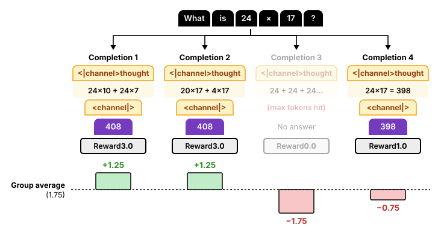
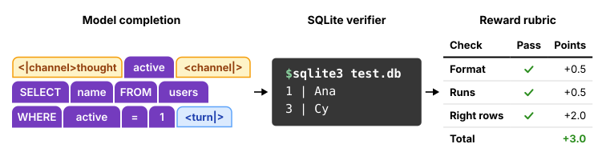
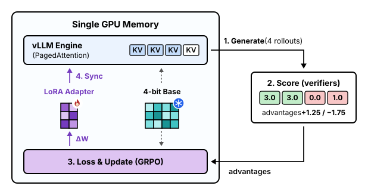
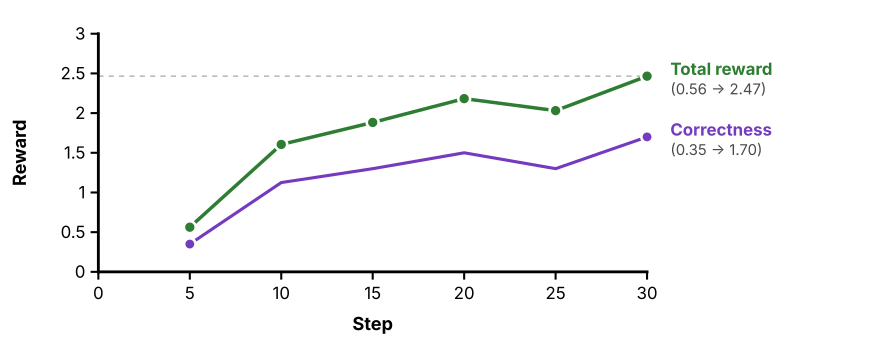

# Verifiable rewards

Supervised fine-tuning and preference optimization teach Gemma 4 to imitate existing examples. When you train on math, code generation, or SQL queries, you want the model to test intermediate steps and fix its own mistakes inside its `<|channel>thought`{.token-think} and `<channel|>`{.token-think} reasoning block.


Reinforcement learning with verifiable rewards (RLVR) lets the model learn from its own trial and error. In this guide, you will learn how Group Relative Policy Optimization (GRPO) works, how to write a multi-part reward rubric in Python, how to speed up generation with colocated vLLM, and how to train a reasoning adapter with `GRPOTrainer`.

---

## 1. Group Relative Policy Optimization (GRPO)

Traditional reinforcement learning methods keep a separate critic model in memory to estimate how good each response is, doubling your GPU memory use. Group Relative Policy Optimization removes the critic model completely by sampling a small group of responses for the same prompt and comparing each response against the group average:



In the above image, note how:

* The first two answers reach the right answer (408) through different mental math splits and score 3.0 each. 
* The third answer runs out of tokens before closing the thought block and scores 0.0
* The fourth answer formats its answer properly but makes an arithmetic mistake (398) and scores 1.0. 

Because the group average is 1.75, the two 408 answers receive a +1.25 boost and the two flawed answers receive −1.75 and −0.75. What's interesting about this methodology is that GRPO essentially generates many answers and simply checks them against the average, which is much cheaper than having to use a critic to judge all of the answers. 

Each training step runs through three stages:

1. **Sample a group**: For a given prompt, the example above generates four different answers by using a sampling temperature.
2. **Score each answer**: Deterministic functions (that you can define yourself) score every answer and assign a numeric reward.
3. **Compare against the group average**: Answers that score above the group average get a positive advantage and are reinforced. Answers that score below the average get a negative advantage and are pushed down.

---

## 2. Designing rewards

Instead of training a reward model that can be tricked by confident phrasing, verifiable rewards use deterministic checks like unit tests, SQL execution, or math parsers. In other words, they are functions that you can create yourself! 

However, you typically do not want to use a single reward that either score 0 or 1. The reason is that early in the training process, it might score 0 across every answer therefore not producing a clear signal. Instead, you can build a smooth learning ramp by combining three small rewards that add up:



Note how awarding +2.0 for correctness ensures accuracy always outweighs formatting, while the +0.5 format and execution checks guide the model during early steps:

1. **Format** *(+0.5)*: Checks that the model opened and closed its thought block cleanly before writing the final answer.
2. **Runs** *(+0.5)*: Checks that the extracted answer executes cleanly, such as a valid SQL query or a parseable number.
3. **Right rows** *(+2.0)*: Awards the main points when the query returns the expected rows or the number matches the ground-truth answer.

---

## 3. Speeding up generation

During supervised fine-tuning, every step is a single fast pass over existing tokens. During reinforcement learning, the model has to generate four to eight full answers token by token at every training step. To speed things up, we can use vLLM to do something called "colocating". This is a four step process that allows both the inference engine and the trainer to share on GPU:

1. **Generate**: vLLM samples the group of answers in parallel using PagedAttention.
2. **Score**: Your reward functions score each completion (3.0, 3.0, 0.0, 1.0).
3. **Update**: The trainer runs backpropagation through the frozen base model and updates the LoRA adapter.
4. **Sync adapter**: The updated LoRA weights are copied back into vLLM directly in GPU memory before the next step begins.



---

## 4. Set up the environment

To setup the environment, we install the post-training and evaluation libraries:

```python { .notebook-cell }
# Install Hugging Face post-training, quantization, multimodal, and evaluation libraries
%pip install -q -U "transformers>=5.10.1" "trl>=0.16.0" "peft>=0.19.0" accelerate datasets bitsandbytes torchao
%pip install -q -U evaluate sacrebleu jiwer pillow soundfile librosa matplotlib tensorboard

# Optional: install vLLM on Linux GPUs for faster colocated GRPO rollouts
# %pip install -q vllm
```

If you plan to push your trained adapter to the Hugging Face Hub, log in with a write token:

```python { .notebook-cell }
from huggingface_hub import login

# Optional: uncomment to push your trained adapter to the Hugging Face Hub
# login()
```

---

## 5. Prepare the dataset

Out of the box, `gemma-4-E2B-it` can already solve most grade-school math problems (~75% on [`openai/gsm8k`](https://huggingface.co/datasets/openai/gsm8k) when given a 1,024-token budget). However, its thinking traces average nearly 700 tokens and its final answer format varies from prompt to prompt. If your application needs to use fewer tokens and a stricter parser, then we can fine-tune it for example so that its behavior aligns with your application. 

GSM8K is quite a nice dataset to use here since we can use verifiable rewards to teach the model to reason more concisely and always end its answer with `Answer:` so that we can easily extract it. As such, GSM8K serves as an example on how we can change the behavior of our model.

`GRPOTrainer` only needs a `prompt` column and any ground-truth columns (such as `gold_answer`) that your reward functions check. You do not need chain-of-thought traces in the dataset since we only care about their length. We load 500 training problems and 100 held-out test problems, extract the answer after `####`, and ask Gemma 4 to reason concisely before writing `Answer: <number>`:

```python { .notebook-cell }
import re
from datasets import load_dataset

SYSTEM_PROMPT = (
    "Reason concisely inside your thinking block, then output only the final answer "
    "formatted as: Answer: <number>"
)


# Extract the ground-truth numeric answer after #### in GSM8K
def extract_gsm8k_gold(answer_str: str) -> str:
    match = re.search(r"####\s*([\-0-9\.,]+)", answer_str)
    return match.group(1).replace(",", "").strip() if match else ""


# Format each math problem into chat prompt messages and gold_answer
def format_grpo_sample(sample):
    return {
        "prompt": [
            {"role": "system", "content": SYSTEM_PROMPT},
            {"role": "user", "content": sample["question"]},
        ],
        "gold_answer": extract_gsm8k_gold(sample["answer"]),
    }


# Load 500 training and 100 test problems from GSM8K
train_dataset = load_dataset("openai/gsm8k", "main", split="train[:500]")
eval_dataset = load_dataset("openai/gsm8k", "main", split="test[:100]")

train_dataset = train_dataset.map(format_grpo_sample, remove_columns=train_dataset.column_names)
eval_dataset = eval_dataset.map(format_grpo_sample, remove_columns=eval_dataset.column_names)

print("Sample Prompt:", train_dataset[0]["prompt"])
print("Gold Answer:  ", train_dataset[0]["gold_answer"])
```

```{ .no-copy .output }
Sample Prompt: [{'role': 'system', 'content': 'Reason concisely inside your thinking block, then output only the final answer formatted as: Answer: <number>'}, {'role': 'user', 'content': 'Natalia sold clips to 48 of her friends in April, and then she sold half as many clips in May. How many clips did Natalia sell altogether in April and May?'}]
Gold Answer:   72
```

---

## 6. Load the model

We load our model and set `LoraConfig` across the seven text decoder projections. As always, we keep the vision and audio encoders frozen:

```python { .notebook-cell .model-swap }
import torch
from transformers import AutoTokenizer, AutoModelForMultimodalLM, BitsAndBytesConfig
from peft import LoraConfig, PeftModel

model_id = "google/gemma-4-E2B-it"

# Configure 4-bit NF4 quantization
bnb_config = BitsAndBytesConfig(
    load_in_4bit=True,
    bnb_4bit_use_double_quant=True,
    bnb_4bit_quant_type="nf4",
    bnb_4bit_compute_dtype=torch.bfloat16,
    bnb_4bit_quant_storage=torch.bfloat16,
)

# Load the base model and tokenizer
model = AutoModelForMultimodalLM.from_pretrained(
    model_id,
    dtype=torch.bfloat16,
    device_map="auto",
    quantization_config=bnb_config,
)
tokenizer = AutoTokenizer.from_pretrained(model_id)

# Configure LoRA adapters across the seven decoder projections
peft_config = LoraConfig(
    r=16,
    lora_alpha=32,
    lora_dropout=0.0,
    bias="none",
    target_modules=[
        "q_proj",
        "k_proj",
        "v_proj",
        "o_proj",
        "gate_proj",
        "up_proj",
        "down_proj",
    ],
    exclude_modules=r"model\.(vision_tower|audio_tower)\..*",
    task_type="CAUSAL_LM",
)
```

---

## 7. Evaluate the base model

Before training, let's evaluate our model across all 100 unseen `gsm8k` test problems to create a baseline. Note that we add `max_new_tokens=512` to see if the base model can stay below this budget:

```python { .notebook-cell }
ANSWER_NUMBER_PATTERN = re.compile(r"Answer:\s*([\-0-9\.,]+)")


# Helper to measure math accuracy, format adherence, and mean token length
def evaluate_gsm8k(eval_model, dataset_split, max_new_tokens=512, batch_size=25):
    eval_model.eval()
    orig_padding = tokenizer.padding_side
    tokenizer.padding_side = "left"
    stop_ids = [tokenizer.eos_token_id, tokenizer.convert_tokens_to_ids("<turn|>")]
    closed_count, format_count, correct_count = 0, 0, 0
    token_lengths = []
    try:
        for i in range(0, len(dataset_split), batch_size):
            batch = dataset_split.select(range(i, min(i + batch_size, len(dataset_split))))
            rendered = [
                tokenizer.apply_chat_template(
                    p, tokenize=False, add_generation_prompt=True, enable_thinking=True
                )
                for p in batch["prompt"]
            ]
            inputs = tokenizer(rendered, return_tensors="pt", padding=True).to(eval_model.device)
            prompt_len = inputs["input_ids"].shape[1]
            with torch.no_grad():
                outputs = eval_model.generate(
                    **inputs,
                    max_new_tokens=max_new_tokens,
                    do_sample=False,
                    eos_token_id=stop_ids,
                )
            for seq, gold in zip(outputs, batch["gold_answer"]):
                raw = (
                    tokenizer.decode(seq[prompt_len:], skip_special_tokens=False)
                    .split("<turn|>")[0]
                    .split("<eos>")[0]
                )
                token_lengths.append(len(tokenizer.encode(raw, add_special_tokens=False)))
                parsed = tokenizer.parse_response(raw, prefix="")
                thinking = parsed.get("thinking", "").strip()
                content = parsed.get("content", "").strip()
                if thinking and content:
                    closed_count += 1
                match = ANSWER_NUMBER_PATTERN.search(content)
                if thinking and match:
                    format_count += 1
                    pred = match.group(1).replace(",", "").strip().rstrip(".")
                    try:
                        if abs(float(pred) - float(gold)) < 1e-5:
                            correct_count += 1
                    except ValueError:
                        pass
    finally:
        tokenizer.padding_side = orig_padding
    n = len(dataset_split)
    return {
        "closed_pct": closed_count / n * 100,
        "format_pct": format_count / n * 100,
        "accuracy_pct": correct_count / n * 100,
        "mean_tokens": sum(token_lengths) / n,
    }


# Evaluate the zero-shot baseline before GRPO training
before_metrics = evaluate_gsm8k(model, eval_dataset, max_new_tokens=512)
print(
    f"Baseline (100 test problems): accuracy={before_metrics['accuracy_pct']:.1f}% | "
    f"valid format={before_metrics['format_pct']:.1f}% | "
    f"closed thoughts={before_metrics['closed_pct']:.1f}% | "
    f"mean length={before_metrics['mean_tokens']:.1f} tokens"
)
```

```{ .no-copy .output }
Baseline (100 test problems): accuracy=28.0% | valid format=29.0% | closed thoughts=46.0% | mean length=480.0 tokens
```

When given a budget, the model has a difficult time staying below that budget. After all, it was trained to do more reasoning than our budget. Let's see if we can change this behavior by training the model.

---

## 8. Train the model

### The reward functions

Before we can train, we need to define the reward functions.

To score each generated response, we first separate its reasoning trace from its final answer. Notice that if the model runs out of tokens mid-thought before reaching `<channel|>`{.token-think}, the final answer will simply be empty.

From there, we score each response with three functions that add up to `3.0` points:

* **Format** *(+0.5)*: Checks that the thought block closed concisely and the answer starts with `Answer:`.
* **Parseable number** *(+0.5)*: Checks that the value after `Answer:` is a valid number.
* **Correctness** *(+2.0)*: Checks that the number matches the ground-truth answer.

```python { .notebook-cell }
CHANNEL_END_TOKEN_ID = 101  # <channel|> in the Gemma 4 tokenizer


# Split each rollout into its thinking trace and visible final answer
def _split_completion(completion, token_ids=None) -> tuple[str, str]:
    if isinstance(completion, list) and completion:
        msg = completion[-1]
        if "thinking" in msg:
            return msg.get("thinking", "").strip(), msg.get("content", "").strip()
        text = msg.get("content", "")
    else:
        text = str(completion)

    if "<channel|>" in text:
        thinking, _, content = text.partition("<channel|>")
        return thinking.replace("<|channel>thought", "").strip(), content.strip()
    if token_ids is not None and CHANNEL_END_TOKEN_ID not in token_ids:
        return text.removeprefix("thought\n").strip(), ""
    if "Answer:" in text:
        idx = text.rfind("Answer:")
        return text[:idx].removeprefix("thought\n").strip(), text[idx:].strip()
    return "", text.strip()


def thinking_format_reward_func(completions, completion_ids=None, **kwargs) -> list[float]:
    """Awards up to +0.5 when a concise thinking block closes cleanly into 'Answer: ...'."""
    ids_iter = completion_ids if completion_ids is not None else [None] * len(completions)
    rewards = []
    for comp, ids in zip(completions, ids_iter):
        thinking, content = _split_completion(comp, ids)
        score = 0.0
        if thinking and content:
            score += 0.15
            if "Answer:" in content:
                score += 0.15
            if content.startswith("Answer:") and len(thinking.split()) <= 180:
                score += 0.20
        rewards.append(score)
    return rewards


def numeric_parse_reward_func(completions, completion_ids=None, **kwargs) -> list[float]:
    """Awards +0.5 if the extracted Answer: field parses cleanly as a number."""
    ids_iter = completion_ids if completion_ids is not None else [None] * len(completions)
    rewards = []
    for comp, ids in zip(completions, ids_iter):
        _, content = _split_completion(comp, ids)
        match = ANSWER_NUMBER_PATTERN.search(content)
        if match:
            cleaned = match.group(1).replace(",", "").strip().rstrip(".")
            try:
                float(cleaned)
                rewards.append(0.5)
                continue
            except ValueError:
                pass
        rewards.append(0.0)
    return rewards


def correctness_reward_func(completions, gold_answer, completion_ids=None, **kwargs) -> list[float]:
    """Awards +2.0 if the extracted numerical answer matches the ground-truth solution."""
    ids_iter = completion_ids if completion_ids is not None else [None] * len(completions)
    rewards = []
    for comp, gold, ids in zip(completions, gold_answer, ids_iter):
        _, content = _split_completion(comp, ids)
        match = ANSWER_NUMBER_PATTERN.search(content)
        if match:
            pred = match.group(1).replace(",", "").strip().rstrip(".")
            try:
                if abs(float(pred) - float(gold)) < 1e-5:
                    rewards.append(2.0)
                    continue
            except ValueError:
                pass
        rewards.append(0.0)
    return rewards
```

### Run GRPO training

Now we can configure `GRPOConfig` and start training. Notice that we set `beta=0.0` here. Unlike DPO, we do not need to keep the model close to its original style, since we want it to reduce the length of its thinking traces:

```python { .notebook-cell }
from trl import GRPOConfig, GRPOTrainer

# Set the configuration for the GRPO trainer
grpo_args = GRPOConfig(
    output_dir="gemma-4-grpo-math",
    learning_rate=1.5e-4,
    lr_scheduler_type="cosine",
    warmup_steps=0.05,
    beta=0.0,                           # No KL penalty against verbose base thoughts (DAPO default)
    num_generations=4,                  # Sample 4 answers per prompt to form each group
    max_completion_length=512,
    temperature=1.0,
    chat_template_kwargs={"enable_thinking": True},
    per_device_train_batch_size=16,     # 4 prompts x 4 generations per step
    gradient_accumulation_steps=1,
    gradient_checkpointing=True,
    max_steps=30,
    optim="adamw_bnb_8bit",
    max_grad_norm=0.5,
    bf16=True,
    logging_steps=5,
    save_strategy="epoch",
    report_to="tensorboard",
    # Uncomment on Linux GPUs with a matching vllm build for faster rollouts:
    # use_vllm=True,
    # vllm_mode="colocate",
)

# Define and run the GRPO trainer with our three reward functions
trainer = GRPOTrainer(
    model=model,
    reward_funcs=[
        thinking_format_reward_func,
        numeric_parse_reward_func,
        correctness_reward_func,
    ],
    args=grpo_args,
    train_dataset=train_dataset,
    peft_config=peft_config,
    processing_class=tokenizer,
)

trainer.train()
trainer.save_model()
```

```{ .no-copy .output }
[30/30 37:58, Epoch 0.24]

| Step | Loss | Reward | Format Reward | Parse Reward | Correctness Reward | Completion Length |
|---|---|---|---|---|---|---|
| 5 | 0.0073 | 0.5625 | 0.1000 | 0.1125 | 0.3500 | 485.8 |
| 10 | 0.0226 | 1.6050 | 0.1988 | 0.2812 | 1.1250 | 443.3 |
| 15 | 0.0040 | 1.8825 | 0.2325 | 0.3500 | 1.3000 | 390.6 |
| 20 | 0.0101 | 2.1825 | 0.2700 | 0.4125 | 1.5000 | 326.2 |
| 25 | -0.0037 | 2.0312 | 0.2813 | 0.4500 | 1.3000 | 316.4 |
| 30 | -0.0174 | 2.4656 | 0.2906 | 0.4750 | 1.7000 | 258.6 |
```

<!-- notebook:skip-start -->
??? info "Inspect the reward curve"
    
<!-- notebook:skip-end -->


Training for 30 steps takes about 40 minutes on an A100 GPU and uses around 11 GB of VRAM, so it also fits on a 16 GB GPU like a Colab T4.

Look at how the two main columns move together in the table above. As the average response length drops roughly in half, the correctness and format rewards steadily climb!

---

## 9. Evaluate the fine-tuned model

Free the trainer, reload the saved LoRA adapter onto a fresh 4-bit base model, and re-run `evaluate_gsm8k` across the exact same `100` unseen `gsm8k` test problems alongside a qualitative word problem:

```python { .notebook-cell }
# Free trainer memory and reload the saved GRPO adapter onto a fresh 4-bit base model
del trainer, model
torch.cuda.empty_cache()

base_model = AutoModelForMultimodalLM.from_pretrained(
    model_id,
    dtype=torch.bfloat16,
    device_map="auto",
    quantization_config=bnb_config,
)
rl_model = PeftModel.from_pretrained(base_model, grpo_args.output_dir)

# Evaluate accuracy and reasoning length across the 100 unseen test problems
after_metrics = evaluate_gsm8k(rl_model, eval_dataset, max_new_tokens=512)
print(
    f"After GRPO  (100 test problems): accuracy={after_metrics['accuracy_pct']:.1f}% | "
    f"valid format={after_metrics['format_pct']:.1f}% | "
    f"closed thoughts={after_metrics['closed_pct']:.1f}% | "
    f"mean length={after_metrics['mean_tokens']:.1f} tokens\n"
)

test_messages = [
    {"role": "system", "content": SYSTEM_PROMPT},
    {
        "role": "user",
        "content": "A bakery bakes 120 croissants every morning. It sells 65% of them before noon at $4 each, and the remaining croissants in the afternoon at half price ($2 each). How much total revenue does the bakery make from croissants each day?",
    },
]
prompt = tokenizer.apply_chat_template(
    test_messages,
    tokenize=False,
    add_generation_prompt=True,
    enable_thinking=True,
)
inputs = tokenizer(prompt, return_tensors="pt").to(rl_model.device)

with torch.no_grad():
    outputs = rl_model.generate(
        **inputs,
        max_new_tokens=512,
        do_sample=False,
        eos_token_id=[
            tokenizer.eos_token_id,
            tokenizer.convert_tokens_to_ids("<turn|>"),
        ],
    )
generated_ids = outputs[0][inputs["input_ids"].shape[-1] :]
print(tokenizer.decode(generated_ids, skip_special_tokens=False).split("<turn|>")[0])
```

```{ .no-copy .output }
After GRPO  (100 test problems): accuracy=83.0% | valid format=94.0% | closed thoughts=98.0% | mean length=283.5 tokens

<|channel>thought
The user wants to calculate the total daily revenue from selling croissants based on two different price points for two different quantities sold.

1.  **Calculate the number of croissants sold before noon:**
    Total baked = 120
    Percentage sold before noon = 65%
    Number sold before noon = $120 \times 0.65 = 78$ croissants.

2.  **Calculate the revenue from the morning sales:**
    Price per croissant before noon = $4
    Revenue (morning) = $78 \times \$4 = \$312$.

3.  **Calculate the number of croissants sold in the afternoon:**
    Remaining croissants = Total baked - Sold before noon
    Remaining croissants = $120 - 78 = 42$ croissants.

4.  **Calculate the revenue from the afternoon sales:**
    Price per croissant in the afternoon = $2 (half price)
    Revenue (afternoon) = $42 \times \$2 = \$84$.

5.  **Calculate the total revenue:**
    Total Revenue = Revenue (morning) + Revenue (afternoon)
    Total Revenue = $\$312 + \$84 = \$396$.<channel|>Reason: Calculate the quantity and revenue for the morning sales (65% of 120 at $4 each), calculate the remaining quantity for afternoon sales (35% of 120), calculate the revenue from the afternoon sales (at $2 each), and sum the two amounts to find the total daily revenue.

Answer: 396
```

Thirty steps of 4-bit QLoRA GRPO (`r=16`, **11.29 GB** peak VRAM) nearly triple held-out `openai/gsm8k` accuracy at `512` tokens—and even surpass the un-truncated `1024`-token baseline (`75.0%` → `87.0%` when evaluated at `1024` tokens) in less than half the tokens:

The results look great! After just 30 steps of GRPO, the model reasons much more concisely. It almost always closes its thought block in time and improves its accuracy in less then half of its tokens:

| Metric | Before GRPO | After GRPO |
| :--- | :--- | :--- |
| **Exact-match accuracy (`max_new_tokens=512`)** | 28.0% | **83.0%** |
| **Exact-match accuracy (`max_new_tokens=1024`)** | 75.0% | **87.0%** |
| **Valid `Answer: <number>` format (`512` budget)** | 29.0% | **94.0%** |
| **Mean completion length (`512` budget)** | 480.0 tokens | **283.5 tokens** |

---

## What's next

<div class="card-grid">
<a class="card" href="gemma-trainer.md">
  <span class="card-icon">{{ icon('lucide/wrench') }}</span>
  <div class="card-title">Gemma trainer skill</div>
  <p class="card-desc">Let an AI coding agent set up, validate, and run local Gemma 4 fine-tuning workflows for you.</p>
</a>
<a class="card" href="export.md">
  <span class="card-icon">{{ icon('lucide/rocket') }}</span>
  <div class="card-title">Export</div>
  <p class="card-desc">Export your GRPO-trained reasoning checkpoint to vLLM, GGUF, or LiteRT-LM, or speed up serving with MTP.</p>
</a>
<a class="card" href="preference-alignment.md">
  <span class="card-icon">{{ icon('lucide/sliders-horizontal') }}</span>
  <div class="card-title">Preference optimization</div>
  <p class="card-desc">Combine reasoning improvements with DPO preference alignment for tone, conciseness, and safety.</p>
</a>
<a class="card" href="datasets-formatting.md">
  <span class="card-icon">{{ icon('lucide/braces') }}</span>
  <div class="card-title">Dataset formatting</div>
  <p class="card-desc">Review how Gemma 4's thinking channel works in multi-turn conversations and tool calling.</p>
</a>
</div>

--8<-- "glossary.md"
