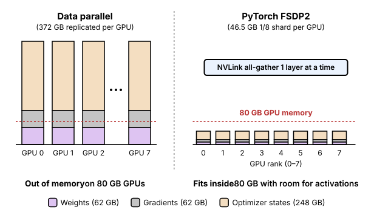
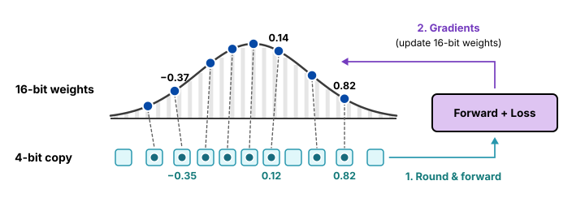

# Scaling

Once your fine-tuning or alignment recipe works on a small sample, two scaling techniques help take it into production:

* **Multi-GPU training**: Sharding training across multiple GPUs when a model or batch size exceeds a single card.
* **Quantization-aware training** *(QAT)*: Running QAT to go from 16-bit accuracy to 4-bit accuracy with minimal loss in quality.

This guide covers multi-GPU sharding with PyTorch FSDP2 and Accelerate, multi-GPU QLoRA data parallelism, and post-tuning QAT with TorchAO. To package finished checkpoints for vLLM, GGUF, or LiteRT-LM, see [Export](export.md).

---

## 1. Multi-GPU training with FSDP2

Normally, when you use multiple GPUs for training, every GPU will have a copy of the model weights, gradients, and optimizer states. For Gemma 4 31B, that would mean around 370 GB per GPU (~60 GB weights, ~60 GB gradients, and ~250 GB optimizer states). This is four times larger than the memory of an 80 GB GPU, for example.

To split the weights, gradients, and optimizer states evenly across your GPUs, we can use **PyTorch FSDP2** (Fully Sharded Data Parallel). Instead of duplicating the full model on every card, FSDP2 slices the training state across all GPUs so each card only stores a fraction of it. Across eight GPUs, each card holds just one eighth of the total (~46 GB per GPU), which fits comfortably on an 80 GB GPU:



During the forward and backward pass, GPUs gather the weights for one layer at a time over NVLink and free the temporary copies as soon as that layer finishes.

You can then save the following configuration as `fsdp2_config.yaml` to shard Gemma 4 layers across an 8-GPU node (adjust `num_processes` to match your GPU count):

```yaml
compute_environment: LOCAL_MACHINE
distributed_type: FSDP
downcast_bf16: 'no'
fsdp_config:
  fsdp_version: 2
  fsdp_auto_wrap_policy: TRANSFORMER_BASED_WRAP
  fsdp_backward_prefetch: BACKWARD_PRE
  fsdp_cpu_ram_efficient_loading: true
  fsdp_forward_prefetch: false
  fsdp_offload_params: false
  fsdp_reshard_after_forward: true
  fsdp_state_dict_type: SHARDED_STATE_DICT
  fsdp_sync_module_states: true
  fsdp_use_orig_params: true
machine_rank: 0
main_training_function: main
mixed_precision: bf16
num_machines: 1
num_processes: 8
rdzv_backend: static
same_network: true
use_cpu: false
```

To use it, launch any TRL script (`SFTTrainer`, `DPOTrainer`, or `GRPOTrainer`) with `accelerate launch`:

```bash
accelerate launch --config_file fsdp2_config.yaml train_sft.py
```

??? tip "Multi-GPU QLoRA data parallelism"
    If you are running 4-bit QLoRA across multiple GPUs to increase batch throughput and the 4-bit model already fits on a single GPU, do not use `device_map="auto"`. Instead, pin each process to its local GPU rank:

    ```python
    from accelerate import PartialState
    from transformers import AutoModelForMultimodalLM

    # Pin each Accelerate worker process to its own local GPU rank
    device_string = PartialState().process_index
    model = AutoModelForMultimodalLM.from_pretrained(
        "google/gemma-4-E4B-it",
        quantization_config=bnb_config,
        device_map={"": device_string},
    )
    ```

---

## 2. Quantization-aware training

When you quantize a 16-bit model to 4-bit integers after training finishes, rounding each weight to one of 16 discrete values adds noise that can hurt accuracy on math, coding, and strict formatting tasks.

Quantization-aware training (QAT) simulates 4-bit rounding during the final 500 to 1,500 steps of fine-tuning so the model can adapt to the rounding grid.

!!! note "Start from Google's official QAT checkpoints if you are not fine-tuning"
    If you want 4-bit Gemma 4 weights without custom fine-tuning, download Google's prebuilt QAT checkpoints (`-qat-q4_0-gguf`, `-qat-w4a16-ct`, or `-qat-q4_0-unquantized`) directly — see [Quantization-aware training](../get-started/qat.md). Run the TorchAO loop below when you want to recover 4-bit accuracy *after* custom `bfloat16` fine-tuning or alignment.



As shown above, each QAT step follows a two-stage loop:

1. **Round for the forward pass**: Training keeps master weights in 16-bit precision (for example, -0.37, 0.14, and 0.82), but rounds a temporary copy to 4-bit values (-0.35, 0.12, and 0.82) before computing the forward pass and the loss.
2. **Update the 16-bit weights**: During the backward pass, gradients flow back to update the 16-bit master weights so they settle into values that round cleanly.

With PyTorch's [TorchAO](https://github.com/pytorch/ao) library, running QAT on a fine-tuned Gemma 4 model takes three steps: prepare the model to simulate 4-bit rounding, run a short training pass, and convert the weights into packed 4-bit integers.

We also pass a small filter function so QAT only targets the linear layers in the text decoder and leaves the embeddings and vision or audio encoders in 16-bit precision:

```python
import torch
from transformers import AutoModelForMultimodalLM, AutoProcessor, TorchAoConfig
from transformers.quantizers.quantizer_torchao import TorchAoHfQuantizer
from trl import SFTConfig, SFTTrainer
from torchao.quantization import (
    Int8DynamicActivationIntxWeightConfig,
    PerGroup,
    quantize_,
)
from torchao.quantization.qat import QATConfig

# Load the fine-tuned checkpoint and processor in bfloat16
model_id = "google/gemma-4-E2B-it"
processor = AutoProcessor.from_pretrained(model_id)
model = AutoModelForMultimodalLM.from_pretrained(
    model_id,
    dtype=torch.bfloat16,
    device_map="auto",
)

# Configure 4-bit per-group quantization for decoder linear layers
base_config = Int8DynamicActivationIntxWeightConfig(
    weight_dtype=torch.int4,
    weight_granularity=PerGroup(32),
)


def qat_filter(module, fqn):
    return (
        isinstance(module, torch.nn.Linear)
        and fqn.startswith("model.language_model.layers.")
        and module.in_features % 32 == 0
    )


# Step 1: Prepare the decoder linear layers to simulate 4-bit rounding
quantize_(model, QATConfig(base_config, step="prepare"), filter_fn=qat_filter)

# Step 2: Train for a short recovery pass at a low learning rate
qat_args = SFTConfig(
    output_dir="gemma-4-e2b-qat",
    max_steps=500,
    per_device_train_batch_size=1,
    gradient_accumulation_steps=8,
    learning_rate=1e-5,
    lr_scheduler_type="cosine",
    warmup_steps=0.10,
    optim="adamw_torch_8bit",
    gradient_checkpointing=True,
    bf16=True,
)

trainer = SFTTrainer(
    model=model,
    args=qat_args,
    train_dataset=train_dataset,
    processing_class=processor,
)
trainer.train()

# Step 3: Convert the layers into packed 4-bit weights
quantize_(model, QATConfig(base_config, step="convert"), filter_fn=qat_filter)

ao_config = TorchAoConfig(quant_type=base_config)
model.hf_quantizer = TorchAoHfQuantizer(ao_config)
model.config.quantization_config = ao_config
model.save_pretrained("gemma-4-e2b-int4-qat-exported")
processor.save_pretrained("gemma-4-e2b-int4-qat-exported")
```

---

## What's next

<div class="card-grid">
<a class="card" href="export.md">
  <span class="card-icon">{{ icon('lucide/rocket') }}</span>
  <div class="card-title">Export</div>
  <p class="card-desc">Package and serve your fine-tuned Gemma 4 checkpoints with vLLM, GGUF, Ollama, or LiteRT-LM.</p>
</a>
<a class="card" href="../get-started/qat.md">
  <span class="card-icon">{{ icon('lucide/cpu') }}</span>
  <div class="card-title">Quantization-aware training</div>
  <p class="card-desc">Explore official QAT checkpoint formats and memory footprints across GPU, desktop, and mobile hardware.</p>
</a>
<a class="card" href="full-finetune.md">
  <span class="card-icon">{{ icon('lucide/sliders-horizontal') }}</span>
  <div class="card-title">Full fine-tuning</div>
  <p class="card-desc">Review single-GPU full fine-tuning hyperparameters, cosine schedules, and loss-curve diagnostics.</p>
</a>
<a class="card" href="index.md">
  <span class="card-icon">{{ icon('lucide/graduation-cap') }}</span>
  <div class="card-title">Fine-tuning overview</div>
  <p class="card-desc">Return to the Gemma 4 fine-tuning overview to compare methods and hardware requirements.</p>
</a>
</div>

--8<-- "glossary.md"
