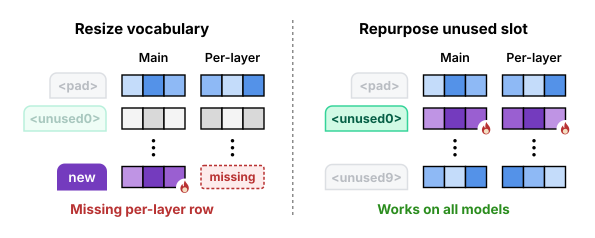
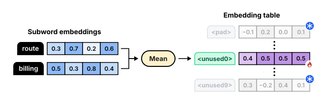
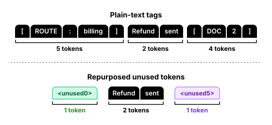
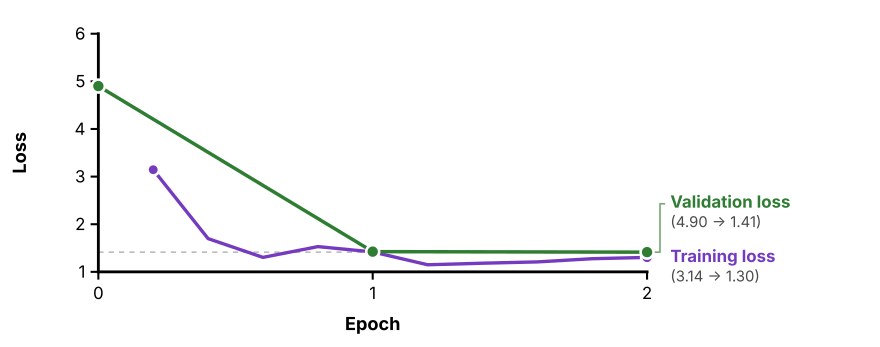

# Unused tokens

Every Gemma 4 checkpoint ships with **6,227 reserved token slots**, namely `<unused0>` (token ID `6`) through `<unused6226>` (token ID `262143`). Those unused tokens are already built into its 262,144-token vocabulary. This allows us to keep the vocabulary size and reuse the `<unused*>` slots in place. Keeping the vocabulary size fixed at `262,144` works on **every** Gemma 4 model without breaking per-layer embeddings or downstream GGUF and LiteRT-LM exports.

In this guide, we turn eight unused slots into single-token routing and source tags on `google/gemma-4-E2B-it`.

---

## 1. Reusing slots versus resizing the vocabulary

On **Gemma 4 E2B** and **E4B**, each decoder layer looks up a separate per-layer embedding table alongside the main embedding table. If we were to expand the actual vocabulary, we would have a problem since the per-layer embeddings stay at `262,144` tokens, which causes an error:



---

## 2. Initializing and training selected tokens

Because `<unused0>` through `<unused6226>` were, as their name imply, unused, their embeddings have no task meaning yet. Training them from scratch takes longer, while unfreezing the full 262,144-row embedding table adds over 400 million trainable weights.

We can avoid both problems in two steps, namely initializing an unused token from subword embeddings and training only that row:

1. **Initialize from existing words:** Before attaching LoRA, split a short description of each new token (such as `"route billing"` for `<unused0>`{.token-tool}) into its existing subwords and copy their average into that slot's row.
2. **Train only the rows you use:** Pass `trainable_token_indices` in `LoraConfig` so PEFT updates only your chosen rows (for 8 tokens on E2B, fewer than 100K weights instead of 402M) and folds them cleanly back into the model when you merge.



It's a very neat trick that prevents us from training entirely from scratch.

!!! important "Initialize rows before wrapping the model with PEFT"
    PEFT copies the starting embedding rows at the moment you call `get_peft_model()`. Always run your subword initialization **before** calling `get_peft_model()` so training starts from your averaged vectors.

---

## 3. Creating single tokens

Plain-text tags like `[ROUTE: billing]` or `[DOC2]` split into several tokens every time the model generates them. Mapping those tags to `<unused0>` through `<unused7>` turns each one into a single generation step:



Using single tokens for structured tags helps in three ways:

- **Faster generation:** Writing `<unused0>`{.token-tool} and `<unused5>`{.token-multi} takes one step each instead of nine bracket, colon, and label tokens.
- **One-step routing scores:** Looking at the first generated token's probabilities across IDs `6` to `11` gives you a direct confidence score for every route in a single forward pass.
- **No broken brackets:** A single token ID cannot be cut off mid-tag like `[ROUTE: billing`.

---

## 4. Set up the environment

As always, we install the Hugging Face post-training and evaluation libraries:

```python { .notebook-cell }
# Install Hugging Face post-training, quantization, multimodal, and evaluation libraries
%pip install -q -U "transformers>=5.10.1" "trl>=0.16.0" "peft>=0.19.0" accelerate datasets bitsandbytes torchao
%pip install -q -U evaluate sacrebleu jiwer pillow soundfile librosa matplotlib tensorboard
```

If you plan to push your adapter to the Hugging Face Hub, log in with a write token:

```python { .notebook-cell }
from huggingface_hub import login

# Optional: uncomment to push your trained adapter to the Hugging Face Hub
# login()
```

---

## 5. Register unused tokens

To register the unused tokens, we start by loading the `google/gemma-4-E2B-it` tokenizer. We then check how many `<unused*>` slots it has and register `<unused0>` through `<unused7>` (IDs `6` through `13`):

```python { .notebook-cell .model-swap }
from tokenizers import AddedToken
from transformers import AutoTokenizer

model_id = "google/gemma-4-E2B-it"
tokenizer = AutoTokenizer.from_pretrained(model_id)

# Count all reserved <unused*> slots in Gemma 4's 262,144-token vocabulary
vocab = tokenizer.get_vocab()
unused_slots = sorted(
    [(tok, idx) for tok, idx in vocab.items() if tok.startswith("<unused") and tok.endswith(">")],
    key=lambda item: item[1],
)
print(f"Reserved slots: {len(unused_slots)} ({unused_slots[0]} .. {unused_slots[-1]})")

# Show why unregistered '<unused0>' after a space splits into 5 subwords
print("Before registration:", tokenizer.tokenize("Answer <unused0>"))

# Map 6 task-routing intents + 2 source-citation badges to IDs 6..13
SLOT_PHRASES = {
    "<unused0>": "route closed question answering",
    "<unused1>": "route information extraction",
    "<unused2>": "route text summarization",
    "<unused3>": "route classification",
    "<unused4>": "route open question answering",
    "<unused5>": "route creative brainstorming",
    "<unused6>": "cite provided reference context",
    "<unused7>": "cite general model knowledge",
}

# Register with special=False, normalized=False so vocab stays 262,144 and decode() keeps tags
tokenizer.add_tokens(
    [AddedToken(slot, special=False, normalized=False) for slot in SLOT_PHRASES]
)
target_token_ids = [tokenizer.convert_tokens_to_ids(slot) for slot in SLOT_PHRASES]
print("After registration: ", tokenizer.tokenize("Answer <unused0>"))
print(f"Target IDs: {target_token_ids} | Vocab size: {len(tokenizer)}")

# Compare token count on a sample routed + cited answer
plain_example = "[ROUTE: billing] Refund sent [DOC2]"
compact_example = "<unused0>Refund sent<unused5>"
print(
    f"Token compression: {len(tokenizer.encode(plain_example, add_special_tokens=False))} plain tokens "
    f"-> {len(tokenizer.encode(compact_example, add_special_tokens=False))} compact tokens"
)
```

```{ .no-copy .output }
Reserved slots: 6227 (('<unused0>', 6) .. ('<unused6226>', 262143))
Before registration: ['Answer', '▁<', 'unused', '0', '>']
After registration:  ['Answer', '▁', '<unused0>']
Target IDs: [6, 7, 8, 9, 10, 11, 12, 13] | Vocab size: 262144
Token compression: 11 plain tokens -> 4 compact tokens
```

---

## 6. Prepare the dataset

We take six task categories from [`databricks/databricks-dolly-15k`](https://huggingface.co/datasets/databricks/databricks-dolly-15k) and map them to `<unused0>` through `<unused5>`. These are specific categories that we want to add to the data so that we can fill the unused tokens with information about these categories. Note that this is merely an example and that you can use any type of data, like different languages or domains.

At the end of each answer, we add `<unused6>` when the answer uses a reference passage or `<unused7>` when it relies on general knowledge:

```python { .notebook-cell }
from datasets import load_dataset

CATEGORY_TO_SLOT = {
    "closed_qa": "<unused0>",
    "information_extraction": "<unused1>",
    "summarization": "<unused2>",
    "classification": "<unused3>",
    "open_qa": "<unused4>",
    "brainstorming": "<unused5>",
}

SYSTEM_INSTRUCTION = (
    "Prefix every response with its route token (<unused0>..<unused5>) and end with "
    "<unused6> when grounded in a Reference block or <unused7> when using general knowledge."
)

# Filter Dolly-15k to our six target categories and keep concise examples
raw_ds = load_dataset("databricks/databricks-dolly-15k", split="train").shuffle(seed=42)
filtered_ds = raw_ds.filter(
    lambda r: r["category"] in CATEGORY_TO_SLOT
    and len(r["context"]) < 1200
    and 20 < len(r["response"]) < 600
)


def format_routed_example(row):
    route_tok = CATEGORY_TO_SLOT[row["category"]]
    has_ctx = bool(row["context"].strip())
    cite_tok = "<unused6>" if has_ctx else "<unused7>"
    user_body = (
        f"Reference:\n{row['context'].strip()}\n\nQuestion: {row['instruction'].strip()}"
        if has_ctx
        else f"Question: {row['instruction'].strip()}"
    )
    return {
        "prompt": [
            {"role": "system", "content": SYSTEM_INSTRUCTION},
            {"role": "user", "content": user_body},
        ],
        "completion": [
            {"role": "assistant", "content": f"{route_tok}{row['response'].strip()}{cite_tok}"},
        ],
        "expected_route": route_tok,
        "expected_cite": cite_tok,
    }


formatted_ds = filtered_ds.select(range(1300)).map(
    format_routed_example, remove_columns=filtered_ds.column_names
)
train_dataset = formatted_ds.select(range(1200))
eval_dataset = formatted_ds.select(range(1200, 1300))
print(f"Prepared {len(train_dataset)} train and {len(eval_dataset)} eval examples")
print("Sample completion:", train_dataset[0]["completion"][0]["content"][:140])
```

```{ .no-copy .output }
Prepared 1200 train and 100 eval examples
Sample completion: <unused4>Garth the Gardener, John the Oak, Gilbert of the Vines, Brandon of the Bloody Blade, Foss the Archer, Owen Oakenshield, Harlon the
```

---

## 7. Load the model

We now load the model, `google/gemma-4-E2B-it`, in 4-bit NF4 precision. We initialize rows `6` through `13` from the average of their subwords. Finally, we configure LoRA to train only those eight token rows alongside the linear adapters:

```python { .notebook-cell }
import torch
from transformers import AutoModelForMultimodalLM, BitsAndBytesConfig
from peft import LoraConfig, get_peft_model, prepare_model_for_kbit_training

# Configure 4-bit NF4 quantization (embedding tables remain in bfloat16)
bnb_config = BitsAndBytesConfig(
    load_in_4bit=True,
    bnb_4bit_use_double_quant=True,
    bnb_4bit_quant_type="nf4",
    bnb_4bit_compute_dtype=torch.bfloat16,
    bnb_4bit_quant_storage=torch.bfloat16,
)

model = AutoModelForMultimodalLM.from_pretrained(
    model_id,
    dtype=torch.bfloat16,
    device_map="auto",
    quantization_config=bnb_config,
)
model = prepare_model_for_kbit_training(model)


# Copy the mean of subwords into embed_tokens and (on E2B/E4B) embed_tokens_per_layer
@torch.no_grad()
def initialize_unused_tokens(model, tokenizer, slot_to_phrase):
    text_model = model.model.language_model
    embedding_tables = [text_model.embed_tokens.weight]
    if hasattr(text_model, "embed_tokens_per_layer"):
        embedding_tables.append(text_model.embed_tokens_per_layer.weight)

    for slot_token, phrase in slot_to_phrase.items():
        slot_id = tokenizer.convert_tokens_to_ids(slot_token)
        subword_ids = tokenizer.encode(phrase, add_special_tokens=False)
        for weight in embedding_tables:
            weight[slot_id] = weight[subword_ids].mean(dim=0).to(weight.dtype)


# Initialize rows 6..13 BEFORE get_peft_model() snapshots original weights
initialize_unused_tokens(model, tokenizer, SLOT_PHRASES)

text_model = model.model.language_model
trainable_tokens = {"embed_tokens": target_token_ids}
if hasattr(text_model, "embed_tokens_per_layer"):
    trainable_tokens["embed_tokens_per_layer"] = target_token_ids

peft_config = LoraConfig(
    r=16,
    lora_alpha=32,
    lora_dropout=0.0,
    bias="none",
    target_modules=[
        "q_proj",
        "k_proj",
        "v_proj",
        "o_proj",
        "gate_proj",
        "up_proj",
        "down_proj",
    ],
    exclude_modules=r"model\.(vision_tower|audio_tower)\..*",
    trainable_token_indices=trainable_tokens,
    task_type="CAUSAL_LM",
)
model = get_peft_model(model, peft_config)

# Expose bias=None on PEFT's TrainableTokensWrapper for TRL's fused chunked LM head
if not hasattr(model.get_output_embeddings(), "bias"):
    model.get_output_embeddings().bias = None

model.print_trainable_parameters()
```

```{ .no-copy .output }
trainable params: 24,242,176 || all params: 5,128,539,680 || trainable%: 0.4727
```

<!-- notebook:skip-start -->
??? tip "Shortening long domain terms with `<unused*>`"
    You can use the same `initialize_unused_tokens` helper to shorten recurring domain terms (such as medical codes, product IDs, or financial metrics) that normally split into many subwords:

    ```python
    # Map recurring multi-token terms to <unused100>..<unused102>
    DOMAIN_TERMS = {
        "EGFR_T790M": "<unused100>",
        "HbA1c_mmol": "<unused101>",
        "Q3_EBITDA": "<unused102>",
    }
    tokenizer.add_tokens(
        [AddedToken(slot, special=False, normalized=False) for slot in DOMAIN_TERMS.values()]
    )
    initialize_unused_tokens(
        model, tokenizer, {slot: term for term, slot in DOMAIN_TERMS.items()}
    )
    ```

    Replace those strings in your dataset before tokenizing (and map `<unused100>` back to `"EGFR_T790M"` after decoding) to shorten sequences while keeping the vocabulary at `262,144`.
<!-- notebook:skip-end -->

---

## 8. Evaluate the base model

First, we check how often the base model writes valid `<unused*>` tags on 40 held-out examples:

```python { .notebook-cell }
from torch.optim import AdamW
from trl import SFTConfig, SFTTrainer

ROUTE_SLOTS = set(CATEGORY_TO_SLOT.values())


# Check route accuracy and citation accuracy on 40 unseen examples
def evaluate_primitives(dataset_slice):
    model.eval()
    route_hits, cite_hits, valid_structure = 0, 0, 0
    for row in dataset_slice:
        prompt_text = tokenizer.apply_chat_template(
            row["prompt"], tokenize=False, add_generation_prompt=True, enable_thinking=False
        )
        inputs = tokenizer(prompt_text, return_tensors="pt").to(model.device)
        with torch.no_grad():
            out_ids = model.generate(
                **inputs, max_new_tokens=96, do_sample=False, use_cache=True
            )
        gen_ids = out_ids[0][inputs["input_ids"].shape[1] :]
        decoded = tokenizer.decode(gen_ids, skip_special_tokens=True).strip()
        starts_valid = any(decoded.startswith(s) for s in ROUTE_SLOTS)
        ends_valid = decoded.endswith("<unused6>") or decoded.endswith("<unused7>")
        valid_structure += int(starts_valid and ends_valid)
        route_hits += int(decoded.startswith(row["expected_route"]))
        cite_hits += int(decoded.endswith(row["expected_cite"]))
    n = len(dataset_slice)
    return {
        "valid_tag_pct": 100.0 * valid_structure / n,
        "route_acc_pct": 100.0 * route_hits / n,
        "cite_acc_pct": 100.0 * cite_hits / n,
    }


test_slice = eval_dataset.select(range(40))
before_metrics = evaluate_primitives(test_slice)
print(f"Before SFT: {before_metrics}")
```

```{ .no-copy .output }
Before SFT: {'valid_tag_pct': 0.0, 'route_acc_pct': 0.0, 'cite_acc_pct': 0.0}
```

Before training, the model outputs `0.0%` valid `<unused*>` tag pairs, even when asked in the system prompt, because rows `6` through `13` have never been trained in conversation.

---

## 9. Train the model

Now, we can train the model for two epochs using a `2e-4` learning rate on LoRA adapters and `1e-4` on the selected token rows:

```python { .notebook-cell }
lora_lr = 2e-4
token_lr = 1e-4

token_params, lora_params = [], []
for name, param in model.named_parameters():
    if not param.requires_grad:
        continue
    if "trainable_tokens" in name:
        token_params.append(param)
    else:
        lora_params.append(param)

optimizer = AdamW(
    [
        {"params": lora_params, "lr": lora_lr, "weight_decay": 0.01},
        {"params": token_params, "lr": token_lr, "weight_decay": 0.0},
    ]
)

# Train only on the assistant completion (route tag + answer + source tag)
sft_args = SFTConfig(
    output_dir="gemma-4-unused-tokens",
    max_length=1024,
    completion_only_loss=True,
    num_train_epochs=2,
    per_device_train_batch_size=4,
    gradient_accumulation_steps=4,
    learning_rate=lora_lr,
    warmup_steps=0.05,
    lr_scheduler_type="cosine",
    max_grad_norm=1.0,
    bf16=True,
    logging_steps=15,
    eval_strategy="epoch",
    eval_on_start=True,
    save_strategy="epoch",
    report_to="tensorboard",
    seed=42,
)

trainer = SFTTrainer(
    model=model,
    args=sft_args,
    train_dataset=train_dataset.remove_columns(["expected_route", "expected_cite"]),
    eval_dataset=eval_dataset.remove_columns(["expected_route", "expected_cite"]),
    processing_class=tokenizer,
    optimizers=(optimizer, None),
)
model.train()
trainer.train()
```

```{ .no-copy .output }
[150/150 08:49, Epoch 2/2]

| Epoch | Training Loss | Validation Loss | Mean Token Accuracy |
|---|---|---|---|
| 0 | — | 4.9008 | 0.5439 |
| 1 | 1.4174 | 1.4244 | 0.6762 |
| 2 | 1.3033 | 1.4140 | 0.6764 |
```

<!-- notebook:skip-start -->
??? info "Inspect the training curve"
    
<!-- notebook:skip-end -->

---

## 10. Evaluate the fine-tuned model

After training, we re-run the evaluation on the held-out examples and save the adapter and updated tokenizer afterwards:

```python { .notebook-cell }
after_metrics = evaluate_primitives(test_slice)
print(f"Before SFT: {before_metrics}")
print(f"After SFT:  {after_metrics}\n")

# Check route probabilities from a single forward pass
sample = test_slice[0]
print(f"Expected route: {sample['expected_route']} ({SLOT_PHRASES[sample['expected_route']]})")
prompt_text = tokenizer.apply_chat_template(
    sample["prompt"], tokenize=False, add_generation_prompt=True, enable_thinking=False
)
inputs = tokenizer(prompt_text, return_tensors="pt").to(model.device)
with torch.no_grad():
    next_token_logits = model(**inputs).logits[0, -1, :]
    route_ids = target_token_ids[:6]
    route_probs = torch.softmax(next_token_logits[route_ids].float(), dim=-1)

for slot, prob in zip(list(SLOT_PHRASES)[:6], route_probs.tolist()):
    print(f"  {slot} ({SLOT_PHRASES[slot]}): {prob:.1%}")

# Save both the adapter and the updated tokenizer.json
trainer.save_model("gemma-4-unused-tokens")
tokenizer.save_pretrained("gemma-4-unused-tokens")
```

```{ .no-copy .output }
Before SFT: {'valid_tag_pct': 0.0, 'route_acc_pct': 0.0, 'cite_acc_pct': 0.0}
After SFT:  {'valid_tag_pct': 95.0, 'route_acc_pct': 82.5, 'cite_acc_pct': 90.0}

Expected route: <unused4> (route open question answering)
  <unused0> (route closed question answering): 0.6%
  <unused1> (route information extraction): 0.6%
  <unused2> (route text summarization): 0.4%
  <unused3> (route classification): 42.9%
  <unused4> (route open question answering): 44.2%
  <unused5> (route creative brainstorming): 11.2%
```

After two epochs of supervised fine-tuning, the performance is quite a bit higher! By leveraging unused tokens, there is less of a risk of a regression in performance since those will be mostly targeted.

---

## What's next

<div class="card-grid">
<a class="card" href="custom-chat-template.md">
  <span class="card-icon">{{ icon('lucide/notebook-pen') }}</span>
  <div class="card-title">Custom chat templates</div>
  <p class="card-desc">Turn a pre-trained base model into a multi-turn chat assistant using ChatML and QLoRA.</p>
</a>
<a class="card" href="continued-pretraining.md">
  <span class="card-icon">{{ icon('lucide/book-open') }}</span>
  <div class="card-title">Continued pre-training</div>
  <p class="card-desc">Pack unlabeled domain documents and adapt Gemma 4 to new languages.</p>
</a>
<a class="card" href="datasets-formatting.md">
  <span class="card-icon">{{ icon('lucide/braces') }}</span>
  <div class="card-title">Dataset formatting</div>
  <p class="card-desc">Structure thinking blocks, multi-turn history, and chained tool calls.</p>
</a>
<a class="card" href="export.md">
  <span class="card-icon">{{ icon('lucide/rocket') }}</span>
  <div class="card-title">Export</div>
  <p class="card-desc">Convert merged 262,144-vocab checkpoints to vLLM, GGUF, and LiteRT-LM.</p>
</a>
</div>
