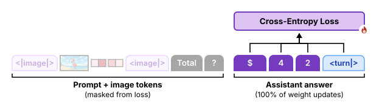
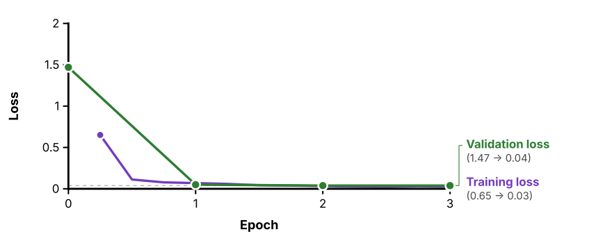

# Vision fine-tuning

Every model in the Gemma 4 family accepts images and text natively. Fine-tuning Gemma 4 on image-text pairs lets you build visual assistants for receipt and document OCR, medical imaging, chart extraction, UI grounding, and product cataloging.

!!! note "Hardware requirements"
    Vision fine-tuning requires a GPU that supports bfloat16 (such as an NVIDIA L4, A100, H100, or RTX 30/40/50 series) with at least 16 GB of VRAM for E2B and E4B, 24 GB for 12B, and 48 to 80 GB for 26B A4B and 31B.

---

## 1. Choosing a vision token budget

Many older vision-language models crop every image into a fixed square, which distorts wide charts and tall receipts. Gemma 4 preserves each image's original aspect ratio, slices it into patches, and pools them into a selectable token budget:


Each image is wrapped between `<|image|>`{.token-multi} and `<image|>`{.token-multi} tokens and converted into soft tokens. The vision token budget decides how many tokens will be generated. Lowering the budget from 1,120 to 280 tokens cuts the visual token count by 4x, which reduces activation memory and lets you train with larger batch sizes. Here are some guiding principles for choosing the budget:

- **70 or 140 tokens**: Best for thumbnails, multi-image prompts, or fast classification where you want larger batch sizes.
- **280 tokens (default)**: Good balance for general visual question answering, product photos, and UI screenshots.
- **560 or 1,120 tokens**: High-detail budgets for dense PDF pages, financial charts, schematics, and small-font OCR.

---

## 2. Two architectures

The image patches are processed through either dedicated vision encoder (all models except 12B) or an encoder-free embedder (12B). When fine-tuning the models, note how everything is frozen except for the adapters:


 As shown, there are two different architecture to encoding the input images and training the adapters:
 
 1. **Separate vision encoder** *(E2B, E4B, 26B A4B, and 31B)*: The images are sliced into 16x16 pixels which we call "patches" and are passed through a vision encoder. For most tasks such as OCR, captioning, and product descriptions, keep the vision encoder frozen and attach LoRA adapters to the language layers. Unfreeze the vision encoder only when you want the model to train on things it may not have seen before, like X-rays or satellite radar images.
 2. **Encoder-free (12B)**: Gemma 4 12B has no separate vision encoder. Instead, 48x48 pixel patches pass through a frozen 1x embedder block into the 12B, so attaching LoRA adapters to the 12B layers adapts vision and text together.

---

## 3. Masking tokens

As we have seen before, it is important to mask the input tokens so the loss only tries to predict the output tokens rather than trying to predict the input image tokens. 



If we would not mask the input image tokens, then the cross-entropy loss would attempt to predict the input image placeholder IDs which corrupts the gradients. Masking all prompt and image tokens directs 100% of the weight updates to the model's text answer and closing `<turn|>`{.token-turn} token.

---

## 4. Set up the environment

We will fine-tune Gemma 4 on [`naver-clova-ix/cord-v2`](https://huggingface.co/datasets/naver-clova-ix/cord-v2) which is a multimodal dataset for receipt parsing. We use 1000 examples from the dataset that we can train and validate on. The goal is to extract structured items like subtotals and discounts on the receipts. 

To start, we install the Hugging Face post-training, quantization, multimodal, and evaluation libraries:

```python { .notebook-cell }
# Install Hugging Face post-training, quantization, multimodal, and evaluation libraries
%pip install -q -U "transformers>=5.10.1" "trl>=0.16.0" "peft>=0.19.0" accelerate datasets bitsandbytes torchao
%pip install -q -U evaluate sacrebleu jiwer pillow soundfile librosa matplotlib tensorboard
```

If you plan to push your trained adapter to the Hugging Face Hub, log in with a write token:

```python { .notebook-cell }
# Optional: Uncomment if using gated checkpoints or pushing to the Hub
# from huggingface_hub import login
# login()
```

---

## 5. Prepare the dataset


Next up is preparing the dataset such that they are in a conversational format:

```python { .notebook-cell }
import json
from datasets import load_dataset

system_message = (
    "You are a document extraction assistant that parses receipt images into "
    "structured JSON using the CORD schema (menu, sub_total, total). "
    "Return only valid JSON without markdown code fences."
)
user_prompt = "Extract all line items, subtotals, and totals from this receipt image as JSON."


# Format each receipt photo and ground-truth JSON into a multimodal conversation
def format_batch(batch):
    messages_list = []
    images_list = []
    for img, gt in zip(batch["image"], batch["ground_truth"]):
        rgb_img = img.convert("RGB")
        gt_parse = json.loads(gt)["gt_parse"]
        images_list.append(rgb_img)
        messages_list.append(
            [
                {"role": "system", "content": system_message},
                {
                    "role": "user",
                    "content": [
                        {"type": "image", "image": rgb_img},
                        {"type": "text", "text": user_prompt},
                    ],
                },
                {
                    "role": "assistant",
                    "content": [
                        {"type": "text", "text": json.dumps(gt_parse, ensure_ascii=False)}
                    ],
                },
            ]
        )
    return {"image": images_list, "messages": messages_list}


# Attach the lazy batch transform to the train, validation, and test splits
raw_dataset = load_dataset("naver-clova-ix/cord-v2")
dataset_train = raw_dataset["train"].with_transform(format_batch)
dataset_val = raw_dataset["validation"].with_transform(format_batch)
dataset_test = raw_dataset["test"].with_transform(format_batch)

print(f"Splits: train={len(dataset_train)}, val={len(dataset_val)}, test={len(dataset_test)}")
print(dataset_train[0]["messages"])
```

```{ .no-copy .output }
Splits: train=800, val=100, test=100
[{'role': 'system', 'content': 'You are a document extraction assistant that parses receipt images into structured JSON using the CORD schema (menu, sub_total, total). Return only valid JSON without markdown code fences.'}, {'role': 'user', 'content': [{'type': 'image', 'image': <PIL.Image.Image image mode=RGB size=864x1296>}, {'type': 'text', 'text': 'Extract all line items, subtotals, and totals from this receipt image as JSON.'}]}, {'role': 'assistant', 'content': [{'type': 'text', 'text': '{"menu": [{"nm": "Nasi Campur Bali", "cnt": "1 x", "price": "75,000"}, {"nm": "Bbk Bengil Nasi", "cnt": "1 x", "price": "125,000"}, ...], "sub_total": {"subtotal_price": "1,346,000", "service_price": "100,950", "tax_price": "144,695", "etc": "-45"}, "total": {"total_price": "1,591,600"}}'}]}]
```

Note that the images in a given turn are always before the text. That was part of the training of Gemma 4 models and tends to result in a better performance rather than putting the images after the text.

---

## 6. Load the model

We will load the Gemma 4 checkpoint in 4-bit and set the token budget to 560. 560 is a nice trade-off between accuracy and speed. Especially receipts benefit from more vision tokens, so it might be worthwhile to increase it even further to improve the performance (at the cost of speed).

```python { .notebook-cell .model-swap }
import torch
from transformers import AutoModelForMultimodalLM, AutoProcessor, BitsAndBytesConfig

model_id = "google/gemma-4-E2B-it"

# Configure 4-bit NF4 quantization with bfloat16 compute
bnb_config = BitsAndBytesConfig(
    load_in_4bit=True,
    bnb_4bit_use_double_quant=True,
    bnb_4bit_quant_type="nf4",
    bnb_4bit_compute_dtype=torch.bfloat16,
    bnb_4bit_quant_storage=torch.bfloat16,
)

# Load the multimodal base model and processor
model = AutoModelForMultimodalLM.from_pretrained(
    model_id,
    dtype=torch.bfloat16,
    device_map="auto",
    quantization_config=bnb_config,
)
processor = AutoProcessor.from_pretrained(model_id)

# Set the 560-token high-detail budget for dense receipt OCR (70, 140, 280, 560, or 1120)
processor.image_processor.max_soft_tokens = 560
```

---

## 7. Evaluate the base model

We evaluate the base model on held-out receipts first to establish a baseline we can compare it to:

```python { .notebook-cell }
# Evaluate CORD schema adherence and exact total_price accuracy on held-out receipts
def evaluate_receipts(eval_model, eval_processor, samples):
    eval_model.eval()
    stop_ids = [
        eval_processor.tokenizer.eos_token_id,
        eval_processor.tokenizer.convert_tokens_to_ids("<turn|>"),
    ]
    schema_ok, total_matches, total_count = 0, 0, 0
    preds = []

    for idx in range(len(samples)):
        sample = samples[idx]
        gold = json.loads(sample["messages"][2]["content"][0]["text"])
        prompt = eval_processor.apply_chat_template(
            sample["messages"][:2], tokenize=False, add_generation_prompt=True
        )
        inputs = eval_processor(
            text=[prompt], images=[[sample["image"]]], padding=True, return_tensors="pt"
        ).to(eval_model.device)

        with torch.no_grad():
            out = eval_model.generate(
                **inputs, max_new_tokens=512, do_sample=False, eos_token_id=stop_ids
            )
        pred_text = eval_processor.decode(
            out[0][inputs.input_ids.shape[1] :], skip_special_tokens=True
        ).strip()
        preds.append(pred_text)

        try:
            pred = json.loads(pred_text)
        except json.JSONDecodeError:
            pred = {}

        pred_total = pred.get("total") if isinstance(pred, dict) else None
        if isinstance(pred_total, dict) and "total_price" in pred_total:
            schema_ok += 1

        gold_price = (gold.get("total") or {}).get("total_price")
        if gold_price is not None:
            total_count += 1
            pred_price = pred_total.get("total_price") if isinstance(pred_total, dict) else pred_total
            if str(pred_price).strip() == str(gold_price).strip():
                total_matches += 1

    metrics = {
        "schema_valid_pct": round(100.0 * schema_ok / len(samples), 1),
        "total_price_acc_pct": round(100.0 * total_matches / max(total_count, 1), 1),
    }
    return metrics, preds


# Measure zero-shot performance on 40 unseen test receipts before training
eval_subset = raw_dataset["test"].select(range(40)).with_transform(format_batch)
before_metrics, before_preds = evaluate_receipts(model, processor, eval_subset)
print("Before QLoRA (40 unseen receipts):", before_metrics)
print("Sample #4 zero-shot output:", before_preds[4])
```

```{ .no-copy .output }
Before QLoRA (40 unseen receipts): {'schema_valid_pct': 0.0, 'total_price_acc_pct': 43.2}
Sample #4 zero-shot output: {"menu": ["ICE BLACKCOFFEE", "AVOCADO COFFEE", "CHICKEN KATSUFF"], "sub_total": 144000, "total": 200000}
```

Without any fine-tuning, the model has some failure modes like misreading values (for instance confusing the cash tendered `200000` with the actual `174,600` total) and not adhering to the exact nested CORD format (`{"total": {"total_price": "174,600"}}`), since our short prompt did not spell out every nested key or comma-formatting rule. This is a great signal as it allows us to identify why the model fails without any tuning. In practical use cases, you might want to identify the failure modes first before deciding what data to use and/or collect.

---

## 8. Train the model

We start with defining the `LoraConfig` where we choose the same target projections as before and exclude the vision encoder (called the `vision_tower`). Remember that we are not fine-tuning the encoder itself (if you choose a non-12B model) since there is already much to be gained from fine-tuning the model itself.

```python { .notebook-cell }
from peft import LoraConfig, prepare_model_for_kbit_training

# Prepare the 4-bit model for gradient checkpointing and k-bit adapter training
model = prepare_model_for_kbit_training(model)

# Configure LoRA adapters on the language layers while keeping vision/audio towers frozen
peft_config = LoraConfig(
    r=16,
    lora_alpha=32,
    lora_dropout=0.0,
    bias="none",
    target_modules=[
        "q_proj",
        "k_proj",
        "v_proj",
        "o_proj",
        "gate_proj",
        "up_proj",
        "down_proj",
    ],
    exclude_modules=r"model\.(vision_tower|audio_tower)\..*",
    task_type="CAUSAL_LM",
)
```

Next up, is training. The process is similar to other training processes in these guide with one difference, we need to properly build the multimodal batches. This means making sure that we they are padded correctly and the right input information is ignored during loss updates:

```python { .notebook-cell }
from trl import SFTConfig, SFTTrainer

# Set the training hyperparameters for SFTTrainer
args = SFTConfig(
    output_dir="gemma-4-receipt-json",
    num_train_epochs=3,
    per_device_train_batch_size=2,
    per_device_eval_batch_size=2,
    gradient_accumulation_steps=4,
    optim="adamw_torch_fused",
    logging_steps=25,
    save_strategy="no",
    eval_strategy="epoch",
    eval_on_start=True,
    learning_rate=2e-4,
    warmup_steps=0.05,
    lr_scheduler_type="cosine",
    bf16=True,
    max_grad_norm=1.0,
    report_to="none",
    dataset_text_field="",
    dataset_kwargs={"skip_prepare_dataset": True},
    remove_unused_columns=False,
)

target_tokens = [
    processor.tokenizer.convert_tokens_to_ids("<|turn>"),
    processor.tokenizer.convert_tokens_to_ids("model"),
    processor.tokenizer.convert_tokens_to_ids("\n"),
]
target_len = len(target_tokens)


# Build multimodal batches and mask prompt, padding, and image soft tokens from the loss
def collate_fn(examples):
    texts = [
        processor.apply_chat_template(
            example["messages"], add_generation_prompt=False, tokenize=False
        ).strip()
        for example in examples
    ]
    images = [[example["image"]] for example in examples]

    batch = processor(text=texts, images=images, return_tensors="pt", padding=True)
    labels = batch["input_ids"].clone()

    for i in range(labels.size(0)):
        row_tokens = batch["input_ids"][i].tolist()
        for idx in range(len(row_tokens) - target_len, -1, -1):
            if row_tokens[idx : idx + target_len] == target_tokens:
                labels[i, : idx + target_len] = -100
                break

    labels[labels == processor.tokenizer.pad_token_id] = -100
    labels[labels == processor.tokenizer.boi_token_id] = -100
    labels[labels == processor.tokenizer.image_token_id] = -100
    labels[labels == processor.tokenizer.eoi_token_id] = -100

    batch["labels"] = labels
    return batch


# Initialize and run the multimodal trainer
trainer = SFTTrainer(
    model=model,
    args=args,
    train_dataset=dataset_train,
    eval_dataset=dataset_val,
    peft_config=peft_config,
    processing_class=processor,
    data_collator=collate_fn,
)

trainer.train()
trainer.save_model()
```

```{ .no-copy .output }
[300/300 24:23, Epoch 3/3]

| Epoch | Training Loss | Validation Loss | Mean Token Accuracy |
|---|---|---|---|
| 0 | — | 1.4696 | 0.8571 |
| 1 | 0.0691 | 0.0500 | 0.9869 |
| 2 | 0.0319 | 0.0389 | 0.9907 |
| 3 | 0.0252 | 0.0389 | 0.9908 |
```

<!-- notebook:skip-start -->
??? info "Inspect the training curve"
    
<!-- notebook:skip-end -->

We see a healthy loss, which is definitely a good sign!

---

## 9. Evaluate the fine-tuned model

To evaluate our model, let's free up the GPU memory and save the adapter first:

```python { .notebook-cell }
import gc

# Free the 4-bit training model and optimizer states before merging
del model
del trainer
gc.collect()
torch.cuda.empty_cache()
```

```python { .notebook-cell }
from peft import PeftModel
from transformers import AutoModelForMultimodalLM, AutoProcessor

# Merge the trained LoRA adapter into the bfloat16 base checkpoint
base_model = AutoModelForMultimodalLM.from_pretrained(
    model_id,
    low_cpu_mem_usage=True,
    dtype=torch.bfloat16,
    device_map="auto",
)

peft_model = PeftModel.from_pretrained(base_model, args.output_dir)
merged_model = peft_model.merge_and_unload()
merged_model.save_pretrained("merged_vision_model", safe_serialization=True, max_shard_size="2GB")
processor.save_pretrained("merged_vision_model")

del base_model, peft_model, merged_model
torch.cuda.empty_cache()
```

Now, we can load the adapter that we merged into the checkpoint and explore how it performs across the unseen receipts:

```python { .notebook-cell }
# Reload the merged checkpoint and evaluate on the 40 unseen test receipts
merged_dir = "merged_vision_model"
reloaded_model = AutoModelForMultimodalLM.from_pretrained(
    merged_dir, device_map="auto", dtype="auto"
)
reloaded_processor = AutoProcessor.from_pretrained(merged_dir)

after_metrics, after_preds = evaluate_receipts(reloaded_model, reloaded_processor, eval_subset)
print("Before QLoRA (40 unseen receipts):", before_metrics)
print("After QLoRA  (40 unseen receipts):", after_metrics)

gold_sample_4 = eval_subset[4]["messages"][2]["content"][0]["text"]
print("\n--- Unseen Test Receipt #4 ---")
print("Ground Truth:", gold_sample_4)
print("Before QLoRA:", before_preds[4])
print("After QLoRA :", after_preds[4])
```

```{ .no-copy .output }
Before QLoRA (40 unseen receipts): {'schema_valid_pct': 0.0, 'total_price_acc_pct': 43.2}
After QLoRA  (40 unseen receipts): {'schema_valid_pct': 95.0, 'total_price_acc_pct': 91.9}

--- Unseen Test Receipt #4 ---
Ground Truth: {"menu": [{"nm": "ICE BLACKCOFFE", "cnt": "2", "price": "82,000"}, {"nm": "AVOCADO COFFEE", "cnt": "1", "price": "61,000"}, {"nm": "CHIKEN KATSU FF", "cnt": "1", "price": "51,000"}], "sub_total": {"subtotal_price": "194,000", "discount_price": "19,400"}, "total": {"total_price": "174,600", "cashprice": "200,000", "changeprice": "25,400"}}
Before QLoRA: {"menu": ["ICE BLACKCOFFEE", "AVOCADO COFFEE", "CHICKEN KATSUFF"], "sub_total": 144000, "total": 200000}
After QLoRA : {"menu": [{"nm": "ICE BLACKCOFFE", "cnt": "2", "price": "82,000"}, {"nm": "NEW AVOCADO COFFEE", "cnt": "1", "price": "61,000"}, {"nm": "OLBE CHIKEN KATSUFF", "cnt": "1", "price": "51,000"}], "sub_total": {"subtotal_price": "194,000", "discount_price": "19,400"}, "total": {"total_price": "174,600", "cashprice": "200,000", "changeprice": "28,400"}}
```

The performance increased quite a bit! Fine-tuning only the language adapters taught the model the exact nested CORD JSON schema (`95.0%`) and raised exact `total_price` extraction to `91.9%` across unseen receipts—though notice in Sample #4 that harder character-level line-item OCR (such as `"NEW AVOCADO COFFEE"` and `"changeprice": "28,400"` vs. `"25,400"`) can still make occasional mistakes on a compact E2B model. It shows how far you can get with fine-tuning a small part of the model rather than the entire encoders.

---

## What's next

<div class="card-grid">
<a class="card" href="audio-qlora.md">
  <span class="card-icon">{{ icon('lucide/audio-lines') }}</span>
  <div class="card-title">Audio fine-tuning</div>
  <p class="card-desc">Fine-tune Gemma 4 E2B, E4B, and 12B on speech transcription, dialect adaptation, and spoken QA.</p>
</a>
<a class="card" href="preference-alignment.md">
  <span class="card-icon">{{ icon('lucide/sliders-horizontal') }}</span>
  <div class="card-title">Preference optimization</div>
  <p class="card-desc">Shape your model's tone and formatting using chosen and rejected response pairs.</p>
</a>
<a class="card" href="reinforcement-learning.md">
  <span class="card-icon">{{ icon('lucide/brain') }}</span>
  <div class="card-title">Verifiable rewards</div>
  <p class="card-desc">Train Gemma 4's thinking channel using verifiable reward functions.</p>
</a>
<a class="card" href="export.md">
  <span class="card-icon">{{ icon('lucide/rocket') }}</span>
  <div class="card-title">Export</div>
  <p class="card-desc">Export your multimodal Gemma 4 model to LiteRT-LM, GGUF, or vLLM.</p>
</a>
</div>
